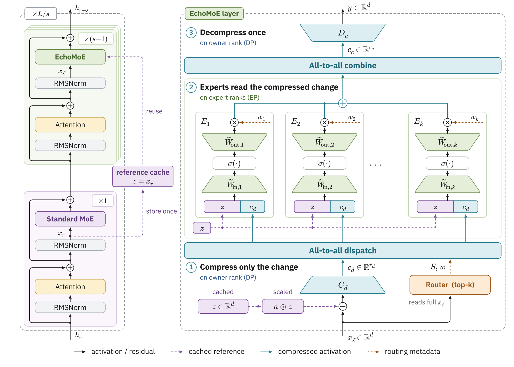

# EchoMoE：复用跨层参考，只通信压缩变化量

[English](README-en.md)

> **L1机制组件；不是完整模型**。完整实验**成本过高，不复现（审查 DONE）**；无能力提升或Evolve晋级声明。

## 论文信息

| 字段 | 内容 |
| --- | --- |
| 论文链接 | [arXiv:2611.22215v1](https://arxiv.org/abs/2611.22215v1)；[固定全文](https://arxiv.org/html/2611.22215v1) |
| 公司 / 机构 / 学校 | 一作 Fengyuan Liu：Mila / McGill University |
| 首次公开日期 | 2026-11-17T04:52:41Z（arXiv v1）；公告日期另记为 2026-11-18 |
| 原作者开源代码 | [作者仓库](https://github.com/McGill-NLP/EchoMoE)；核验HEAD `c211186cdd7ccd9315f5f061c7cc56f6dc725f53`。未复制上游源码；许可证未另行核验。 |
| 本地 adapter / key | `echomoe`；`adapter: null`，未接入Evolve |
| 本地复现代码目录 | `src/auto_research/foundation_models/echomoe.py` |

## 原始论文总结

### 背景与主要改动

每组MoE层先广播参考z，其余层只发送x-a⊙z的压缩code；router仍读取完整x。专家将reference gain和dispatch decoder折入gate/up权重，再将combine compressor折入down权重，避免完整重建或输出物化。 [已核方法位置](https://arxiv.org/html/2611.22215v1#S3)：4.1–4.4, 5.1, G.1。

<!-- paper-figure:start -->
### 原论文关键图

[](https://arxiv.org/html/2611.22215v1)

原图/原表来自固定v1，未经科学内容改绘；是作者方法或结果，不是本地测量。[来源、裁切和SHA256](assets/provenance.json)。图片来自[原论文](https://arxiv.org/html/2611.22215v1)，版权归原作者所有。
<!-- paper-figure:end -->

### 核心公式

$$
c_d=C_d(x-a\odot z),\quad \hat x=Gz+D_dc_d,\qquad \widetilde W_{in}=[W_g;W_u][G,D_d],\quad \widetilde W_{out}=C_cW_{down},\quad y=D_c\sum_iw_i\widetilde W_{out,i}\operatorname{SwiGLU}(\widetilde W_{in,i}[z;c_d]).
$$

相对于压缩后模型，折叠与未折叠线性代数等价；不等于压缩模型无损于原backbone。原文还以projection-weighted重建初始化，再执行KL蒸馏和少量next-token训练。通信公式是张量/路由字节计算，不是测得RDMA流量。

~~~mermaid
flowchart LR
 X[Full x and cached reference z] --> C[Compressed difference]
 C --> F[Folded expert SwiGLU]
 F --> R[Compressed weighted combine]
 R --> D[One owner-side decoder]
~~~

### 论文离线与线上效果

原文以其完整训练/推理与评测配置讨论效果；本地没有复跑该矩阵，不把论文数值写成本地指标。未报告本文方法的生产随机流量线上A/B；benchmark、单卡服务计时或使用Meta/Google模型本身不是A/B证据。具体质量/速度与成本配置须一起阅读。

## 本地复现

### 数据协议与代码映射

执行非reference层的两侧压缩、专家SwiGLU、路由加权合并、折叠/未折叠输出与梯度对照及解析traffic；不实现分布式collectives、异步broadcast或完整模型适配。


```bash
PYTHONPATH=src python -c 'from auto_research.foundation_models.echomoe import diagnostic; print(diagnostic(42, device="cpu"))'
PYTHONPATH=src python -m pytest tests/test_nov18_latest_foundation.py -q
```

CPU seeds42/43/44已通过本组件检查；仅为合成张量机制诊断，不含公开能力benchmark。CUDA验收以[真实GPU回执](../../gpu-validations/echomoe-a100-20261118-latest.json)为准，不能由CPU通过替代；文档本身不提前宣称GPU已通过。

### 同主题比较与边界

MoEZip保护路由敏感KV token；EchoMoE压缩专家并行激活通信，两者不是同一缓存，也不能共享“压缩率”作为吞吐对照。 本地结果只支撑上面列明的算子合同，多个seed不将L1升级成公开能力L2/L3。

### 高成本完整实验

原文从Qwen3-30B-A3B及另外4种16B—30B模型做适配，主配置4.32B训练token；吞吐使用4台DGX H100共32张GPU。单A100/A30无法复跑其专家并行通信矩阵。

以上是配置依据的成本判断，不是本地实测耗时。资源预算为单A100或A30，或本地Mac；不假定多卡、不断扩大或试训证明成本。**成本过高，不复现（审查 DONE）**；不下载大模型/数据，不启动完整矩阵，不自动重试，不阻塞本轮审查闭环。
