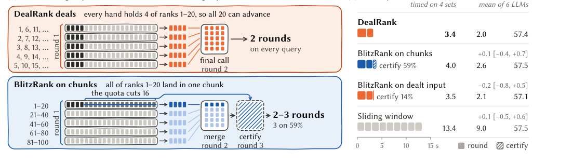

<!-- source-sha256: e6b22b311ed6d91aaf453381d4bf845828e2b8e35a61886e2c0b7e896e22fee3 -->
# Deal With It: On Better Schedules for Listwise Reranking

[简体中文](README.md)

> L1 bounded mechanism component, not a capability benchmark or Evolve promotion.

## Paper information

| Field | Content |
| --- | --- |
| Paper | [Deal With It: On Better Schedules for Listwise Reranking](https://arxiv.org/abs/2611.22392v1); [fixed v1](https://arxiv.org/html/2611.22392v1) |
| Institution | First author Benjamin Clavié: Mixedbread; fixed-v1 byline checked |
| First publication | 2026-11-17 08:42:11 UTC, arXiv v1 |
| Original source code | The paper links [author code](https://github.com/mixedbread-ai/dealrank), but the public API returned404 in this review; public code/license unverified and no code copied. |
| Local adapter / key | `dealrank`; adapter is null, not a complete model |
| Local implementation | `src/auto_research/foundation_models/dealrank.py` |

## Paper summary

### Motivation and changes

Parallel listwise reranking splits candidates into groups with fixed advancement quotas. Contiguous chunks crowd strong retriever-prefix documents into one group, so a better retriever can suffer more quota cuts. DealRank deals candidates round-robin by retriever rank to balance every prefix, then ranks groups concurrently and advances quotas into a final merge without repair certification.

<!-- paper-figure:start -->
### Original figure



Image from the [original paper](https://arxiv.org/pdf/2611.22392v1); copyright belongs to the original authors. Original asset/PDF crop, not local results. [Provenance and SHA256](assets/provenance.json).
<!-- paper-figure:end -->

### Core formulas

$$
\ell_P(T)=\sum_h\max(|T\cap P_h|-q,0),\qquad N=Hw,\ Hq\le w\Rightarrow H+1\ calls\ in\ two\ rounds\ recover\ top\ q.
$$

For100 candidates, Section2.1 uses five hands of20, keeps four per hand and reranks the final20: six calls in two rounds. A consistent ranker guarantees only topq=4 recovery, not top10. The500 schedule is25 hands keeping three then four keeping five; the1,000 schedule is50 keeping two then five keeping four, both three rounds. Later eliminations precede earlier ones. Real ThreadPool calls must return an exact permutation of their input IDs; this tests schedules, not LLM ranking quality.

### Author results

Over1,622 queries, the main Gemini table gives DealRank57.6 nDCG@10×100 with six calls/two rounds, versus sliding-window57.9 with nine rounds. Median API latency is3.4s versus13.4s; controlled local timing separately uses a27B model on two H100s. Many cross-model difference intervals include zero and do not establish losslessness for every ranker. No production A/B is reported.

## Local implementation and boundaries

### Data protocol and code mapping

The local ranker is a deterministic consistent callback, not a model. true_top is evaluator-only in quota_cuts and never enters schedule. There is no RankGPT prompt, token-cost or API-latency measurement; call accounting proves neither NDCG nor speed. The author links mixedbread-ai/dealrank, but repository/main-commit API checks return404 on2026-11-18; public source and license are unverified and no external code is executed. Full multi-model/27B timing is not reproduced due to cost. Grouping and final survivor order must follow the paper’s hierarchical schedules rather than a generic top-k shortcut.

```bash
PYTHONPATH=src python -c 'from auto_research.foundation_models.dealrank import diagnostic; print(diagnostic(42, device="cpu"))'
```

### Results, controls and limits

L1 bounded mechanism component, not a capability benchmark or Evolve promotion. Seeds42/43/44 check explicit fixtures/small-tensor arithmetic and gradients, not three independent model-capability trials. CPU and actual GPU evidence remain separate. Author scores must not populate local dashboards.

### High-cost full experiments

Full six-model NDCG/latency campaign includes paid frontier calls and27Blocal inference. Deterministic consistent-ranker checks are schedule diagnostics only **Not reproduced due to high cost; review DONE.** No automatic training/retry queue and no blocking of declared review closure.

### Same-topic comparison

HVMap changes cross-space candidate mapping/scoring. DealRank does not train representations; it schedules existing candidates into ranker calls. They can compose in a retrieval pipeline, but fewer calls do not establish better alignment, and correct SCORE2 does not prove lossless listwise quotas.
