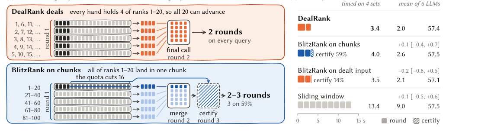

# DealRank：按召回名次轮发候选，减少配额切掉好文档

[English](README-en.md)

> L1低成本机制组件；不是能力benchmark，未接入Evolve晋级。

## 论文信息

| 字段 | 内容 |
| --- | --- |
| 论文链接 | [Deal With It: On Better Schedules for Listwise Reranking](https://arxiv.org/abs/2611.22392v1)；[固定v1全文](https://arxiv.org/html/2611.22392v1) |
| 公司 / 作者机构 | 一作 Benjamin Clavié：Mixedbread；按固定v1作者栏核对 |
| 首次公开日期 | 2026-11-17 08:42:11 UTC（arXiv v1） |
| 原作者开源代码 | 原文给出[作者仓库](https://github.com/mixedbread-ai/dealrank)，本轮公开API返回404，未核验公开代码/许可证，不复制代码。 |
| 本地adapter / 稳定键 | `dealrank`；adapter为null，不冒充完整模型 |
| 本地复现代码目录 | `src/auto_research/foundation_models/dealrank.py` |

## 原始论文总结

### 背景与主要改动

并行listwise重排要把候选分组，每组只晋级固定配额。连续切块会把初始召回前部的好文档挤进同一组，越好的retriever越可能被配额误切。DealRank按retriever名次轮流发牌，使每个前缀在各组尽量平衡，再并行排序、按配额晋级并最终合并，不依赖补救认证轮。

<!-- paper-figure:start -->
### 原论文关键图



图片来自[原论文](https://arxiv.org/pdf/2611.22392v1)，版权归原作者所有；为原图或PDF裁剪，不是本地结果。[出处与SHA256](assets/provenance.json)。
<!-- paper-figure:end -->

### 核心公式

$$
\ell_P(T)=\sum_h\max(|T\cap P_h|-q,0),\qquad N=Hw,\ Hq\le w\Rightarrow H+1\ calls\ in\ two\ rounds\ recover\ top\ q.
$$

§2.1的100候选配置是5组×20、每组留4、最后20再排，共6调用2轮。一致ranker只给最前q=4的最坏情况恢复保证，不是top10保证。500配置25组留3再4组留5，1000配置50组留2再5组留4，均三轮；被后轮淘汰的排在早轮前。调用回调必须返回原候选的一次排列，真正ThreadPool并发只验证调度，不产生LLM排序内容。

### 论文离线与线上效果

作者在1622查询上比较调度，Gemini主表DealRank为57.6 nDCG@10×100、6调用2轮；滑窗57.9但9轮。API中位延迟3.4秒对滑窗13.4秒，另有27B双H100受控计时；不同模型平均差的区间经常跨0，不能说所有ranker都无损。未报告生产线上A/B。

## 本地复现与边界

### 数据协议与代码映射

本地ranker是确定性一致排序回调，不是模型；true_top只给quota_cuts外层诊断，不进入schedule。没有RankGPT提示、token费用或真实API延迟，机制计数不作NDCG／速度证据。作者提供mixedbread-ai/dealrank链接，但2026-11-18仓库／main commit API返回404，未核实公开源码或许可，不执行外部代码。完整多模型及27B计时矩阵高成本不复现。分组和最后晋级排序必须按原文层级配置核对，不能把所有情况压成一个generic topk。

```bash
PYTHONPATH=src python -c 'from auto_research.foundation_models.dealrank import diagnostic; print(diagnostic(42, device="cpu"))'
```

### 结果、负控与边界

L1低成本机制组件；不是能力benchmark，未接入Evolve晋级。 种子42/43/44只验证显式夹具/小张量的数值和梯度，不是三次独立模型能力试验。CPU与实际GPU证据分别保存，不能用作者指标填充本地看板。

### 高成本完整实验

六模型、数千query、frontier付费调用和27B本地推理的NDCG/延迟全矩阵不执行；确定性一致ranker仅核验调度性质。 **成本过高，不复现（审查DONE）**；不阻塞已声明的审查闭环，不进入自动训练或补跑队列。

### 同主题对照

HVMap改变异构向量候选怎么映射和打分，DealRank不训练表示，而是安排已有候选进入ranker的组合。它们可串在同一检索流水线，但更少调用不是更好向量对齐，SCORE2正确也不能证明listwise配额无损。
