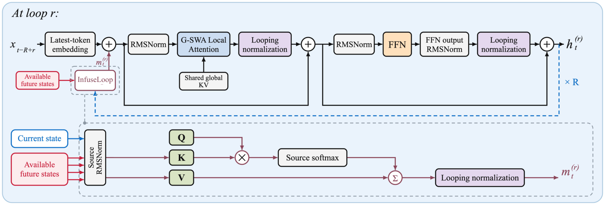

# InfuseLoop: causal cross-trajectory latent injection

<!-- source-sha256: 2cd1aa9a88436942cee2079e916e08dd47334965e543ba9ae37d21e7fe6d93e8 -->

[简体中文](README.md)

> **L1 mechanism component, not a complete model.** Full experiments are **too costly; not reproduced (review DONE)**. No capability improvement or Evolve promotion is claimed.

## Paper information

| Field | Value |
| --- | --- |
| Paper | [arXiv:2611.22426v1](https://arxiv.org/abs/2611.22426v1); [fixed text](https://arxiv.org/html/2611.22426v1) |
| Institution/company | First author Zhaofeng Sun: Tsinghua University |
| Original publication | 2026-11-17T09:00:59Z (arXiv v1); separately observed announcement: 2026-11-18 |
| Authors' code | No released method-specific author source was found in fixed v1 and its author links. Dependency libraries are not counted as the paper code. |
| Local adapter/key | `infuseloop`; adapter null; no Evolve integration |
| Local source | `src/auto_research/foundation_models/infuseloop.py` |

## Original paper

### Motivation and changes

Parallel loops advance several prediction trajectories in one execution cycle. Loop r aggregates completed previous-cycle states from shallower loops rather than only its own preceding state. A later trajectory position is not an unseen future token; legality follows the execution schedule. [Reviewed method](https://arxiv.org/html/2611.22426v1#S3): 3.1–3.4, 4.1, Appendix A.

### Key original figure

[](https://arxiv.org/html/2611.22426v1)

The fixed-version author figure/table is not a local result. Scientific content was not redrawn. Copyright remains with the original authors; no open-image license is inferred. [Source, crop and SHA256](assets/provenance.json).

### Equations

$$
s=t+r-j-1,\quad1\le j<r,\qquad \alpha_j=\operatorname{softmax}_j(w_r^T\operatorname{RMS}(h_s^{(j)})/\sqrt d+b_{rj}),\qquad z=\rho_r\sum_j\alpha_j\operatorname{RMS}(h_s^{(j)}).
$$

Both keys and values use parameter-free RMS normalization. Document boundaries are masked before softmax. Every new state reads the same old buffer, with commit only after the cycle. The aggregate replaces the prior cross-loop input rather than being added twice.

~~~mermaid
flowchart LR
 S[Immutable previous-cycle bank] --> I[Admissible shallower trajectory sources]
 I --> M[Document-masked RMS aggregation]
 M --> C[Commit next cycle together]
~~~

### Reported results and evidence

The reported quality/efficiency relies on the full paper configuration, which was not reproduced locally. No production randomized-traffic A/B is reported for this method. Benchmarks, single-device serving measurements, or using Meta/Google models are not production A/B evidence.

## Local implementation

### Protocol and code mapping

Executes legal source indexing, document isolation and learned query/bias/scale aggregation. It omits the complete G-SWA backbone, token-embedding fusion and language-model pretraining.


```bash
PYTHONPATH=src python -c 'from auto_research.foundation_models.infuseloop import diagnostic; print(diagnostic(42, device="cpu"))'
PYTHONPATH=src python -m pytest tests/test_nov18_latest_foundation.py -q
```

CPU seeds42/43/44passed the mechanism checks on synthetic tensors, not capability benchmarks. CUDA acceptance requires the [real-device receipt](../../gpu-validations/infuseloop-a100-20261118-latest.json); this text does not preclaim a GPU pass.

### Same-topic comparison and boundaries

Anchor shares an external TTT state with learned read maps. InfuseLoop aggregates trajectory latents admitted by a parallel execution graph; arbitrary cross-layer averaging is not equivalent. Multiple seeds do not upgrade these mechanism checks into L2/L3 capability evidence.

### High-cost full experiments

0.6B/28-layer width1024 backbone, FineWebEdu6Btokens, loops through8, GB200/H200; full pretraining matrix high cost.

This is a configuration-based cost assessment, not measured local duration. The budget is one A100 or A30, or the local Mac. No multi-GPU capacity, costly probing run, large-resource download or automatic retry is assumed. Full experiments are **too costly; not reproduced (review DONE)** and do not block review closure.
