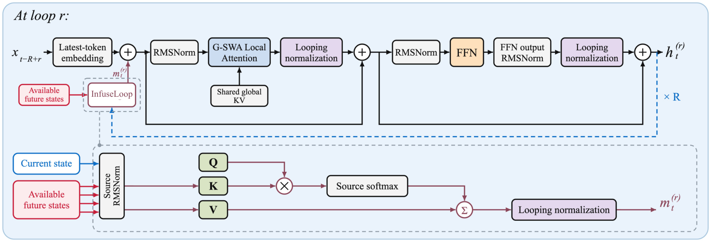

# InfuseLoop：在上一执行周期聚合跨轨迹潜状态

[English](README-en.md)

> **L1机制组件；不是完整模型**。完整实验**成本过高，不复现（审查 DONE）**；无能力提升或Evolve晋级声明。

## 论文信息

| 字段 | 内容 |
| --- | --- |
| 论文链接 | [arXiv:2611.22426v1](https://arxiv.org/abs/2611.22426v1)；[固定全文](https://arxiv.org/html/2611.22426v1) |
| 公司 / 机构 / 学校 | 一作 Zhaofeng Sun：Tsinghua University |
| 首次公开日期 | 2026-11-17T09:00:59Z（arXiv v1）；公告日期另记为 2026-11-18 |
| 原作者开源代码 | 固定v1及原作者链接未找到可核验的已发布方法源码；未找到/未发布，不把依赖库算原作者代码。 |
| 本地 adapter / key | `infuseloop`；`adapter: null`，未接入Evolve |
| 本地复现代码目录 | `src/auto_research/foundation_models/infuseloop.py` |

## 原始论文总结

### 背景与主要改动

并行loop在同一执行周期同时推进多个预测轨迹。InfuseLoop让第r轮聚合上一周期已完成、但来自更浅loop的状态，而非仅传递本轨迹前一轮。未来轨迹位置不等于未来未生成token，合法性由执行周期决定。 [已核方法位置](https://arxiv.org/html/2611.22426v1#S3)：3.1–3.4, 4.1, Appendix A。

<!-- paper-figure:start -->
### 原论文关键图

[](https://arxiv.org/html/2611.22426v1)

原图/原表来自固定v1，未经科学内容改绘；是作者方法或结果，不是本地测量。[来源、裁切和SHA256](assets/provenance.json)。图片来自[原论文](https://arxiv.org/html/2611.22426v1)，版权归原作者所有。
<!-- paper-figure:end -->

### 核心公式

$$
s=t+r-j-1,\quad1\le j<r,\qquad \alpha_j=\operatorname{softmax}_j(w_r^T\operatorname{RMS}(h_s^{(j)})/\sqrt d+b_{rj}),\qquad z=\rho_r\sum_j\alpha_j\operatorname{RMS}(h_s^{(j)}).
$$

keys和values都用无参数RMS归一化，文档边界在softmax前屏蔽。所有新状态读同一旧缓冲，完成整周期后再commit；聚合替换原跨loop输入，不能重复加上旧状态。

~~~mermaid
flowchart LR
 S[Immutable previous-cycle bank] --> I[Admissible shallower trajectory sources]
 I --> M[Document-masked RMS aggregation]
 M --> C[Commit next cycle together]
~~~

### 论文离线与线上效果

原文以其完整训练/推理与评测配置讨论效果；本地没有复跑该矩阵，不把论文数值写成本地指标。未报告本文方法的生产随机流量线上A/B；benchmark、单卡服务计时或使用Meta/Google模型本身不是A/B证据。具体质量/速度与成本配置须一起阅读。

## 本地复现

### 数据协议与代码映射

执行可用源索引、文档隔离、可学习query/bias/scale聚合及梯度；没有G-SWA完整backbone、token embedding融合或语言模型预训练。


```bash
PYTHONPATH=src python -c 'from auto_research.foundation_models.infuseloop import diagnostic; print(diagnostic(42, device="cpu"))'
PYTHONPATH=src python -m pytest tests/test_nov18_latest_foundation.py -q
```

CPU seeds42/43/44已通过本组件检查；仅为合成张量机制诊断，不含公开能力benchmark。CUDA验收以[真实GPU回执](../../gpu-validations/infuseloop-a100-20261118-latest.json)为准，不能由CPU通过替代；文档本身不提前宣称GPU已通过。

### 同主题比较与边界

Anchor跨层共享外部TTT状态并学习read-map，InfuseLoop共享的是可用计算图中的轨迹latent；不能把任意跨层平均或持久缓存叫作InfuseLoop。 本地结果只支撑上面列明的算子合同，多个seed不将L1升级成公开能力L2/L3。

### 高成本完整实验

原文为0.6B、28层、1024维backbone，FineWebEdu约6B训练token、最多8loops，使用GB200/H200。多结构、多loop预训练对照明显超过短时预算。

以上是配置依据的成本判断，不是本地实测耗时。资源预算为单A100或A30，或本地Mac；不假定多卡、不断扩大或试训证明成本。**成本过高，不复现（审查 DONE）**；不下载大模型/数据，不启动完整矩阵，不自动重试，不阻塞本轮审查闭环。
