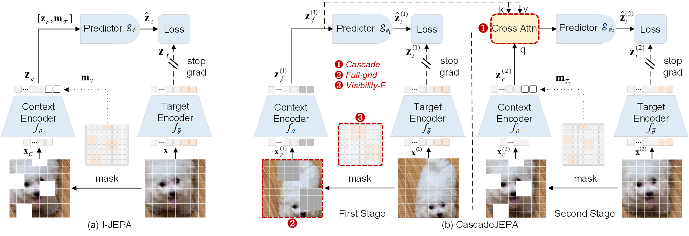

# CascadeJEPA: full-grid spatial context for two-stage prediction

<!-- source-sha256: a15fe54dfa63a05a308f4da8c3b7c413750e9799c91ff58bdf6c02ad089b27bb -->

[简体中文](README.md)

> **L1 mechanism component, not a complete model.** Full experiments are **too costly; not reproduced (review DONE)**. No capability improvement or Evolve promotion is claimed.

## Paper information

| Field | Value |
| --- | --- |
| Paper | [arXiv:2611.22686v1](https://arxiv.org/abs/2611.22686v1); [fixed text](https://arxiv.org/html/2611.22686v1) |
| Institution/company | First author Kailai Zhou: Nanyang Technological University |
| Original publication | 2026-11-17T12:36:05Z (arXiv v1); separately observed announcement: 2026-11-18 |
| Authors' code | No released method-specific author source was found in fixed v1 and its author links. Dependency libraries are not counted as the paper code. |
| Local adapter/key | `cascadejepa`; adapter null; no Evolve integration |
| Local source | `src/auto_research/foundation_models/cascadejepa.py` |

## Original paper

### Motivation and changes

Better high-level semantics in I-JEPA need not improve geometric correspondence. Two crops share context and EMA target encoders. Stage1zeros masked patch embeddings before adding positions, retaining a full grid; stage2encodes visible patches and predicts with stage1full-grid KV. [Reviewed method](https://arxiv.org/html/2611.22686v1#S3): 3.2.1–3.2.4, 4.1–4.2.

### Key original figure

[](https://arxiv.org/html/2611.22686v1)

The fixed-version author figure/table is not a local result. Scientific content was not redrawn. Copyright remains with the original authors; no open-image license is inferred. [Source, crop and SHA256](assets/provenance.json).

### Equations

$$
\tilde z_c^{(2)}=[z_c^{(2)},m_{T_2}]+CrossAttn([z_c^{(2)},m_{T_2}],z_f^{(1)},z_f^{(1)}),\qquad L=\tfrac12L_{T_1}^{L2}+\tfrac12L_{T_2}^{L2}.
$$

Spatial coupling is unidirectional from stage1to stage2. Targets are stop-gradient and updated by EMA; each crop has independent position coordinates. Full-grid encoding does not expose unmasked target pixels or erase positional information.

~~~mermaid
flowchart LR
 C1[Crop1 zero-mask plus position] --> F[Shared full-grid context]
 C2[Crop2 visible context and mask queries] --> X[Residual cross attention]
 F --> X
 F --> P1[Predictor1]
 X --> P2[Predictor2]
 P1 --> L[Two stopped EMA target losses]
 P2 --> L
~~~

### Reported results and evidence

The reported quality/efficiency relies on the full paper configuration, which was not reproduced locally. No production randomized-traffic A/B is reported for this method. Benchmarks, single-device serving measurements, or using Meta/Google models are not production A/B evidence.

## Local implementation

### Protocol and code mapping

Executes tiny shared token encoders, two predictors, residual cross-attention, zero-before-position masking, two L2 losses and EMA. Callers supply patch features/masks; no ImageNet pipeline, full ViT, geometry probe or planner is included.


```bash
PYTHONPATH=src python -c 'from auto_research.foundation_models.cascadejepa import diagnostic; print(diagnostic(42, device="cpu"))'
PYTHONPATH=src python -m pytest tests/test_nov18_latest_foundation.py -q
```

CPU seeds42/43/44passed the mechanism checks on synthetic tensors, not capability benchmarks. CUDA acceptance requires the [real-device receipt](../../gpu-validations/cascadejepa-a100-20261118-latest.json); this text does not preclaim a GPU pass.

### Same-topic comparison and boundaries

DuoJEPA translates into the other modality space with differentiable targets. CascadeJEPA uses two image crops and stopped EMA targets. Their target-gradient contracts differ despite the JEPA name. Multiple seeds do not upgrade these mechanism checks into L2/L3 capability evidence.

### High-cost full experiments

ViT-B/16ImageNet1K300epochs,featurecorrespondence,depth/normals,ImageNetfinetuning andworldmodelplanning; full campaign high cost.

This is a configuration-based cost assessment, not measured local duration. The budget is one A100 or A30, or the local Mac. No multi-GPU capacity, costly probing run, large-resource download or automatic retry is assumed. Full experiments are **too costly; not reproduced (review DONE)** and do not block review closure.
