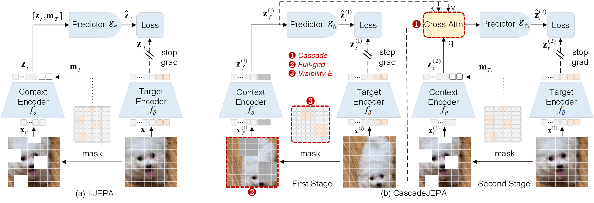

# CascadeJEPA：用完整空间网格单向耦合两级预测

[English](README-en.md)

> **L1机制组件；不是完整模型**。完整实验**成本过高，不复现（审查 DONE）**；无能力提升或Evolve晋级声明。

## 论文信息

| 字段 | 内容 |
| --- | --- |
| 论文链接 | [arXiv:2611.22686v1](https://arxiv.org/abs/2611.22686v1)；[固定全文](https://arxiv.org/html/2611.22686v1) |
| 公司 / 机构 / 学校 | 一作 Kailai Zhou：Nanyang Technological University |
| 首次公开日期 | 2026-11-17T12:36:05Z（arXiv v1）；公告日期另记为 2026-11-18 |
| 原作者开源代码 | 固定v1及原作者链接未找到可核验的已发布方法源码；未找到/未发布，不把依赖库算原作者代码。 |
| 本地 adapter / key | `cascadejepa`；`adapter: null`，未接入Evolve |
| 本地复现代码目录 | `src/auto_research/foundation_models/cascadejepa.py` |

## 原始论文总结

### 背景与主要改动

I-JEPA的高层语义改善不保证几何对应更好。CascadeJEPA对同图两个crop共享context和EMA target；第一crop把masked patch embedding置零后加位置、保留完整网格，第二crop只编码visible patches，再通过第一阶段full-grid KV引导预测。 [已核方法位置](https://arxiv.org/html/2611.22686v1#S3)：3.2.1–3.2.4, 4.1–4.2。

<!-- paper-figure:start -->
### 原论文关键图

[](https://arxiv.org/html/2611.22686v1)

原图/原表来自固定v1，未经科学内容改绘；是作者方法或结果，不是本地测量。[来源、裁切和SHA256](assets/provenance.json)。图片来自[原论文](https://arxiv.org/html/2611.22686v1)，版权归原作者所有。
<!-- paper-figure:end -->

### 核心公式

$$
\tilde z_c^{(2)}=[z_c^{(2)},m_{T_2}]+CrossAttn([z_c^{(2)},m_{T_2}],z_f^{(1)},z_f^{(1)}),\qquad L=\tfrac12L_{T_1}^{L2}+\tfrac12L_{T_2}^{L2}.
$$

空间耦合单向从第一阶段到第二阶段，两阶段target stop-gradient并由EMA更新。两个crop的位置坐标分别定义。full-grid不是输入未mask图像，也不是先加位置再把masked位置一起清零。

~~~mermaid
flowchart LR
 C1[Crop1 zero-mask plus position] --> F[Shared full-grid context]
 C2[Crop2 visible context and mask queries] --> X[Residual cross attention]
 F --> X
 F --> P1[Predictor1]
 X --> P2[Predictor2]
 P1 --> L[Two stopped EMA target losses]
 P2 --> L
~~~

### 论文离线与线上效果

原文以其完整训练/推理与评测配置讨论效果；本地没有复跑该矩阵，不把论文数值写成本地指标。未报告本文方法的生产随机流量线上A/B；benchmark、单卡服务计时或使用Meta/Google模型本身不是A/B证据。具体质量/速度与成本配置须一起阅读。

## 本地复现

### 数据协议与代码映射

执行小型共享token encoder、双predictor、residual cross-attention、zero-before-position、双L2与EMA。调用者提供patch特征和两个mask，不实现ImageNet图像pipeline、完整ViT、几何探针或规划器。


```bash
PYTHONPATH=src python -c 'from auto_research.foundation_models.cascadejepa import diagnostic; print(diagnostic(42, device="cpu"))'
PYTHONPATH=src python -m pytest tests/test_nov18_latest_foundation.py -q
```

CPU seeds42/43/44已通过本组件检查；仅为合成张量机制诊断，不含公开能力benchmark。CUDA验收以[真实GPU回执](../../gpu-validations/cascadejepa-a100-20261118-latest.json)为准，不能由CPU通过替代；文档本身不提前宣称GPU已通过。

### 同主题比较与边界

DuoJEPA在对方模态own space做可微target translation；CascadeJEPA同图两crop并使用stop-gradient EMA target。都叫JEPA不代表目标是否detach相同。 本地结果只支撑上面列明的算子合同，多个seed不将L1升级成公开能力L2/L3。

### 高成本完整实验

原文ViT-B/16在ImageNet1K预训练300epochs，另有几何对应、深度/法线、分类微调和世界模型规划。这里不下载ImageNet或重做这些训练链路。

以上是配置依据的成本判断，不是本地实测耗时。资源预算为单A100或A30，或本地Mac；不假定多卡、不断扩大或试训证明成本。**成本过高，不复现（审查 DONE）**；不下载大模型/数据，不启动完整矩阵，不自动重试，不阻塞本轮审查闭环。
