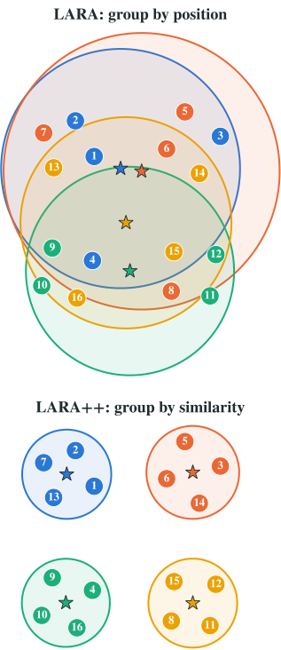

# LARA++: deterministic clustered proposals for kernel attention

<!-- source-sha256: 8fdf31f0814b2a6d2df18592ab8aafa38710ec0dfdaf6fd1be9c166377192c65 -->

[简体中文](README.md)

> **L1 mechanism component, not a complete model.** Full experiments are **too costly; not reproduced (review DONE)**. No capability improvement or Evolve promotion is claimed.

## Paper information

| Field | Value |
| --- | --- |
| Paper | [arXiv:2611.22947v1](https://arxiv.org/abs/2611.22947v1); [fixed text](https://arxiv.org/html/2611.22947v1) |
| Institution/company | First author Fırat Öncel: Concordia University / Mila |
| Original publication | 2026-11-17T15:38:48Z (arXiv v1); separately observed announcement: 2026-11-18 |
| Authors' code | [Author repository](https://github.com/firatoncel/KernelRealityCheckNeurIPS2026), verified HEAD `20a9f67a252059ce04383e1365700416de9d9447`. No upstream source was copied; its license was not separately verified. |
| Local adapter/key | `lara-plus-plus`; adapter null; no Evolve integration |
| Local source | `src/auto_research/foundation_models/lara_plus_plus.py` |

## Original paper

### Motivation and changes

The paper audits practical kernel-attention efficiency. Deterministic proposal means replace sampling, and similarity clusters replace contiguous chunks. When the number of clusters grows with sequence length, k-center costs are quadratic; near-softmax quality does not imply a FlashAttention speedup. [Reviewed method](https://arxiv.org/html/2611.22947v1#S3): 7, Appendix E.1.

### Key original figure

[](https://arxiv.org/html/2611.22947v1)

The fixed-version author figure/table is not a local result. Scientific content was not redrawn. Copyright remains with the original authors; no open-image license is inferred. [Source, crop and SHA256](assets/provenance.json).

### Equations

$$
\hat o_n=\frac{\sum_c[p_n(\mu_c)/q(\mu_c)]f_n(\mu_c)}{\sum_c p_n(\mu_c)/q(\mu_c)},\qquad f_n(\mu_c)=\frac{\sum_i\xi(k_i,\mu_c)v_i}{\sum_i\xi(k_i,\mu_c)}.
$$

The local operator follows the pinned author mis-opt path. Section7 describes query-only clustering and a random initial center, whereas released code uses normalized joint Q+K features, deterministic initialization and a separate CLS proposal. This difference is explicit. Proposal construction is detached; Q/K features and value aggregation remain differentiable.

~~~mermaid
flowchart LR
 Q[Q and K] --> C[Detached joint-feature clustering]
 C --> M[Deterministic proposal means]
 M --> I[Feature and proposal-density scores]
 I --> S[Self-normalized importance weights]
 S --> V[Value aggregation]
~~~

### Reported results and evidence

The reported quality/efficiency relies on the full paper configuration, which was not reproduced locally. No production randomized-traffic A/B is reported for this method. Benchmarks, single-device serving measurements, or using Meta/Google models are not production A/B evidence.

## Local implementation

### Protocol and code mapping

Executes the pinned deterministic clustering, proposal means, mis-opt self-normalized importance weights and value aggregation. No layerwise distillation, ImageNet/YFCC15M training or efficient FLA kernel is included.


```bash
PYTHONPATH=src python -c 'from auto_research.foundation_models.lara_plus_plus import diagnostic; print(diagnostic(42, device="cpu"))'
PYTHONPATH=src python -m pytest tests/test_nov18_latest_foundation.py -q
```

CPU seeds42/43/44passed the mechanism checks on synthetic tensors, not capability benchmarks. CUDA acceptance requires the [real-device receipt](../../gpu-validations/lara-plus-plus-a100-20261118-latest.json); this text does not preclaim a GPU pass.

### Same-topic comparison and boundaries

LazyFlash keeps dense forward attention and sparsifies backward work. LARA++ approximates forward softmax and requires distillation. Their computation and error targets differ. Multiple seeds do not upgrade these mechanism checks into L2/L3 capability evidence.

### High-cost full experiments

DeiT/DINOv2 through1.1B40layers,layerwise distillation plus jointfinetuning,ImageNet/YFCC15M andsegmentationmatrix; full campaign high cost.

This is a configuration-based cost assessment, not measured local duration. The budget is one A100 or A30, or the local Mac. No multi-GPU capacity, costly probing run, large-resource download or automatic retry is assumed. Full experiments are **too costly; not reproduced (review DONE)** and do not block review closure.
