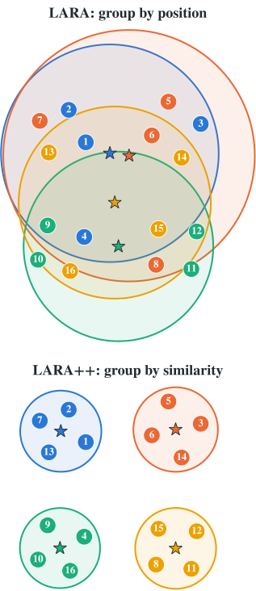

# LARA++：确定性proposal与相似性分组的核注意力

[English](README-en.md)

> **L1机制组件；不是完整模型**。完整实验**成本过高，不复现（审查 DONE）**；无能力提升或Evolve晋级声明。

## 论文信息

| 字段 | 内容 |
| --- | --- |
| 论文链接 | [arXiv:2611.22947v1](https://arxiv.org/abs/2611.22947v1)；[固定全文](https://arxiv.org/html/2611.22947v1) |
| 公司 / 机构 / 学校 | 一作 Fırat Öncel：Concordia University / Mila |
| 首次公开日期 | 2026-11-17T15:38:48Z（arXiv v1）；公告日期另记为 2026-11-18 |
| 原作者开源代码 | [作者仓库](https://github.com/firatoncel/KernelRealityCheckNeurIPS2026)；核验HEAD `20a9f67a252059ce04383e1365700416de9d9447`。未复制上游源码；许可证未另行核验。 |
| 本地 adapter / key | `lara-plus-plus`；`adapter: null`，未接入Evolve |
| 本地复现代码目录 | `src/auto_research/foundation_models/lara_plus_plus.py` |

## 原始论文总结

### 背景与主要改动

本文重新核查核化attention的真实效率，并用确定性proposal均值代替随机采样、相似性聚类代替连续切块改善LARA质量。与复杂度口号不同，cluster数量随序列增长时k-center成本为二次；近softmax质量不等于比FlashAttention快。 [已核方法位置](https://arxiv.org/html/2611.22947v1#S3)：7, Appendix E.1。

<!-- paper-figure:start -->
### 原论文关键图

[](https://arxiv.org/html/2611.22947v1)

原图/原表来自固定v1，未经科学内容改绘；是作者方法或结果，不是本地测量。[来源、裁切和SHA256](assets/provenance.json)。图片来自[原论文](https://arxiv.org/html/2611.22947v1)，版权归原作者所有。
<!-- paper-figure:end -->

### 核心公式

$$
\hat o_n=\frac{\sum_c[p_n(\mu_c)/q(\mu_c)]f_n(\mu_c)}{\sum_c p_n(\mu_c)/q(\mu_c)},\qquad f_n(\mu_c)=\frac{\sum_i\xi(k_i,\mu_c)v_i}{\sum_i\xi(k_i,\mu_c)}.
$$

本地固定作者commit的mis-opt路径。论文§7描述query-only和随机首中心，而公开源码用归一化Q+K联合特征、确定性首中心，CLS单独保留。这里明确执行源码变体，不把差异消除：proposal生成不反传，当前Q/K特征与V聚合仍可微。

~~~mermaid
flowchart LR
 Q[Q and K] --> C[Detached joint-feature clustering]
 C --> M[Deterministic proposal means]
 M --> I[Feature and proposal-density scores]
 I --> S[Self-normalized importance weights]
 S --> V[Value aggregation]
~~~

### 论文离线与线上效果

原文以其完整训练/推理与评测配置讨论效果；本地没有复跑该矩阵，不把论文数值写成本地指标。未报告本文方法的生产随机流量线上A/B；benchmark、单卡服务计时或使用Meta/Google模型本身不是A/B证据。具体质量/速度与成本配置须一起阅读。

## 本地复现

### 数据协议与代码映射

执行固定源码的deterministic clustering、proposal means、mis-opt自归一重要性权重与value聚合；不执行逐层蒸馏、ImageNet/YFCC15M训练或FLA高效内核。


```bash
PYTHONPATH=src python -c 'from auto_research.foundation_models.lara_plus_plus import diagnostic; print(diagnostic(42, device="cpu"))'
PYTHONPATH=src python -m pytest tests/test_nov18_latest_foundation.py -q
```

CPU seeds42/43/44已通过本组件检查；仅为合成张量机制诊断，不含公开能力benchmark。CUDA验收以[真实GPU回执](../../gpu-validations/lara-plus-plus-a100-20261118-latest.json)为准，不能由CPU通过替代；文档本身不提前宣称GPU已通过。

### 同主题比较与边界

LazyFlash保持前向dense而稀疏反向；LARA++近似前向softmax并需要蒸馏适配。两者改变的计算与误差对象不同，不能都归纳成“线性attention更快”。 本地结果只支撑上面列明的算子合同，多个seed不将L1升级成公开能力L2/L3。

### 高成本完整实验

原文对DeiT与DINOv2直到1.1B/40层做逐层蒸馏和联合微调，涉及ImageNet、YFCC15M与分割任务。完整数据/模型/内核矩阵超过本轮低成本组件范围。

以上是配置依据的成本判断，不是本地实测耗时。资源预算为单A100或A30，或本地Mac；不假定多卡、不断扩大或试训证明成本。**成本过高，不复现（审查 DONE）**；不下载大模型/数据，不启动完整矩阵，不自动重试，不阻塞本轮审查闭环。
