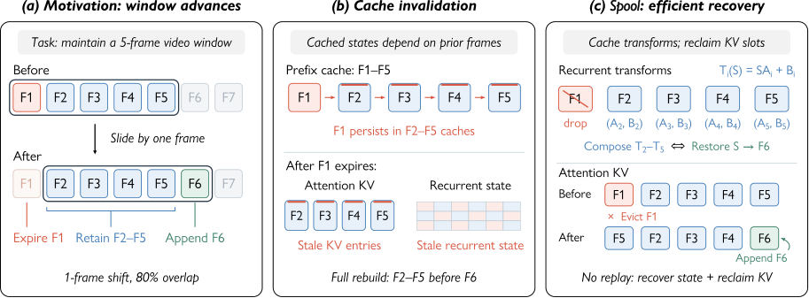

# Spool: affine summaries for sliding recurrent windows

<!-- source-sha256: e1973cc17fa472fb3e50fc8b84d171d091b9814f2be479f2555760e6d4b6f092 -->

[简体中文](README.md)

> **L1 mechanism component, not a complete model.** Full experiments are **too costly; not reproduced (review DONE)**. No capability improvement or Evolve promotion is claimed.

## Paper information

| Field | Value |
| --- | --- |
| Paper | [arXiv:2611.23228v1](https://arxiv.org/abs/2611.23228v1); [fixed text](https://arxiv.org/html/2611.23228v1) |
| Institution/company | First author Rui Ning: MIT CSAIL |
| Original publication | 2026-11-17T18:59:27Z (arXiv v1); separately observed announcement: 2026-11-18 |
| Authors' code | No released method-specific author source was found in fixed v1 and its author links. Dependency libraries are not counted as the paper code. |
| Local adapter/key | `spool`; adapter null; no Evolve integration |
| Local source | `src/auto_research/foundation_models/spool.py` |

## Original paper

### Motivation and changes

With recorded layer inputs fixed, GDN keys, values and gates make each update affine in prior state. Per-frame transitions compose chronologically in a segment tree. Expiry rebuilds state from the prefix anchor without replaying retained tokens through the backbone. [Reviewed method](https://arxiv.org/html/2611.23228v1#S3): 3.2–3.4, 4, 5.1, Appendix A.

### Key original figure

[](https://arxiv.org/html/2611.23228v1)

The fixed-version author figure/table is not a local result. Scientific content was not redrawn. Copyright remains with the original authors; no open-image license is inferred. [Source, crop and SHA256](assets/provenance.json).

### Equations

$$
F_i(S)=S(I+D_i)+B_i,\qquad D_{12}=D_1+D_2+D_1D_2,\qquad B_{12}=B_1+B_1D_2+B_2.
$$

Storing D=A-I protects small deviations from identity in low precision. Composition is noncommutative. Exactness holds for recorded inputs within a layer, not whole-network recomputation: higher-layer cached features can retain expired-frame influence.

~~~mermaid
flowchart LR
 X[Recorded GDN keys values gates] --> A[Per-block affine summary]
 A --> T[Ordered residual segment tree]
 T --> S[Replay retained interval from anchor]
~~~

### Reported results and evidence

The reported quality/efficiency relies on the full paper configuration, which was not reproduced locally. No production randomized-traffic A/B is reported for this method. Benchmarks, single-device serving measurements, or using Meta/Google models are not production A/B evidence.

## Local implementation

### Protocol and code mapping

Implements token-to-block GDN summaries and a cyclic residual segment tree with append, expiry and queries. No VLM, Triton/FLA engine integration, KV-tail-filling or RoPE-rebasing kernel is included.


```bash
PYTHONPATH=src python -c 'from auto_research.foundation_models.spool import diagnostic; print(diagnostic(42, device="cpu"))'
PYTHONPATH=src python -m pytest tests/test_nov18_latest_foundation.py -q
```

CPU seeds42/43/44passed the mechanism checks on synthetic tensors, not capability benchmarks. CUDA acceptance requires the [real-device receipt](../../gpu-validations/spool-a100-20261118-latest.json); this text does not preclaim a GPU pass.

### Same-topic comparison and boundaries

DropKV selects attention KV entries for eviction. Spool reconstructs shared recurrent state after expiry. Layerwise recorded-input exactness does not establish full-network equivalence. Multiple seeds do not upgrade these mechanism checks into L2/L3 capability evidence.

### High-cost full experiments

0.8B–122B hybrid VLM matrix, video streaming benchmarks up to5hours, A100/GH200/B200/B300; no full serving campaign on available single-device budget.

This is a configuration-based cost assessment, not measured local duration. The budget is one A100 or A30, or the local Mac. No multi-GPU capacity, costly probing run, large-resource download or automatic retry is assumed. Full experiments are **too costly; not reproduced (review DONE)** and do not block review closure.
