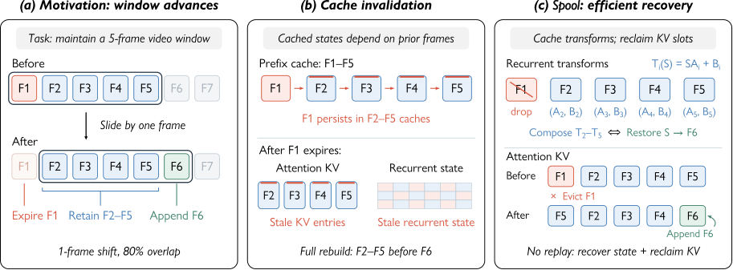

# Spool：用仿射摘要维护混合 VLM 的滑动窗口

[English](README-en.md)

> **L1机制组件；不是完整模型**。完整实验**成本过高，不复现（审查 DONE）**；无能力提升或Evolve晋级声明。

## 论文信息

| 字段 | 内容 |
| --- | --- |
| 论文链接 | [arXiv:2611.23228v1](https://arxiv.org/abs/2611.23228v1)；[固定全文](https://arxiv.org/html/2611.23228v1) |
| 公司 / 机构 / 学校 | 一作 Rui Ning：MIT CSAIL |
| 首次公开日期 | 2026-11-17T18:59:27Z（arXiv v1）；公告日期另记为 2026-11-18 |
| 原作者开源代码 | 固定v1及原作者链接未找到可核验的已发布方法源码；未找到/未发布，不把依赖库算原作者代码。 |
| 本地 adapter / key | `spool`；`adapter: null`，未接入Evolve |
| 本地复现代码目录 | `src/auto_research/foundation_models/spool.py` |

## 原始论文总结

### 背景与主要改动

GDN的key/value/gates只依赖已记录的层输入，因此状态更新对旧状态是仿射的。每帧缓存一个变换，以非交换的时间顺序组成segment tree；窗口到期时从prefix anchor重放保留摘要，而非重跑所有视频token。 [已核方法位置](https://arxiv.org/html/2611.23228v1#S3)：3.2–3.4, 4, 5.1, Appendix A。

<!-- paper-figure:start -->
### 原论文关键图

[](https://arxiv.org/html/2611.23228v1)

原图/原表来自固定v1，未经科学内容改绘；是作者方法或结果，不是本地测量。[来源、裁切和SHA256](assets/provenance.json)。图片来自[原论文](https://arxiv.org/html/2611.23228v1)，版权归原作者所有。
<!-- paper-figure:end -->

### 核心公式

$$
F_i(S)=S(I+D_i)+B_i,\qquad D_{12}=D_1+D_2+D_1D_2,\qquad B_{12}=B_1+B_1D_2+B_2.
$$

摘要存D=A-I避免BF16把接近单位矩阵的小变化舍入掉；合并顺序不可交换。逐层、固定记录输入下精确，不等于整个多层网络重新处理剩余帧，因为高层缓存输入可能仍含已到期帧的影响。

~~~mermaid
flowchart LR
 X[Recorded GDN keys values gates] --> A[Per-block affine summary]
 A --> T[Ordered residual segment tree]
 T --> S[Replay retained interval from anchor]
~~~

### 论文离线与线上效果

原文以其完整训练/推理与评测配置讨论效果；本地没有复跑该矩阵，不把论文数值写成本地指标。未报告本文方法的生产随机流量线上A/B；benchmark、单卡服务计时或使用Meta/Google模型本身不是A/B证据。具体质量/速度与成本配置须一起阅读。

## 本地复现

### 数据协议与代码映射

执行GDN逐token摘要、残差合并和循环segment tree的append/expiry/query；不含VLM、Triton/FLA集成、KV tail filling或RoPE重基内核。


```bash
PYTHONPATH=src python -c 'from auto_research.foundation_models.spool import diagnostic; print(diagnostic(42, device="cpu"))'
PYTHONPATH=src python -m pytest tests/test_nov18_latest_foundation.py -q
```

CPU seeds42/43/44已通过本组件检查；仅为合成张量机制诊断，不含公开能力benchmark。CUDA验收以[真实GPU回执](../../gpu-validations/spool-a100-20261118-latest.json)为准，不能由CPU通过替代；文档本身不提前宣称GPU已通过。

### 同主题比较与边界

DropKV直接挑选attention KV驱逐项，Spool处理递归共享状态的到期重建。后者的固定层输入精确性不能推导为保留视频内容的全网络精确性。 本地结果只支撑上面列明的算子合同，多个seed不将L1升级成公开能力L2/L3。

### 高成本完整实验

原文覆盖0.8B—122B混合VLM，多个视频benchmark、最长5小时流式片段，以及A100/GH200/B200/B300硬件。完整模型和视频服务矩阵不适合本轮单卡短跑。

以上是配置依据的成本判断，不是本地实测耗时。资源预算为单A100或A30，或本地Mac；不假定多卡、不断扩大或试训证明成本。**成本过高，不复现（审查 DONE）**；不下载大模型/数据，不启动完整矩阵，不自动重试，不阻塞本轮审查闭环。
