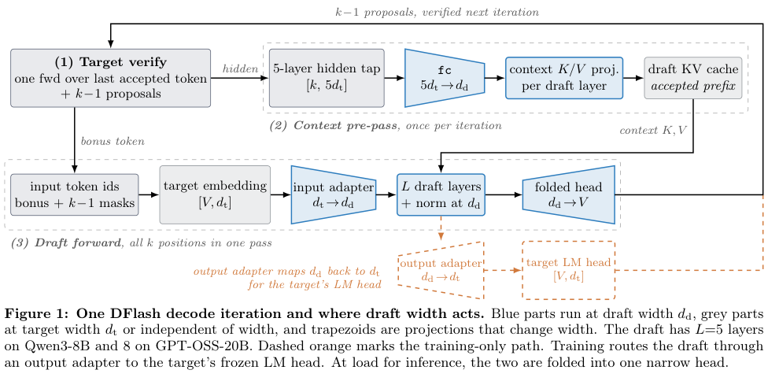

<!-- source-sha256: af0c3da4fb5afdcf2ccda4773e3d22f5e393cdc084f3bf89a8e2b958587c0947 -->
# NarrowSpec: Draft Hidden Width Need Not Match the Target in Speculative Decoding

[简体中文](README.md)

> **l1_mechanism component; not a complete model**. Full experiments: **high cost, not reproduced (review DONE)**.

## Paper information

| Field | Value |
| --- | --- |
| Paper link | [arXiv:2611.23835v1](https://arxiv.org/abs/2611.23835v1); [fixed PDF](https://arxiv.org/pdf/2611.23835v1) |
| Company / institution / school | Alagappan Valliappan: NVIDIA (verified fixed-v1 PDF byline) |
| Original publication date | 2026-11-18T04:40:10Z (arXiv v1); announcement2026-11-19 |
| Original source code | No independently verified NarrowSpec source revision was found. The paper uses[SpecForge](https://github.com/sgl-project/SpecForge) and lists released drafters; a general training framework is not proof that this method implementation is released. |
| Local adapter / key | `narrow-spec`; `adapter: null`; not Evolve-integrated |
| Local reproduction code directory | `src/auto_research/foundation_models/narrow_spec.py` |

## Original paper summary

### Background and main changes

DFlash/EAGLE-3 residual width is halved or quartered and the narrow drafter is trained from scratch. Boundary adapters connect target features and token space. DFlash folds its output adapter into the target head; EAGLE-3 can fold its input adapter into embeddings. Head geometry stays fixed, so KV cache size does not automatically shrink. [Fixed-v1 source](https://arxiv.org/pdf/2611.23835v1).

~~~mermaid
flowchart LR
 T[Target features] --> N[Narrow residual stream]
 N --> A[Output adapter]
 A --> H[Frozen target LM head]
 N --> F[Folded narrow head]
 F --> L[Same real arithmetic logits]
 H --> L
~~~

<!-- paper-figure:start -->
### Original paper figure

[](https://arxiv.org/pdf/2611.23835v1)

Original PDF crop; author method/result, not local evidence. [Page, crop and SHA256](assets/provenance.json). Copyright remains with the original authors.
<!-- paper-figure:end -->

### Core equations

$$
W_{\rm fold}=W_{\rm lm}W_{\rm out},\quad W_{\rm lm}(W_{\rm out}h_d)=W_{\rm fold}h_d,\qquad E_{\rm fold}=E_tW_{\rm in}^{\top}.
$$

A fold requires consecutive linear maps without intervening normalization/nonlinearity. Floating-point association changes rounding, so equality is not bitwise. Quantizing a product generally differs from multiplying a quantized head; a pre-quantized head is not covered by this identity.

### Paper offline and online results

At batch1 and temperature0, reported end-to-end speedups are1.06–1.12x on B200 and1.13–1.44x on GB10. These depend on trained acceptance and verification cost, not width ratio alone. No production A/B is reported.

## Local reproduction

### Data protocol and code mapping

Only the two boundary folds and output/input/hidden-gradient parity are implemented. There is no trained drafter, target model, token verifier or SGLang integration. A simple uniform-quantization negative control is illustrative, not the paper NVFP4 kernel.

```bash
PYTHONPATH=src python -c 'from auto_research.foundation_models.narrow_spec import diagnostic; print(diagnostic(42))'
PYTHONPATH=src python -m pytest tests/test_nov19_latest_foundation.py -q
```

Local generated tensors/contract cases are diagnostics only, not public capability benchmarks. Seeds42/43/44 do not elevate the evidence tier.

CUDA acceptance is recorded separately in the[sanitized GPU receipt](../../gpu-validations/narrow-spec-a100-20261119-latest.json); CPU success cannot substitute for it.

### Same-topic comparison and boundaries

LoopSpec changes the draft/verify pipeline of a looped model. NarrowSpec narrows drafter residuals while leaving target verification unchanged. Pipeline waiting and drafter work are different axes; fold parity says nothing about acceptance quality.

### High-cost full experiment

Two8B/20B targets, two drafter families and three widths train on four B200 GPUs: six DFlash epochs or three EAGLE-3 epochs. The32K-context B200/GB10/H100 serving matrix is not reproduced on one A100/A30.

This is a configuration-based cost estimate, not a measured full-run duration. **High cost, not reproduced (review DONE)**; no large downloads, full experiments, automatic retries or implementation queue. No capability improvement or Evolve promotion is claimed.
