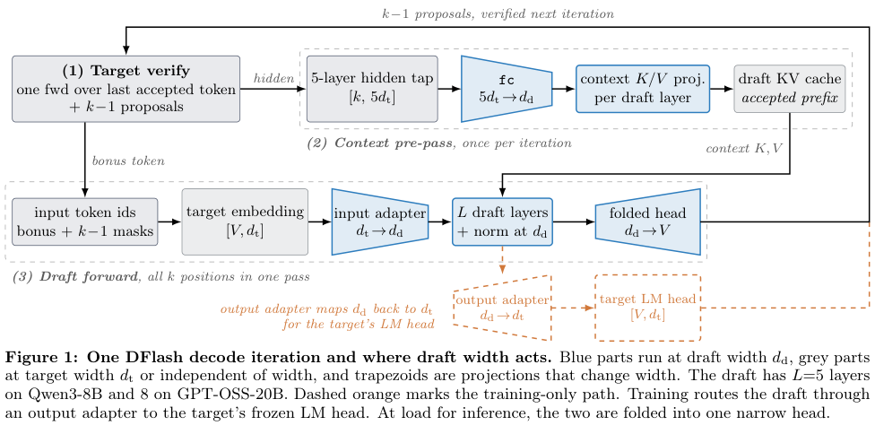

# NarrowSpec：缩窄整个草稿残差流，而不只是词表投影

[English](README-en.md)

> **l1_mechanism组件；不是完整模型**. 完整实验：**成本过高，不复现（审查 DONE）**。

## 论文信息

| 字段 | 内容 |
| --- | --- |
| 论文链接 | [arXiv:2611.23835v1](https://arxiv.org/abs/2611.23835v1); [fixed PDF](https://arxiv.org/pdf/2611.23835v1) |
| 公司 / 机构 / 学校 | 一作 Alagappan Valliappan：NVIDIA（已核对固定v1 PDF署名） |
| 首次公开日期 | 2026-11-18T04:40:10Z（arXiv v1）；公告2026-11-19，不把PDF内日期或公告当首发日期 |
| 原作者开源代码 | 未找到可核验的独立NarrowSpec方法源码修订。正文使用[SpecForge](https://github.com/sgl-project/SpecForge)训练并列出released drafters；通用训练框架不等于本方法源码已发布。 |
| 本地 adapter / key | `narrow-spec`；`adapter: null`；未接入Evolve |
| 本地复现代码目录 | `src/auto_research/foundation_models/narrow_spec.py` |

## 原始论文总结

### 背景与主要改动

把DFlash/EAGLE-3的整个残差宽度设为目标的二分之一或四分之一，并从头训练窄草稿；边界adapter连接目标hidden和共享词表。DFlash输出adapter可与目标head相乘，EAGLE-3输入adapter可折进embedding。head数量和head维度保持不变，因此KV cache不因残差流变窄而自动缩小。 [Fixed-v1 source](https://arxiv.org/pdf/2611.23835v1).

~~~mermaid
flowchart LR
 T[Target features] --> N[Narrow residual stream]
 N --> A[Output adapter]
 A --> H[Frozen target LM head]
 N --> F[Folded narrow head]
 F --> L[Same real arithmetic logits]
 H --> L
~~~

<!-- paper-figure:start -->
### 原论文关键图

[](https://arxiv.org/pdf/2611.23835v1)

固定v1原始PDF裁切，是作者方法/结果，不是本地指标。[页码、裁切与SHA256](assets/provenance.json)。图片来自[原论文](https://arxiv.org/pdf/2611.23835v1)，版权归原作者所有。
<!-- paper-figure:end -->

### 核心公式

$$
W_{\rm fold}=W_{\rm lm}W_{\rm out},\quad W_{\rm lm}(W_{\rm out}h_d)=W_{\rm fold}h_d,\qquad E_{\rm fold}=E_tW_{\rm in}^{\top}.
$$

两侧线性映射之间没有额外非线性或norm才能直接折叠。浮点结合顺序变化会改变舍入，不能要求bitwise一致；Q(WlmWout)一般不等于Q(Wlm)Wout，预先量化的head不能据此保证等价。

### 论文离线与线上效果

原文batch1/temperature0下端到端解码加速：B200为1.06–1.12倍，GB10为1.13–1.44倍。结果依赖训练后的接受长度和verify代价，不是矩阵维度比例本身；未报告生产线上A/B。

## 本地复现

### 数据协议与代码映射

仅实现两种边界折叠及输入/输出、hidden梯度一致性；不构造或训练DFlash/EAGLE-3，不运行目标模型、token接受/拒绝或SGLang。量化不交换负控使用说明性均匀量化，不冒充论文NVFP4内核。

```bash
PYTHONPATH=src python -c 'from auto_research.foundation_models.narrow_spec import diagnostic; print(diagnostic(42))'
PYTHONPATH=src python -m pytest tests/test_nov19_latest_foundation.py -q
```

本地生成小张量/接口案例仅为诊断，不是公开能力benchmark；seeds42/43/44不自动提升证据等级。

CUDA验收以[真实GPU回执](../../gpu-validations/narrow-spec-a100-20261119-latest.json)为准；CPU通过不能替代。

### 同主题比较与边界

LoopSpec改变looped模型的推测/验证流水线；NarrowSpec改变草稿网络的残差宽度，并保持目标verify不变。一个降低等待，一个减少草稿计算，不能用折叠等价证明任一方法的接受率。

### 高成本完整实验

Qwen3-8B与GPT-OSS-20B目标、DFlash/EAGLE-3三种宽度，四张B200训练；DFlash6epochs、EAGLE-3为3epochs，并做32K上下文和B200/GB10/H100服务矩阵。完整训练/服务实验超单A100/A30短预算。

以上是配置依据的成本估计，不是完整实验实测耗时。**成本过高，不复现（审查 DONE）**；不下载大资源、不启动完整实验、不自动重试、不加入自动实现队列，不声明能力提升或Evolve晋级。
