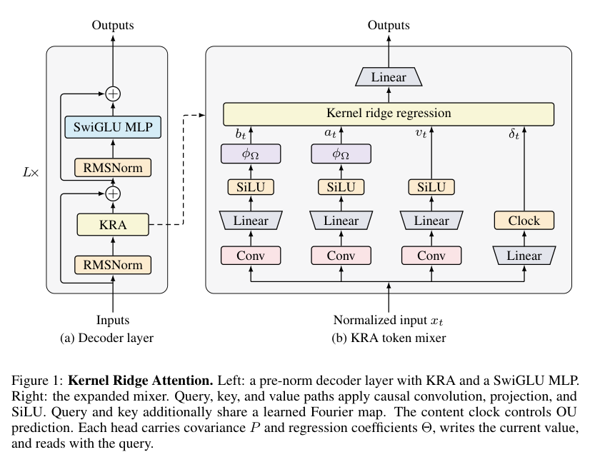

<!-- source-sha256: 44d055261f665849341526b12537423ee07559cebe19cec23e3ef32cbed78006 -->
# Kernel Ridge Attention: Nonlinear Memory with Selective Forgetting

[简体中文](README.md)

> **l1_mechanism component; not a complete model**. Full experiments: **high cost, not reproduced (review DONE)**.

## Paper information

| Field | Value |
| --- | --- |
| Paper link | [arXiv:2611.23896v1](https://arxiv.org/abs/2611.23896v1); [fixed PDF](https://arxiv.org/pdf/2611.23896v1) |
| Company / institution / school | Haowei Chen: Independent Researcher (verified fixed-v1 PDF byline) |
| Original publication date | 2026-11-18T05:49:34Z (arXiv v1); announcement2026-11-19 |
| Original source code | No author KRA implementation was found in fixed v1. Cited FLA is a dependency, not this method release. |
| Local adapter / key | `kernel-ridge-attention`; `adapter: null`; not Evolve-integrated |
| Local reproduction code directory | `src/auto_research/foundation_models/kernel_ridge_attention.py` |

## Original paper summary

### Background and main changes

KRA stores associations in fixed-size regression coefficients and posterior covariance. Shared learned Fourier features supply a nonlinear kernel. A content-dependent OU clock decays coefficients while restoring uncertainty toward the prior, reopening forgotten directions for writing. Reads include the current write. [Fixed-v1 source](https://arxiv.org/pdf/2611.23896v1).

~~~mermaid
flowchart LR
 X[Projected causal Q K V] --> F[Shared learned Fourier features]
 C[Content clock] --> P[OU coefficient decay and covariance recovery]
 F --> R[Covariance guided residual write]
 P --> R
 R --> O[Inclusive query read]
~~~

<!-- paper-figure:start -->
### Original paper figure

[](https://arxiv.org/pdf/2611.23896v1)

Original PDF crop; author method/result, not local evidence. [Page, crop and SHA256](assets/provenance.json). Copyright remains with the original authors.
<!-- paper-figure:end -->

### Core equations

$$
\bar\Theta_t=\delta_t\Theta_{t-1},\quad\bar P_t=\delta_t^2P_{t-1}+(1-\delta_t^2)\lambda^{-1}I,\quad G_t=\frac{\bar P_ta_t}{1+a_t^\top\bar P_ta_t},\quad\Theta_t=\bar\Theta_t+G_t(v_t-\bar\Theta_t^\top a_t)^\top,\quad P_t=\bar P_t-\frac{(\bar P_ta_t)(\bar P_ta_t)^\top}{1+a_t^\top\bar P_ta_t},\quad o_t=\Theta_t^\top b_t.
$$

Keys and queries share unit-norm sine/cosine features. P rotates and rescales a write; it is not a scalar gate. An independent dual reference solves each causal prefix with the product of content and OU-time Gram matrices.

### Paper offline and online results

At the paper’s matched100M-token budget, validation perplexity is88.00 versus97.21 for Transformer++. Rare-repeat top1 is25.41%, below Transformer++32.00%; memory is not uniformly better. Training uses one seed. No production A/B is reported.

## Local reproduction

### Data protocol and code mapping

Implements shared Fourier features, OU prediction, covariance-guided RLS, inclusive reads and streaming continuation. It excludes the width4 convolution frontend, decoder, parallel adjoints and fused kernels. The expensive dual solve is only a small independent reference.

```bash
PYTHONPATH=src python -c 'from auto_research.foundation_models.kernel_ridge_attention import diagnostic; print(diagnostic(42))'
PYTHONPATH=src python -m pytest tests/test_nov19_latest_foundation.py -q
```

Local generated tensors/contract cases are diagnostics only, not public capability benchmarks. Seeds42/43/44 do not elevate the evidence tier.

CUDA acceptance is recorded separately in the[sanitized GPU receipt](../../gpu-validations/kernel-ridge-attention-a100-20261119-latest.json); CPU success cannot substitute for it.

### Same-topic comparison and boundaries

Mamba controls an SSM with input-dependent steps and read/write vectors. KRA additionally maintains covariance to handle correlated-key interference, costing D-squared state per head. Bounded context-independent state does not make their costs identical.

### High-cost full experiment

The paper trains30.92M parameters on100,007,936tokens for3,052updates using eight RTX5090 GPUs, plus baseline/ablation runs. The full pretraining matrix is outside this single-device short-run budget.

This is a configuration-based cost estimate, not a measured full-run duration. **High cost, not reproduced (review DONE)**; no large downloads, full experiments, automatic retries or implementation queue. No capability improvement or Evolve promotion is claimed.
