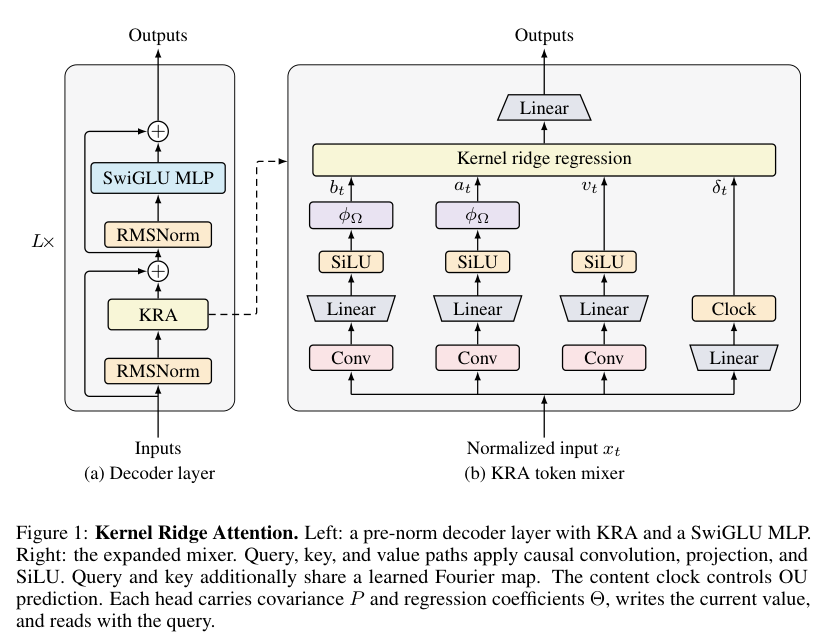

# KRA：在遗忘时恢复不确定性，用协方差决定写入方向

[English](README-en.md)

> **l1_mechanism组件；不是完整模型**. 完整实验：**成本过高，不复现（审查 DONE）**。

## 论文信息

| 字段 | 内容 |
| --- | --- |
| 论文链接 | [arXiv:2611.23896v1](https://arxiv.org/abs/2611.23896v1); [fixed PDF](https://arxiv.org/pdf/2611.23896v1) |
| 公司 / 机构 / 学校 | 一作 Haowei Chen：Independent Researcher（已核对固定v1 PDF署名） |
| 首次公开日期 | 2026-11-18T05:49:34Z（arXiv v1）；公告2026-11-19，不把PDF内日期或公告当首发日期 |
| 原作者开源代码 | 固定v1未找到作者KRA源码；引用的FLA是依赖，不能算本方法已开源。 |
| 本地 adapter / key | `kernel-ridge-attention`；`adapter: null`；未接入Evolve |
| 本地复现代码目录 | `src/auto_research/foundation_models/kernel_ridge_attention.py` |

## 原始论文总结

### 背景与主要改动

KRA把历史关联写入固定大小的回归矩阵，同时保留后验协方差。共享可学习Fourier特征形成非线性核；内容相关OU时钟既衰减旧系数，也把协方差恢复到先验，使已经遗忘的方向重新可写。读取发生在当前值写入之后。 [Fixed-v1 source](https://arxiv.org/pdf/2611.23896v1).

~~~mermaid
flowchart LR
 X[Projected causal Q K V] --> F[Shared learned Fourier features]
 C[Content clock] --> P[OU coefficient decay and covariance recovery]
 F --> R[Covariance guided residual write]
 P --> R
 R --> O[Inclusive query read]
~~~

<!-- paper-figure:start -->
### 原论文关键图

[](https://arxiv.org/pdf/2611.23896v1)

固定v1原始PDF裁切，是作者方法/结果，不是本地指标。[页码、裁切与SHA256](assets/provenance.json)。图片来自[原论文](https://arxiv.org/pdf/2611.23896v1)，版权归原作者所有。
<!-- paper-figure:end -->

### 核心公式

$$
\bar\Theta_t=\delta_t\Theta_{t-1},\quad\bar P_t=\delta_t^2P_{t-1}+(1-\delta_t^2)\lambda^{-1}I,\quad G_t=\frac{\bar P_ta_t}{1+a_t^\top\bar P_ta_t},\quad\Theta_t=\bar\Theta_t+G_t(v_t-\bar\Theta_t^\top a_t)^\top,\quad P_t=\bar P_t-\frac{(\bar P_ta_t)(\bar P_ta_t)^\top}{1+a_t^\top\bar P_ta_t},\quad o_t=\Theta_t^\top b_t.
$$

a、b由同一组cos/sin频率映射，范数为1。P不是可省略的标量门；它会旋转并缩放写入方向。独立dual参考求解内容Gram与OU时间Gram的乘积核，按每个因果prefix核对输出。

### 论文离线与线上效果

原文100M-token同预算实验中，KRA验证PPL为88.00，Transformer++为97.21；但自然稀有重复top-1为25.41%，低于Transformer++的32.00%。不能概括成所有记忆指标均优。仅一个训练seed，未报告生产线上A/B。

## 本地复现

### 数据协议与代码映射

实现共享Fourier特征、OU预测、协方差引导RLS、inclusive读取及状态续接；不含width4因果卷积前端、完整decoder、手写并行adjoint或融合内核。dual solve只作独立小规模参考，不能当高效推理路径。

```bash
PYTHONPATH=src python -c 'from auto_research.foundation_models.kernel_ridge_attention import diagnostic; print(diagnostic(42))'
PYTHONPATH=src python -m pytest tests/test_nov19_latest_foundation.py -q
```

本地生成小张量/接口案例仅为诊断，不是公开能力benchmark；seeds42/43/44不自动提升证据等级。

CUDA验收以[真实GPU回执](../../gpu-validations/kernel-ridge-attention-a100-20261119-latest.json)为准；CPU通过不能替代。

### 同主题比较与边界

Mamba用输入相关步长和读写向量控制SSM状态；KRA额外维护后验协方差来处理相关key方向的干扰。两者都是有界状态，但KRA每头还承担D平方协方差存储，不能仅按线性序列复杂度认为成本相同。

### 高成本完整实验

原文约30.92M参数，100,007,936训练token、3,052更新，八张RTX5090、多个模型/消融；本轮单A100/A30不重做完整预训练矩阵。

以上是配置依据的成本估计，不是完整实验实测耗时。**成本过高，不复现（审查 DONE）**；不下载大资源、不启动完整实验、不自动重试、不加入自动实现队列，不声明能力提升或Evolve晋级。
