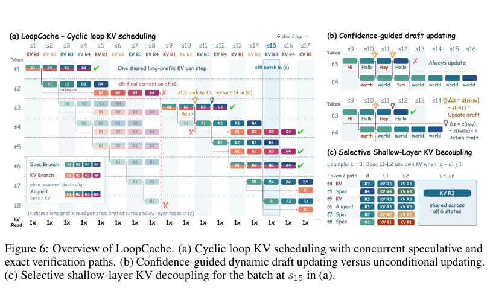

<!-- source-sha256: 3153657fd45239f535a445cbd69fdbac58199463917094ff51fa0606112fbf90 -->
# LoopCache: Accelerating Long-Context Self-Speculative Decoding for Looped Transformers

[简体中文](README.md)

> **l0_interface component; not a complete model**. Full experiments: **high cost, not reproduced (review DONE)**.

## Paper information

| Field | Value |
| --- | --- |
| Paper link | [arXiv:2611.24301v1](https://arxiv.org/abs/2611.24301v1); [fixed PDF](https://arxiv.org/pdf/2611.24301v1) |
| Company / institution / school | Zizhuo Fu: Peking University (verified fixed-v1 PDF byline) |
| Original publication date | 2026-11-18T12:11:43Z (arXiv v1); announcement2026-11-19 |
| Original source code | Yes:[author repository](https://github.com/zZzZ9zZ9/LoopCache), MIT, inspected HEAD`0ebecb21cc1bfb4a26696496694e25ba9e819e68`. Upstream serving code was not copied or executed. |
| Local adapter / key | `loopcache-interface`; `adapter: null`; not Evolve-integrated |
| Local reproduction code directory | `src/auto_research/foundation_models/loopcache_interface.py` |

## Original paper summary

### Background and main changes

A fixed-depth draft can remain on a stale trajectory. LoopCache replaces it only when the new-versus-old logit margin is large enough and prunes dependent descendants. Speculation shares a cyclic cache while a separate exact KV branch recomputes with correct loop caches. Selected shallow layers may decouple when loop mismatch is large. [Fixed-v1 source](https://arxiv.org/pdf/2611.24301v1).

~~~mermaid
flowchart LR
 G[Global step] --> C[Cyclic KV loop]
 D[Current draft logits] --> M[New old margin threshold]
 M --> P[Replace and prune descendants]
 C --> S[Approximate spec branch external]
 S --> E[Exact full KV branch external]
 E --> T[Verified token commit external]
~~~

<!-- paper-figure:start -->
### Original paper figure

[](https://arxiv.org/pdf/2611.24301v1)

Original PDF crop; author method/result, not local evidence. [Page, crop and SHA256](assets/provenance.json). Copyright remains with the original authors.
<!-- paper-figure:end -->

### Core equations

$$
c(g)=1+((g-1)\bmod R),\quad \mathrm{update}\iff s\ne x\ \land\ z_r(s)-z_r(x)\ge\tau;\quad KV_\ell^{spec}(d,c)=\begin{cases}KV_{\ell,d}&\ell\in\mathcal S, |d-c|\ge\delta\\KV_{\ell,c}&\text{otherwise}.\end{cases}
$$

Equality at the margin threshold triggers replacement. Future-loop harmful-switch labels are analysis only, never runtime oracles. Approximate speculative-cache computation cannot commit a token; the exact branch is mandatory.

### Paper offline and online results

Across six looped models and4K–128K contexts, reported average speedups are10.25x/14.56x over WFD/LoopSpec. The full campaign uses eight A100 GPUs and long-context parallelism. Local code reports neither speed nor acceptance. No production A/B is reported.

## Local reproduction

### Data protocol and code mapping

L0 implements margin updates, cyclic loop IDs, shallow-cache selection and the next full verification-cycle interface. It includes no model, real KV buffers, exact verifier, rejection sampler or token commit. A zero committed-token counter describes scope, not model performance.

```bash
PYTHONPATH=src python -c 'from auto_research.foundation_models.loopcache_interface import diagnostic; print(diagnostic(42))'
PYTHONPATH=src python -m pytest tests/test_nov19_latest_foundation.py -q
```

Local generated tensors/contract cases are diagnostics only, not public capability benchmarks. Seeds42/43/44 do not elevate the evidence tier.

### Same-topic comparison and boundaries

Spool reconstructs recurrent state for fixed recorded layer inputs. LoopCache schedules loop-specific KV reads and corrects approximate speculation through an exact branch. Their exactness claims concern different objects.

### High-cost full experiment

Six0.84B–3.5B models, contexts up to128K, eight A100 GPUs, context parallelism and an additionally trained DFlash baseline exceed this single-device short-run budget.

This is a configuration-based cost estimate, not a measured full-run duration. **High cost, not reproduced (review DONE)**; no large downloads, full experiments, automatic retries or implementation queue. No capability improvement or Evolve promotion is claimed.
