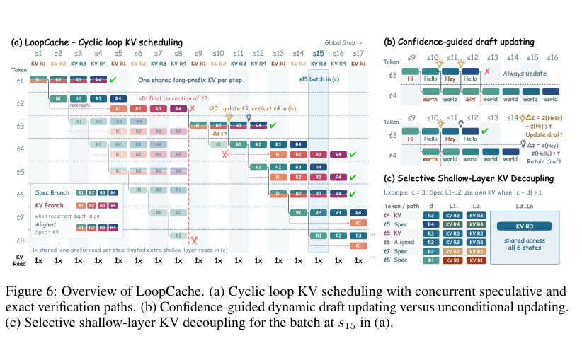

# LoopCache：循环KV调度与有条件草稿更新接口

[English](README-en.md)

> **l0_interface组件；不是完整模型**. 完整实验：**成本过高，不复现（审查 DONE）**。

## 论文信息

| 字段 | 内容 |
| --- | --- |
| 论文链接 | [arXiv:2611.24301v1](https://arxiv.org/abs/2611.24301v1); [fixed PDF](https://arxiv.org/pdf/2611.24301v1) |
| 公司 / 机构 / 学校 | 一作 Zizhuo Fu：Peking University（已核对固定v1 PDF署名） |
| 首次公开日期 | 2026-11-18T12:11:43Z（arXiv v1）；公告2026-11-19，不把PDF内日期或公告当首发日期 |
| 原作者开源代码 | 是：[作者仓库](https://github.com/zZzZ9zZ9/LoopCache)，MIT；只读核验HEAD `0ebecb21cc1bfb4a26696496694e25ba9e819e68`，未复制执行上游服务程序。 |
| 本地 adapter / key | `loopcache-interface`；`adapter: null`；未接入Evolve |
| 本地复现代码目录 | `src/auto_research/foundation_models/loopcache_interface.py` |

## 原始论文总结

### 背景与主要改动

固定深度的draft可能沿过时轨迹继续推进。LoopCache用新候选相对旧候选的logit差控制替换，并清除依赖旧token的所有后代。推测路径轮转读取同一loop cache，独立KV分支再以正确loop缓存重算；浅层差异较大时才单独读取对应loop的cache。 [Fixed-v1 source](https://arxiv.org/pdf/2611.24301v1).

~~~mermaid
flowchart LR
 G[Global step] --> C[Cyclic KV loop]
 D[Current draft logits] --> M[New old margin threshold]
 M --> P[Replace and prune descendants]
 C --> S[Approximate spec branch external]
 S --> E[Exact full KV branch external]
 E --> T[Verified token commit external]
~~~

<!-- paper-figure:start -->
### 原论文关键图

[](https://arxiv.org/pdf/2611.24301v1)

固定v1原始PDF裁切，是作者方法/结果，不是本地指标。[页码、裁切与SHA256](assets/provenance.json)。图片来自[原论文](https://arxiv.org/pdf/2611.24301v1)，版权归原作者所有。
<!-- paper-figure:end -->

### 核心公式

$$
c(g)=1+((g-1)\bmod R),\quad \mathrm{update}\iff s\ne x\ \land\ z_r(s)-z_r(x)\ge\tau;\quad KV_\ell^{spec}(d,c)=\begin{cases}KV_{\ell,d}&\ell\in\mathcal S, |d-c|\ge\delta\\KV_{\ell,c}&\text{otherwise}.\end{cases}
$$

阈值相等也触发替换；无需未来loop预测来决定当前更新。未来回到旧token的harmful-switch定义只用于分析，不能变成运行时oracle。近似spec cache不能直接提交token，必须等待独立exact分支。

### 论文离线与线上效果

原文在六类looped模型、4K–128K上下文上报告相对WFD/LoopSpec平均10.25倍/14.56倍速度；完整实验用八张A100和长上下文并行。这里不重测速度或接受率；未报告生产线上A/B。

## 本地复现

### 数据协议与代码映射

仅实现Eq2–4的阈值更新、循环loop编号、浅层cache选择及最近完整验证周期接口，标记L0。没有模型、实际KV内存、exact verifier、随机采样拒绝或token提交；tokens_committed固定为0是接口边界，不是模型指标。

```bash
PYTHONPATH=src python -c 'from auto_research.foundation_models.loopcache_interface import diagnostic; print(diagnostic(42))'
PYTHONPATH=src python -m pytest tests/test_nov19_latest_foundation.py -q
```

本地生成小张量/接口案例仅为诊断，不是公开能力benchmark；seeds42/43/44不自动提升证据等级。

### 同主题比较与边界

Spool重建固定记录层输入下的递归状态；LoopCache安排loop-specific KV读取并以exact分支纠正近似推测。前者的摘要精确性与后者的目标解码精确性证明对象不同。

### 高成本完整实验

六个0.84B–3.5B模型，最长128K上下文；原文全部实验使用八张A100，长上下文用context parallelism，并额外训练DFlash。完整服务/训练矩阵超本轮单卡资源。

以上是配置依据的成本估计，不是完整实验实测耗时。**成本过高，不复现（审查 DONE）**；不下载大资源、不启动完整实验、不自动重试、不加入自动实现队列，不声明能力提升或Evolve晋级。
