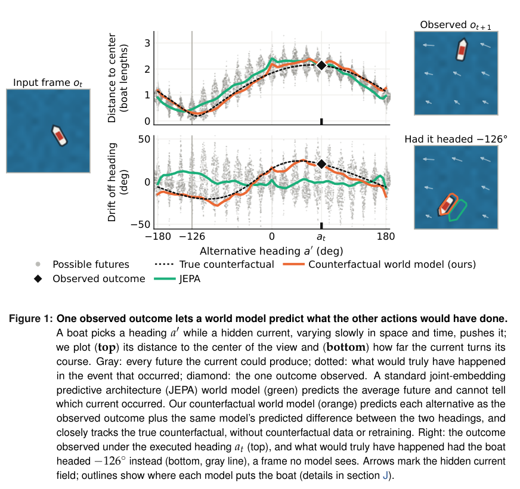

<!-- source-sha256: a75e14881c4e4fc60f3fc62d1c2fb7bc0d846158c61948fe9e96ad0763343bee -->
# Counterfactual World Models: JEPAs That Reason About "What If"

[简体中文](README.md)

> **l1_mechanism component; not a complete model**. Full experiments: **high cost, not reproduced (review DONE)**.

## Paper information

| Field | Value |
| --- | --- |
| Paper link | [arXiv:2611.24778v1](https://arxiv.org/abs/2611.24778v1); [fixed PDF](https://arxiv.org/pdf/2611.24778v1) |
| Company / institution / school | Randall Balestriero: Brown University / AMI Labs (verified fixed-v1 PDF byline) |
| Original publication date | 2026-11-18T17:24:00Z (arXiv v1); announcement2026-11-19 |
| Original source code | The fixed PDF links[the method repository](https://github.com/galilai-group/counterfactual-WM), but this review received404. Accessible code, revision and license could not be verified; the link is not presented as successfully retrieved source. |
| Local adapter / key | `counterfactual-wm`; `adapter: null`; not Evolve-integrated |
| Local reproduction code directory | `src/auto_research/foundation_models/counterfactual_wm.py` |

## Original paper summary

### Background and main changes

A factual world model estimates average outcomes, not the same-event coupling between actions. This method combines an observed outcome with the factual predictor’s action contrast. It is exact under additive disturbances, with interaction bounds for smooth short transitions; contacts, gain faults and curved coordinates can break it. [Fixed-v1 source](https://arxiv.org/pdf/2611.24778v1).

~~~mermaid
flowchart LR
 O[Observed factual outcome] --> R[Observed residual]
 F[Factual action prediction] --> R
 A[Alternative action prediction] --> C[Residual reuse]
 R --> C
 C --> L[Same event alternative estimate]
~~~

<!-- paper-figure:start -->
### Original paper figure

[](https://arxiv.org/pdf/2611.24778v1)

Original PDF crop; author method/result, not local evidence. [Page, crop and SHA256](assets/provenance.json). Copyright remains with the original authors.
<!-- paper-figure:end -->

### Core equations

$$
\hat z(a')=z_{obs}+\mu(H,a')-\mu(H,a),\qquad T_R-Y(a')=\mathbb E[\Delta]-\Delta,\quad\Delta=Y(a')-Y(a).
$$

The observed input follows the factual action; the true alternative outcome is never an algorithm input. Transport-then-decode differs from decoding each term before transport. Coordinate guarantees need readout assumptions. Error is individual-minus-average action effect, not simply factual-model prediction error.

### Paper offline and online results

In four pixel-based simulators, reported counterfactual R-squared rises from38–46% to86–96%. A fifth underwater task uses16times more factual data and reaches90–94%. These require frozen encoders, fitted predictors and simulator replay, not this local operator. No production A/B is reported.

## Local reproduction

### Data protocol and code mapping

Implements equation6 residual reuse and equation7 readout-space transport, rejecting implicit broadcasting. Tests establish additive exactness and preserve expected failures under gain faults/nonlinear readouts. No JEPA training, encoder, simulator collection or planning runs. Analytic diagnostics are not trained world models.

```bash
PYTHONPATH=src python -c 'from auto_research.foundation_models.counterfactual_wm import diagnostic; print(diagnostic(42))'
PYTHONPATH=src python -m pytest tests/test_nov19_latest_foundation.py -q
```

Local generated tensors/contract cases are diagnostics only, not public capability benchmarks. Seeds42/43/44 do not elevate the evidence tier.

CUDA acceptance is recorded separately in the[sanitized GPU receipt](../../gpu-validations/counterfactual-wm-a100-20261119-latest.json); CPU success cannot substitute for it.

### Same-topic comparison and boundaries

DT-JEPA predicts future latent distributions from history for decision making; true futures appear only in training. CWM answers alternative actions after a factual outcome is observed. It cannot access an unobserved future, and a DT-JEPA mean is not automatically an individual counterfactual.

### High-cost full experiment

Full evaluation combines several frozen visual encoders, five pixel simulators, width1024 two-block predictors,20,000updates per fit at batch256/three seeds, and history/readout/planning sweeps. Total GPU hours are not stated; configuration-based cost exceeds this short-run budget, without a costly probe.

This is a configuration-based cost estimate, not a measured full-run duration. **High cost, not reproduced (review DONE)**; no large downloads, full experiments, automatic retries or implementation queue. No capability improvement or Evolve promotion is claimed.
