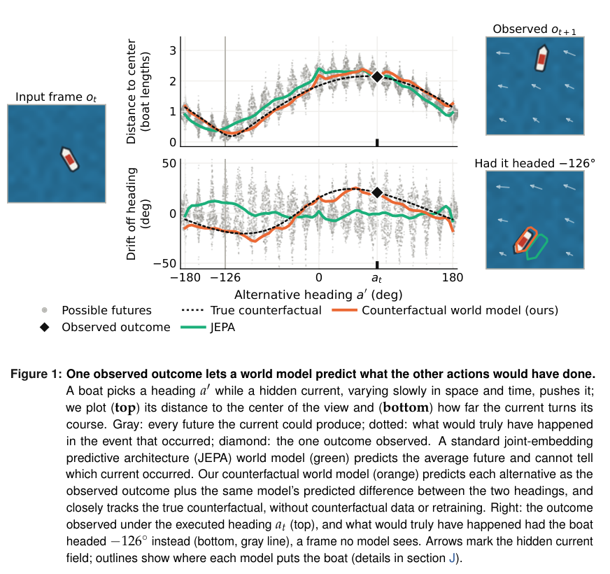

# Counterfactual WM：复用已发生事件的残差，而非预测平均未来

[English](README-en.md)

> **l1_mechanism组件；不是完整模型**. 完整实验：**成本过高，不复现（审查 DONE）**。

## 论文信息

| 字段 | 内容 |
| --- | --- |
| 论文链接 | [arXiv:2611.24778v1](https://arxiv.org/abs/2611.24778v1); [fixed PDF](https://arxiv.org/pdf/2611.24778v1) |
| 公司 / 机构 / 学校 | 一作 Randall Balestriero：Brown University / AMI Labs（已核对固定v1 PDF署名） |
| 首次公开日期 | 2026-11-18T17:24:00Z（arXiv v1）；公告2026-11-19，不把PDF内日期或公告当首发日期 |
| 原作者开源代码 | 固定PDF列出[作者方法仓库](https://github.com/galilai-group/counterfactual-WM)，本轮只读请求返回404，未能核验可获取源码/修订/许可证；不写成已成功获取开源实现。 |
| 本地 adapter / key | `counterfactual-wm`；`adapter: null`；未接入Evolve |
| 本地复现代码目录 | `src/auto_research/foundation_models/counterfactual_wm.py` |

## 原始论文总结

### 背景与主要改动

普通world model给动作的平均结果，不能仅凭更准的事实分布识别同一扰动下的个体反事实。本文将实际观测结果作为事件信息，加上同一事实预测器对两个动作的预测差；加性扰动时精确，平滑短时动力学下有交互误差界，但碰撞、乘法故障和弯曲坐标可破坏近似。 [Fixed-v1 source](https://arxiv.org/pdf/2611.24778v1).

~~~mermaid
flowchart LR
 O[Observed factual outcome] --> R[Observed residual]
 F[Factual action prediction] --> R
 A[Alternative action prediction] --> C[Residual reuse]
 R --> C
 C --> L[Same event alternative estimate]
~~~

<!-- paper-figure:start -->
### 原论文关键图

[](https://arxiv.org/pdf/2611.24778v1)

固定v1原始PDF裁切，是作者方法/结果，不是本地指标。[页码、裁切与SHA256](assets/provenance.json)。图片来自[原论文](https://arxiv.org/pdf/2611.24778v1)，版权归原作者所有。
<!-- paper-figure:end -->

### 核心公式

$$
\hat z(a')=z_{obs}+\mu(H,a')-\mu(H,a),\qquad T_R-Y(a')=\mathbb E[\Delta]-\Delta,\quad\Delta=Y(a')-Y(a).
$$

观测是已经执行动作a之后的结果，替代动作真值不作为算法输入。先在embedding运输后decode，与先decode每项再做残差运输一般不同；选择坐标需要额外readout假设。误差等于个体动作效应与平均动作效应之差，不是“world model零误差就保证反事实零误差”。

### 论文离线与线上效果

原文四个像素模拟环境中反事实R平方从38%–46%升到86%–96%；第五个水下环境用16倍事实数据，达到90%–94%。这些依赖冻结编码器、训练预测器和模拟器分支回放，不是本地算子结果；未报告生产线上A/B。

## 本地复现

### 数据协议与代码映射

执行Eq6残差复用和Eq7 readout坐标运输，严格拒绝隐式broadcast；加性系统验证等式，乘法gain fault与非线性readout保留预期失效。未训练JEPA、加载encoder、采集模拟轨迹或执行规划；诊断中的分析函数不冒充训练好的world model。

```bash
PYTHONPATH=src python -c 'from auto_research.foundation_models.counterfactual_wm import diagnostic; print(diagnostic(42))'
PYTHONPATH=src python -m pytest tests/test_nov19_latest_foundation.py -q
```

本地生成小张量/接口案例仅为诊断，不是公开能力benchmark；seeds42/43/44不自动提升证据等级。

CUDA验收以[真实GPU回执](../../gpu-validations/counterfactual-wm-a100-20261119-latest.json)为准；CPU通过不能替代。

### 同主题比较与边界

DT-JEPA在历史下预测未来latent分布并用于决策，真实未来只在训练目标出现；CWM在一个事实结果已经可见后推断同一事件的替代动作结果。不能让CWM提前使用尚未观测的未来，亦不能把DT-JEPA的均值直接称个体反事实。

### 高成本完整实验

完整评测含多个冻结视觉encoder、五个像素模拟环境、1024宽两层predictor、每fit20,000更新/batch256/三种子及历史/readout/规划矩阵。没有总GPU小时披露；根据训练和模拟组合判断超单卡短时预算，不试跑扩大。

以上是配置依据的成本估计，不是完整实验实测耗时。**成本过高，不复现（审查 DONE）**；不下载大资源、不启动完整实验、不自动重试、不加入自动实现队列，不声明能力提升或Evolve晋级。
