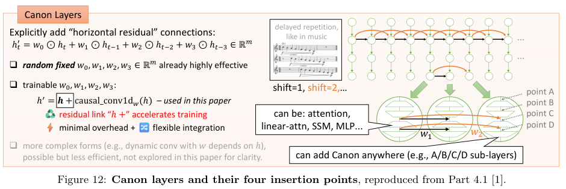

<!-- source-sha256: e8ac3b1fffface324e4d6e5116ddbc1bde5c0916141952f4378fb46f29558a6c -->
# Physics of Language Models: Part 4.2, Canon Layers at Scale where Synthetic Pretraining Resonates in Reality

[简体中文](README.md)

> **Review only; no executable reproduction**. Full experiment: **high cost, not reproduced (review DONE)**.

## Paper information

| Field | Value |
| --- | --- |
| Paper link | [arXiv:2611.24963v1](https://arxiv.org/abs/2611.24963v1); [fixed PDF](https://arxiv.org/pdf/2611.24963v1) |
| Company / institution / school | Zeyuan Allen-Zhu: Allen-Zhu Research (fixed-v1 byline) |
| Original publication date | 2026-11-12T18:51:19Z (arXiv v1); announced2026-11-20 |
| Original source code | [https://github.com/facebookresearch/PhysicsLM4](https://github.com/facebookresearch/PhysicsLM4); Apache-2.0; revision `75806965208c55e9f7f2e2363d3793d2da75d2e4` |
| Local adapter / key | `canon-layers-scale`; `adapter: null`; not Evolve-integrated |
| Local reproduction code directory | `None (review-only; no reproduction code)` |

Current author affiliation is Allen-Zhu Research. The fixed paper states experiments were conducted at FAIR at Meta; this research relationship does not change the byline grouping.

## Original paper summary

### Background and principal changes

Canon adds residual short convolutions along the token axis at several within-layer locations. This paper tests architecture lessons from smaller synthetic training in64 real-corpus pretraining runs at1.3B–8B parameters, including GLA5/GDN2 with low-rank output gates. Budget alignment, baseline tuning and measurable skills are central to the study.

[Fixed-v1 primary source](https://arxiv.org/pdf/2611.24963v1)

~~~mermaid
flowchart LR
 H[Token hidden sequence] --> A[Canon A before attention]
 A --> B[Canon B on projected Q K V]
 B --> C[Canon C before MLP]
 C --> D[Canon D on gated MLP branches]
 D --> E[Matched scale and tuned baselines]
 E --> F[Knowledge scores plus retrieval and two hop probes]
~~~

<!-- paper-figure:start -->
### Original paper figure

Original PDF crop, no semantic editing; author evidence, not a local result. [Provenance](assets/provenance.json). Copyright remains with the authors.
<!-- paper-figure:end -->

### Core equations

$$
h'_t=h_t+\sum_{r=0}^{3}w_r\odot h_{t-r},\qquad g(x)=\operatorname{SiLU}(G_1G_2x+b),\quad\operatorname{rank}(G_1G_2)\le16.
$$

Canon is a per-channel causal width4 convolution with left zero padding and a hidden-state residual. A/C follow normalization, B follows QKV projections, and D covers both gated-MLP branches. The rank constraint applies before SiLU; the activated gate need not be low-rank. Released LlamaCanon also uses quarter RoPE, so its differences are not solely convolution.

### Paper offline and online results

At8B/1T, Canon needs roughly30% fewer tokens to reach vanilla Llama's final MMLU. Yet linear models with stronger standard scores still struggle with simple retrieval in roughly500-token contexts and unreliable two-hop reasoning. This is not universal evidence against linear models. No online A/B is reported. ArXiv v1 is November12; the manuscript's2025-12-09 date and earlier code releases are separate from today's announcement.

## Local reproduction

### Data protocol and code mapping

Review-only fixed-source documentation, figures, affiliation, code revision, cost and limitations. No Canon/GLA5/GDN2 implementation, metrics, GPU receipt or executable Evolve operator is added. A small convolution demo would not reproduce64 pretraining runs. The current byline is Allen-Zhu Research; experiments were conducted at FAIR at Meta and code is in facebookresearch, not proof of current Meta authorship.

### Same-topic comparison and boundaries

Canon's causal width4 residual supplies local token mixing, not a long-history state or independent access to arbitrary distant positions; it can augment attention, linear attention or SSMs. Mamba also maintains input-selective recurrent state beyond its local convolution. These roles differ. Align parameters/state and tuning, then separately test retrieval: stronger knowledge scores do not establish attention-like remote reads from fixed-size state.

### High-cost full experiment

The study contains64 from-scratch1.3B/3B/8B runs on1–2T Nemotron-CC tokens, multiple learning rates and evaluations. The paper estimates about100kUSD per8B run. This exceeds one A100/A30 or Mac budget; no checkpoint download or training probe is attempted.

Configuration-based cost judgment, not measured full-run time. **High cost, not reproduced (review DONE)**; no automatic retry or implementation queue, no capability improvement or Evolve promotion claim.
