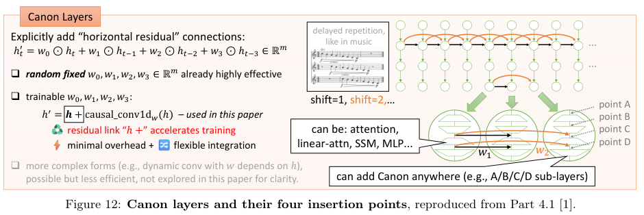

# Physics of Language Models: Part 4.2, Canon Layers at Scale where Synthetic Pretraining Resonates in Reality

[English](README-en.md)

> **仅审查收录；没有可执行复现**. 完整实验：**成本过高，不复现（审查 DONE）**。

## 论文信息

| Field | Value |
| --- | --- |
| 论文链接 | [arXiv:2611.24963v1](https://arxiv.org/abs/2611.24963v1); [fixed PDF](https://arxiv.org/pdf/2611.24963v1) |
| 公司 / 机构 / 学校 | Zeyuan Allen-Zhu: Allen-Zhu Research (fixed-v1 byline) |
| 首次公开日期 | 2026-11-12T18:51:19Z (arXiv v1); announced2026-11-20 |
| 原作者开源代码 | [https://github.com/facebookresearch/PhysicsLM4](https://github.com/facebookresearch/PhysicsLM4); Apache-2.0; revision `75806965208c55e9f7f2e2363d3793d2da75d2e4` |
| 本地 adapter / key | `canon-layers-scale`; `adapter: null`; not Evolve-integrated |
| 本地复现代码目录 | `无（仅审查收录，没有复现代码）` |

当前一作机构为Allen-Zhu Research；固定原文明确实验在FAIR at Meta完成。Meta研究执行/官方代码关系与作者当前机构分别记录，不修改机构聚合。

## 原始论文总结

### 背景与主要改动

Canon在层内多个位置加入沿token轴的残差短卷积，显式提供邻近信息。本文把此前小规模合成训练得到的结构判断放到64组1.3B–8B真实语料预训练中检验，并对线性模型使用低秩输出门的GLA5/GDN2。重要贡献还包括对预算、基线调参和可测技能的重新审视。

[Fixed-v1 primary source](https://arxiv.org/pdf/2611.24963v1)

~~~mermaid
flowchart LR
 H[Token hidden sequence] --> A[Canon A before attention]
 A --> B[Canon B on projected Q K V]
 B --> C[Canon C before MLP]
 C --> D[Canon D on gated MLP branches]
 D --> E[Matched scale and tuned baselines]
 E --> F[Knowledge scores plus retrieval and two hop probes]
~~~

<!-- paper-figure:start -->
### 原论文关键图

原始PDF裁切，没有语义编辑；是作者方法/结果，不是本地证据。[页码、裁切与SHA256](assets/provenance.json)，版权归原作者。
<!-- paper-figure:end -->

### 核心公式

$$
h'_t=h_t+\sum_{r=0}^{3}w_r\odot h_{t-r},\qquad g(x)=\operatorname{SiLU}(G_1G_2x+b),\quad\operatorname{rank}(G_1G_2)\le16.
$$

Canon是每通道独立、kernel=4、左侧补零的因果卷积，带原hidden残差；A/C在norm后、B在QKV投影后、D覆盖门控MLP两支。线性模型低秩约束作用于SiLU之前的G1G2，激活后门不保证低秩。公开LlamaCanon还用quarter RoPE，不能把其全部差异只归因于卷积。

### 论文离线与线上效果

8B/1T比较中，Canon达到vanilla Llama最终MMLU所需token约减少30%；但标准知识分数更高的线性模型仍会在约500token的简单检索上失败，简单两跳也未被可靠学会。这不等于线性结构普遍无效。论文没有线上A/B。arXiv首发是11月12日；正文日期2025-12-09及历史代码公开时间另记，今日公告不是新算法首发。

## 本地复现

### 数据协议与代码映射

仅固定原文、原图、作者机构、公开代码修订、成本与证据局限收录。没有Canon/GLA5/GDN2实现、metrics、GPU回执或可执行Evolve operator；不另造小卷积demo来声称完成64组预训练。当前作者机构是Allen-Zhu Research；正文明确实验在FAIR at Meta完成，官方代码位于facebookresearch，不能把实验关系改写成当前一作Meta署名。

### 同主题比较与边界

Canon的宽4因果残差只提供局部token混合，本身不是长历史状态，也不能独立读取任意远位置；它可插入attention、线性attention或SSM。Mamba除局部卷积外还维护输入选择的递归状态，两者功能不能等同。比较需对齐参数/状态与调参，并另测上下文检索；知识分数更高不推出固定状态已具备attention式远程读取。

### 高成本完整实验

64组从头预训练，1.3B/3B/8B、1–2T Nemotron-CC token；原文估计单8B run约10万美元，并对每配置跑多个学习率和评测。已远超单A100/A30或Mac预算，完整实验不复现，不下载checkpoint、不做训练探针。

这是依据原文配置的成本判断，不是完整实验实测耗时。**成本过高，不复现（审查 DONE）**；不自动重试、不加入实现队列，不声明能力提升或Evolve晋级。
