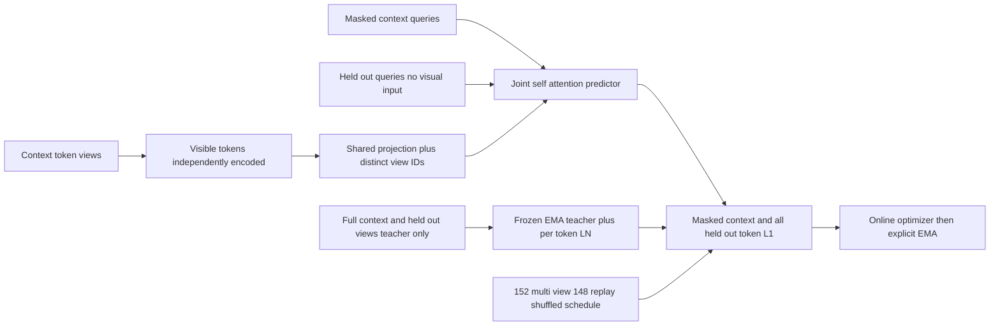
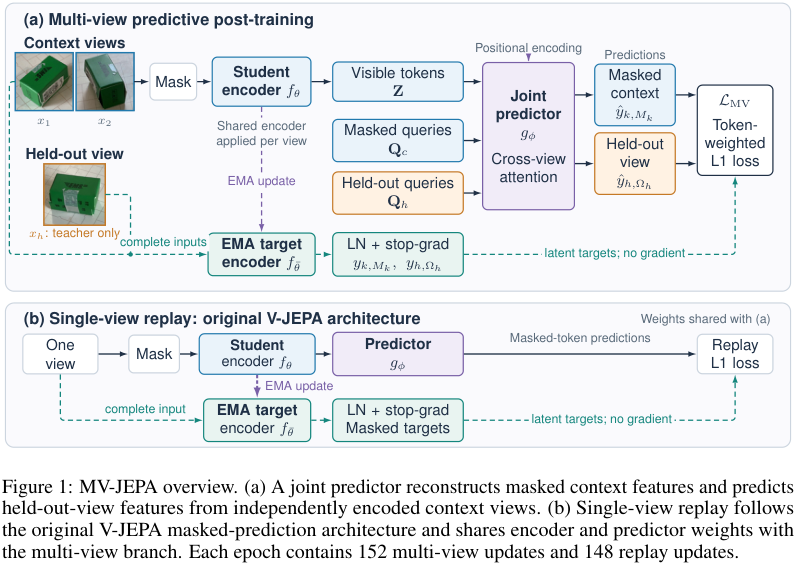

<!-- source-sha256: 6b68e252224045e8d7e1a5ecaa0c06ae2c256dafc9fb954bfe3c1f9085ab981a -->
# MV-JEPA: Post-Training Video Encoders for Cross-View Understanding

[简体中文](README.md)

> L1 host-policy/token-wiring component; not a complete paper reproduction. High-cost full experiments are not reproduced (review DONE).

## Paper information

| Field | Value |
| --- | --- |
| Paper link | [arXiv:2611.25172v1](https://arxiv.org/abs/2611.25172v1); [fixed PDF](https://arxiv.org/pdf/2611.25172v1) |
| Company / institution / school | Yangchen Zhao: University of Minnesota, Twin Cities (fixed-v1 first-author byline) |
| Original publication date | 2026-11-18T20:58:38Z; arXiv announcement2026-11-20; selected2026-11-21, not a new first release today |
| Original author code | No verifiable paper-specific author code found in fixedv1 or this finite repository search; generic dependencies and same-name unrelated repositories are not author releases. |
| Local adapter / key | `mv-jepa`; `adapter: null`; not Evolve-integrated |
| Local code directory | `src/auto_research/foundation_models/mv_jepa.py` |

## Original paper summary

### Background and main changes

MV-JEPA post-trains a pretrained JEPA video encoder for object and moment correspondence across camera views. A shared student independently encodes visible tokens from each context view. A joint predictor reconstructs masked context positions and predicts an entirely held-out view. Held-out pixels/features never enter the student or predictor; they only supply teacher targets. Single-view inference remains independent.



<!-- paper-figure:start -->
### Key original figure

[](https://arxiv.org/pdf/2611.25172v1#page=3)

Original fixed-v1 PDF crop, page3; copyright belongs to the authors. Visually checked, with no scientific-content edits. [Crop/provenance](assets/provenance.json). The figure illustrates the author's full method, not the local diagnostic.
<!-- paper-figure:end -->

### Core formula

$$
\mathcal L_{MV}=\frac{\sum_k\sum_{p\in M_k}D^{-1}\|\hat y_{k,p}-\operatorname{sg}(y_{k,p})\|_1+\sum_{p\in\Omega_h}D^{-1}\|\hat y_{h,p}-\operatorname{sg}(y_{h,p})\|_1}{\sum_k|M_k|+|\Omega_h|},\qquad\bar\theta\leftarrow0.99925\bar\theta+0.00075\theta.
$$

The EMA teacher encodes full context and held-out observations; targets receive per-token LayerNorm and stop-gradient. Contexts receive distinct randomly assigned view IDs, while held-out queries have a reserved ID; the two query types use separate mask embeddings. Eq4 gives equal weight to masked-context and all held-out target tokens, normalizing each example before averaging the batch. It is neither view-wise averaging nor a batch-wide micro-average. Each epoch shuffles152multiview and148original single-view replay updates with shared online encoder/predictor. Teacher EMA follows the optimizer at momentum0.99925.

### Paper results

For V-JEPA2-L, the authors report ABO Recall@1 rising52.82% to62.18% (+9.36percentage points), and six-candidate Ego-Exo4D moment retrieval30.11% to44.75% (+14.64points). These are frozen real-video-encoder evaluations, not accuracy measurements of the local tiny token model. Relative percentages and percentage points differ. The paper also reports transfer and frozen probes, without production online A/B.

## Local reproduction

### Data protocol and code mapping

A real tiny shared self-attention encoder, independently encoded contexts, joint predictor, two query types, distinct view IDs, teacher-only held-out targets, Eq4 loss, shared single-view replay and explicit EMA are implemented. Inputs are synthetic token features, not pixels; no V-JEPA weights are loaded. The declared tiny one-dimensional sinusoidal encoding is not the native spatiotemporal position code. Eight-block video masks, data crops/decoding, V-JEPA2.1 multi-layer5632-dimensional targets and visible-distance weighting, full training and real retrieval are absent. Isolation/gradient diagnostics are not visual capability or Evolve evidence.

```bash
PYTHONPATH=src python -c 'from auto_research.foundation_models.mv_jepa import diagnostic; print(diagnostic(42))'
PYTHONPATH=src python -m pytest tests/test_nov21_mv_jepa.py -q
```

The batch runner records source-bound diagnostics separately. Counts, loss and gradient controls are not model accuracy or throughput. A missing real CUDA receipt is not a pass; no capability or Evolve promotion is claimed.

### Same-topic comparison and boundaries

Time-JEPA supplies physical time-series targets through masked latent prediction and unmasked physical-state regression on one online encoder. MV-JEPA instead predicts another camera's latent targets through a joint predictor over independently encoded context views. Both keep training targets out of inference inputs, but cross-view queries are not Time-JEPA's sensor head; replay-based retention and physical-time alignment require different checks.

### High-cost full experiments

The paper explicitly uses16-frame256×256 inputs, multiview batch48/replay24 and9000updates over30epochs; V-JEPA2-L takes roughly18hours on one RTX PRO6000 Blackwell. MVImgNet2.0/Ego-Exo4D, ImageNet/Kinetics/SSv2 replay and many probes add cost. The complete experiment is too expensive for this single-A100/A30 or Mac budget and is not attempted. Only an8-wide tiny token mechanism is budgeted below30seconds across three seeds, with no model/data downloads or APIs. CPU tests do not complete CUDA validation; that requires this batch's real-GPU receipt.

High-cost full experiments are review DONE / not reproduced, terminal and not automatically retried. No result from another paper certifies this implementation.
