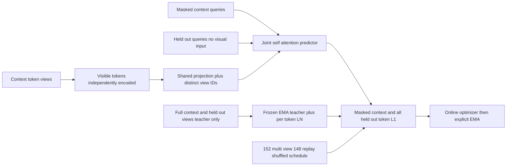
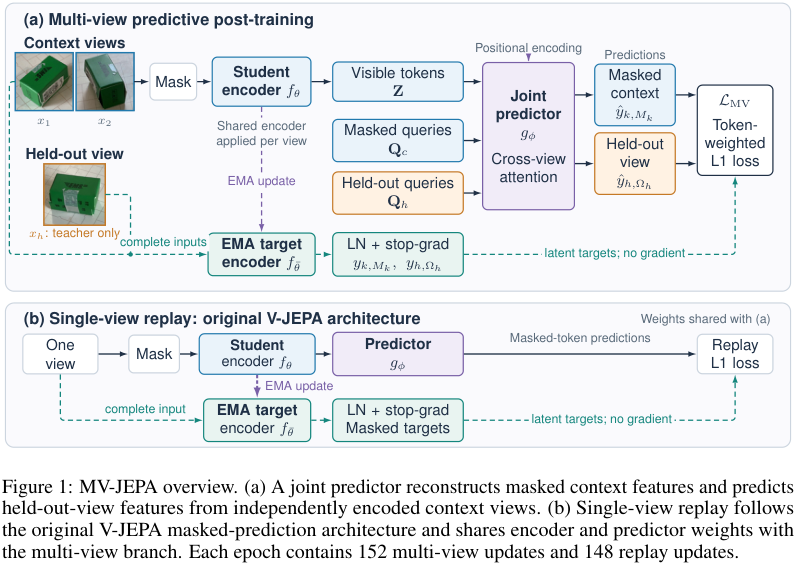

# MV-JEPA: Post-Training Video Encoders for Cross-View Understanding

[English](README-en.md)

> L1策略/训练连线组件，不是完整论文复现。完整实验：成本过高，不复现（审查 DONE）。

## 论文信息

| 字段 | 内容 |
| --- | --- |
| 论文链接 | [arXiv:2611.25172v1](https://arxiv.org/abs/2611.25172v1); [fixed PDF](https://arxiv.org/pdf/2611.25172v1) |
| 公司 / 机构 / 学校 | Yangchen Zhao: University of Minnesota, Twin Cities (fixed-v1 first-author byline) |
| 首次公开日期 | 2026-11-18T20:58:38Z; arXiv announcement2026-11-20; selected2026-11-21, not a new first release today |
| 原作者开源代码 | 固定v1及本轮有限公开仓库检索未找到可核验的论文专用作者代码；不把通用依赖或无关同名仓库当作开源实现。 |
| 本地 adapter / 稳定键 | `mv-jepa`; `adapter: null`; not Evolve-integrated |
| 本地复现代码目录 | `src/auto_research/foundation_models/mv_jepa.py` |

## 原始论文总结

### 背景与主要改动

MV-JEPA直接后训练已有JEPA视频编码器，强化不同摄像头视角之间的对象/时刻对应。共享student分别编码各context view的可见token；联合predictor利用所有context特征，既重建被mask的context位置，又预测一个完全held-out视图。held-out图像/特征从不进入student或predictor，只提供teacher目标；推理仍可独立编码单视角。



<!-- paper-figure:start -->
### 原论文关键图

[](https://arxiv.org/pdf/2611.25172v1#page=3)

图片来自[原论文](https://arxiv.org/pdf/2611.25172v1#page=3)第3页，版权归原作者所有；原图及图注已视觉核对，无科学内容编辑。[裁剪与SHA256](assets/provenance.json)。图示是作者完整方法，不是本地诊断结果。
<!-- paper-figure:end -->

### 核心公式

$$
\mathcal L_{MV}=\frac{\sum_k\sum_{p\in M_k}D^{-1}\|\hat y_{k,p}-\operatorname{sg}(y_{k,p})\|_1+\sum_{p\in\Omega_h}D^{-1}\|\hat y_{h,p}-\operatorname{sg}(y_{h,p})\|_1}{\sum_k|M_k|+|\Omega_h|},\qquad\bar\theta\leftarrow0.99925\bar\theta+0.00075\theta.
$$

完整context和held-out由EMA teacher编码，经逐token LayerNorm并stop-gradient。context视图分配互异随机view ID，held-out使用专属ID；masked-context和held-out使用两种不同mask embedding。Eq4对masked-context和全部held-out目标token等权，先逐example归一化，再对batch取均值，不能按view等权或全batch微平均。每epoch随机打散152次多视图与148次原始单视图replay，共享online encoder和predictor；optimizer后按0.99925更新teacher。

### 论文离线与线上效果

作者V-JEPA2-L后训练后，ABO Recall@1从52.82%到62.18%（+9.36个百分点），Ego-Exo4D六候选moment检索从30.11%到44.75%（+14.64个百分点）。这些是冻结真实视频encoder的原文评测，不是本地tiny token模型的准确率；相对百分比和百分点不可混用。原文还报告迁移和多种冻结probe，未报告生产线上A/B。

## 本地复现

### 数据协议与代码映射

实现真实小型shared self-attention encoder、独立context编码、联合predictor、两种query、互异view ID、teacher-only held-out、Eq4损失、共享单视图replay和显式EMA。输入为人工构造token特征，不是像素，不加载V-JEPA权重；位置编码是声明过的tiny一维正弦码，不冒充原生时空position。没有八block视频mask器、数据裁剪/解码、V-JEPA2.1多层5632维监督或visible距离加权、完整训练和真实检索。诊断检查隔离与梯度，不是视觉能力或Evolve证据。

```bash
PYTHONPATH=src python -c 'from auto_research.foundation_models.mv_jepa import diagnostic; print(diagnostic(42))'
PYTHONPATH=src python -m pytest tests/test_nov21_mv_jepa.py -q
```

源绑定的实际诊断由本批runner单独记录；计数、loss与梯度负控不是模型准确率或吞吐。缺少真实CUDA回执不能算通过，不宣称能力提升或Evolve晋级。

### 同主题比较与边界

Time-JEPA用物理时序作额外训练目标，在同一online encoder上执行masked潜变量预测和unmasked物理态回归；MV-JEPA用另一个摄像头的latent作held-out目标，并让联合predictor从多个独立context视图推断。两者都不能把训练目标喂回推理输入，但MV-JEPA的跨view query不是Time-JEPA的传感器head；重放保持表征和物理时序对齐也是不同验收。

### 高成本完整实验

正文明确V-JEPA2-L使用16帧256×256输入，多视图batch48/replay24、30epoch即9000updates，在单RTX PRO6000 Blackwell约18小时；另有MVImgNet2.0、Ego-Exo4D与ImageNet/Kinetics/SSv2重放及大量probe。按单A100/A30或Mac预算，完整实验成本过高，不复现，不做昂贵试跑。只验收8宽tiny token机制，预期三seed小于30秒，无模型/数据下载或API；CUDA结果须等本批真实GPU回执，不以CPU测试代替。

高成本完整实验为审查 DONE / 不复现，终态且不自动重试；不能借用其他论文的运行回执验收本页实现。
