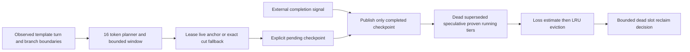
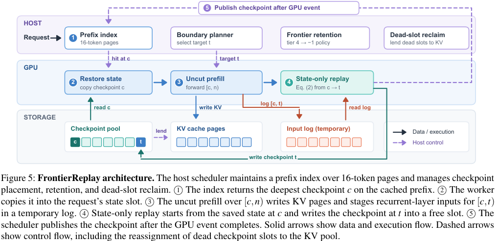

<!-- source-sha256: 045606d01bae6c42450d164dd7e2d22553327ebfb1c5ad0fa1552d0c55fb77a8 -->
# FrontierReplay: Split-Free Exact Prefix Caching for Hybrid Language Models

[简体中文](README.md)

> L1 host-policy/token-wiring component; not a complete paper reproduction. High-cost full experiments are not reproduced (review DONE).

## Paper information

| Field | Value |
| --- | --- |
| Paper link | [arXiv:2611.26020v1](https://arxiv.org/abs/2611.26020v1); [fixed PDF](https://arxiv.org/pdf/2611.26020v1) |
| Company / institution / school | Zekun Wang: Beijing Institute of Technology (fixed-v1 first-author byline) |
| Original publication date | 2026-11-19T12:34:25Z; arXiv announcement2026-11-20; selected2026-11-21, not a new first release today |
| Original author code | No verifiable paper-specific author code found in fixedv1 or this finite repository search; generic dependencies and same-name unrelated repositories are not author releases. |
| Local adapter / key | `frontier-replay`; `adapter: null`; not Evolve-integrated |
| Local code directory | `src/auto_research/foundation_models/frontier_replay.py` |

## Original paper summary

### Background and main changes

Attention KV is reusable by page, but hybrid recurrent state can resume only at an exactly saved position. FrontierReplay plans checkpoints from observed template-stable ends, finished turns and branch junctions. Native prefill remains uncut; short-window state-only replay later materializes exact states. Retention protects active anchors and proven branches instead of relying only on historical frequency.



<!-- paper-figure:start -->
### Key original figure

[](https://arxiv.org/pdf/2611.26020v1#page=6)

Original fixed-v1 PDF crop, page6; copyright belongs to the authors. Visually checked, with no scientific-content edits. [Crop/provenance](assets/provenance.json). The figure illustrates the author's full method, not the local diagnostic.
<!-- paper-figure:end -->

### Core formula

$$
\mathrm{tier}(c)\in\{-1,0,1,2,3,4\},\quad c_{\mathrm{evict}}=\arg\min_{c\in\mathcal E}(\mathrm{tier}(c),\widehat{\mathrm{lost}}(c),\mathrm{lastUsed}(c)),\qquad r\le\min(16,2d,C-C_{\min}).
$$

Section4.3 uses16-token pages. Native chunk ends must already be16-aligned: silently rounding them down would invent an exposed state. Completed turns may use the last page passed during decode, while structural targets may be rounded down and still require replay. Branch depths are at least256, and the replay window is1024tokens. Missing live anchors or log pages force an exact cut. Falcon-H1 never saves/restores below1568tokens. Section4.4 tiers are dead−1, superseded0, natural1, unused template/turn2, proven3 and running4. Repeated restores by one request do not prove reuse. A checkpoint becomes visible only after completion; failed or pending states cannot hit, and leases protect in-use anchors. Long-prefix protection selects the deepest natural checkpoint within one prefill budget before the stable end, at depth at least4096.

### Paper results

The authors compare Qwen3.5-9B and Falcon-H1-7B under vLLM0.30 on an A80080GB with a32GiB combined cache, across chat, agent, document-QA and tree-search traces. Reported exact-cache goodput is1.11–4.26times vLLM and median TTFT falls16–89%. These are native serving measurements, not timings of the local CPU policy. No production online A/B is reported. The27B/34B experiments additionally use two-way tensor parallelism.

## Local reproduction

### Data protocol and code mapping

A CPU-only host-policy component implements observed-boundary planning, explicit pending/completion publication, leases, tiered admission/eviction, long-prefix protection and a sixteen-request reclaim decision. The caller supplies KV residency, observed progress, stable ends and non-self eviction signals; there is no autonomous service or user-log observation. Slots contain synthetic token-prefix metadata, not model state. No GDN/Mamba replay kernel, precision-rounding bitmask, vLLM, CUDA event, VMM or actual memory lending is implemented. This is not exact CUDA replay, serving integration or a throughput reproduction.

```bash
PYTHONPATH=src python -c 'from auto_research.foundation_models.frontier_replay import diagnostic; print(diagnostic(42))'
PYTHONPATH=src python -m pytest tests/test_nov21_frontier_replay.py -q
```

The batch runner records source-bound diagnostics separately. Counts, loss and gradient controls are not model accuracy or throughput. A missing real CUDA receipt is not a pass; no capability or Evolve promotion is claimed.

### Same-topic comparison and boundaries

ReplaySSM reduces per-token matrix-state writes during decoding/speculation through input caching, output-only reads and acceptance rollback. FrontierReplay instead materializes exact checkpoints at structural boundaries for subsequent prefill and decides which states remain useful. Periodic refresh and split-precision anchors are not conversation-frontier retention. Existing standalone Triton evidence for local ReplaySSM cannot certify this host-policy component; the two input logs are not interchangeable.

### High-cost full experiments

The complete study spans five4B–34B models, four long-context workloads, multiple baseline/load/SLO sweeps and native Triton/vLLM integration. The27B/34B runs explicitly require two-way tensor parallelism, and some points have three paired runs. The complete campaign is too expensive for routine single-A100/A30 or Mac reproduction. Only CPU policy diagnostics are budgeted below10seconds across three seeds, without model/data downloads, APIs or native serving. This is a budget estimate, not measured full-experiment time.

High-cost full experiments are review DONE / not reproduced, terminal and not automatically retried. No result from another paper certifies this implementation.
