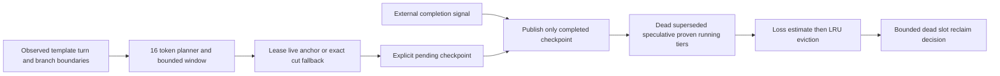
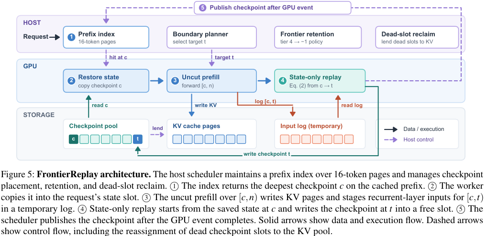

# FrontierReplay: Split-Free Exact Prefix Caching for Hybrid Language Models

[English](README-en.md)

> L1策略/训练连线组件，不是完整论文复现。完整实验：成本过高，不复现（审查 DONE）。

## 论文信息

| 字段 | 内容 |
| --- | --- |
| 论文链接 | [arXiv:2611.26020v1](https://arxiv.org/abs/2611.26020v1); [fixed PDF](https://arxiv.org/pdf/2611.26020v1) |
| 公司 / 机构 / 学校 | Zekun Wang: Beijing Institute of Technology (fixed-v1 first-author byline) |
| 首次公开日期 | 2026-11-19T12:34:25Z; arXiv announcement2026-11-20; selected2026-11-21, not a new first release today |
| 原作者开源代码 | 固定v1及本轮有限公开仓库检索未找到可核验的论文专用作者代码；不把通用依赖或无关同名仓库当作开源实现。 |
| 本地 adapter / 稳定键 | `frontier-replay`; `adapter: null`; not Evolve-integrated |
| 本地复现代码目录 | `src/auto_research/foundation_models/frontier_replay.py` |

## 原始论文总结

### 背景与主要改动

混合模型的attention KV可按页复用，但递归状态只在保存过的精确位置恢复。FrontierReplay先根据已观察到的模板稳定尾、已完成turn和分叉点规划检查点；原生prefill不断开，之后只重放短窗递归输入生成精确状态。保留策略优先保护仍在执行的请求锚点和已证明可复用的分叉，而非只看历史频率。



<!-- paper-figure:start -->
### 原论文关键图

[](https://arxiv.org/pdf/2611.26020v1#page=6)

图片来自[原论文](https://arxiv.org/pdf/2611.26020v1#page=6)第6页，版权归原作者所有；原图及图注已视觉核对，无科学内容编辑。[裁剪与SHA256](assets/provenance.json)。图示是作者完整方法，不是本地诊断结果。
<!-- paper-figure:end -->

### 核心公式

$$
\mathrm{tier}(c)\in\{-1,0,1,2,3,4\},\quad c_{\mathrm{evict}}=\arg\min_{c\in\mathcal E}(\mathrm{tier}(c),\widehat{\mathrm{lost}}(c),\mathrm{lastUsed}(c)),\qquad r\le\min(16,2d,C-C_{\min}).
$$

正文§4.3使用16-token页；native chunk end必须已经16对齐，不能静默向下取整来虚构该位置已有状态。完成turn可按原文取decode已经经过的最后页边界，结构目标仍可向下对齐后请求回放。分叉至少256token，回放窗最多1024token；缺少活锚点/日志页则退化为exact cut。Falcon-H1不在1568token以下保存或恢复状态。§4.4分层为dead=-1、superseded=0、natural=1、未用template/turn=2、proven=3、running=4；两次来自同一request的restore不能晋升proven。只有完成事件后才公开新检查点，失败/未完成状态不能命中；lease保护正在用的锚点。长前缀额外保护稳定尾之前一个prefill预算内、深度至少4096的最深natural检查点。

### 论文离线与线上效果

作者在vLLM0.30、A80080GB、32GiB联合缓存预算下比较Qwen3.5-9B与Falcon-H1-7B，覆盖聊天、Agent、文档问答和树搜索。报告精确缓存相对vLLM的goodput为1.11至4.26倍，median TTFT降低16%至89%；这些是作者原生完整serving实验，不是本地CPU调度器速度。没有生产线上A/B。27B/34B另用双卡张量并行。

## 本地复现

### 数据协议与代码映射

实现纯CPU host-policy组件：观察边界规划、显式pending/completion发布、lease、分层准入/驱逐、长前缀保护和每16请求的回收决策。KV驻留、已观察progress、稳定尾与非自身驱逐信号均由调用方显式提供；没有自主观察真实服务或用户日志。状态槽只是合成token前缀元数据，不是模型状态。没有GDN/Mamba回放kernel、舍入bitmask、vLLM、CUDA事件、VMM或实际内存借出，因此不能称精确CUDA重放、服务接入或吞吐复现。

```bash
PYTHONPATH=src python -c 'from auto_research.foundation_models.frontier_replay import diagnostic; print(diagnostic(42))'
PYTHONPATH=src python -m pytest tests/test_nov21_frontier_replay.py -q
```

源绑定的实际诊断由本批runner单独记录；计数、loss与梯度负控不是模型准确率或吞吐。缺少真实CUDA回执不能算通过，不宣称能力提升或Evolve晋级。

### 同主题比较与边界

ReplaySSM主要减少decode/投机时的逐token矩阵状态写回，把输入缓存、output-only读取和接受回滚联动；FrontierReplay主要为下一次prefill的结构边界补造精确检查点，并管理哪些状态值得保留。前者的周期刷新和高低精度anchor不是后者的会话frontier保留策略。本地ReplaySSM已有独立Triton证据，但不能把那份执行回执借给本页的host策略，更不能把两种输入日志视为可互换。

### 高成本完整实验

完整论文包含4B至34B五种模型、四类长上下文轨迹、多基线负载/SLO扫点、原生Triton和vLLM集成；27B/34B明确双卡张量并行，部分点为三次配对运行。单A100/A30或Mac不适合日常重跑完整矩阵，直接成本过高不复现。仅纯CPU策略诊断预期三seed合计小于10秒，无模型/数据下载、API或原生serving进程；该时间是预算估计，不是完整实验实测。

高成本完整实验为审查 DONE / 不复现，终态且不自动重试；不能借用其他论文的运行回执验收本页实现。
