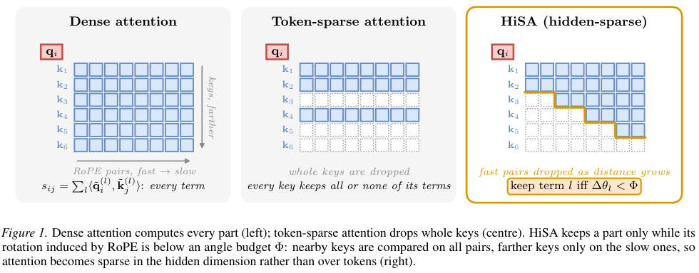

<!-- source-sha256: 5dce7b6058eed71dee471347b54c680de28be219743ffa138cc6453357037d47 -->
# HiSA: Sparsifying the Hidden Dimension of RoPE Attention in LLMs

[简体中文](README.md)

> **L1 reference component, diagnostic only**. Full experiment: **high cost, not reproduced (review DONE)**.

## Paper information

| Field | Value |
| --- | --- |
| Paper link | [arXiv:2611.26363v1](https://arxiv.org/abs/2611.26363v1); [fixed PDF](https://arxiv.org/pdf/2611.26363v1) |
| Company / institution / school | Ambroise Borbely: EPFL / Swiss Data Science Center (EPFL and ETH Zurich) (fixed-v1 byline) |
| Original publication date | 2026-11-19T16:31:46Z (arXiv v1); announced2026-11-20 |
| Original source code | [https://github.com/ambroise-b/hisa](https://github.com/ambroise-b/hisa); Apache-2.0; revision `6224a46e7e439385ce432ce3f600afb88fb1e5a2` |
| Local adapter / key | `hisa`; `adapter: null`; not Evolve-integrated |
| Local reproduction code directory | `src/auto_research/foundation_models/hisa_components.py` |

## Original paper summary

### Background and principal changes

HiSA retains selected RoPE frequency pairs inside each query-key dot product rather than selecting whole tokens first. Nearby keys retain more pairs; distant keys retain slower pairs. Q/K projections stay unchanged, and positions, base and angle budget determine the static rule.

[Fixed-v1 primary source](https://arxiv.org/pdf/2611.26363v1)

~~~mermaid
flowchart LR
 Q[Pre RoPE Q and K] --> R[Position rotations]
 P[Absolute token positions] --> M[Unwrapped distance times frequency below Phi]
 R --> S[Sum only admitted pair scores]
 M --> S
 S --> N[Fixed sqrt d normalization]
 N --> C[Causal and within reach mask]
 C --> O[Softmax and original values]
~~~

<!-- paper-figure:start -->
### Original paper figure

[](https://arxiv.org/pdf/2611.26363v1#page=2)

Original PDF crop, no semantic editing; author evidence, not a local result. [Provenance](assets/provenance.json). Copyright remains with the authors.
<!-- paper-figure:end -->

### Core equations

$$
s_{ij}=d^{-1/2}\sum_{l=0}^{d/2-1}\mathbf 1[0\le(i-j)\theta_l<\Phi]\langle R_{i\theta_l}q_i^{(l)},R_{j\theta_l}k_j^{(l)}\rangle,\quad\theta_l=b^{-2l/d}.
$$

The rule compares the unwrapped relative angle strictly with Phi, not its remainder modulo2pi. Scaling stays1/sqrt(d), not the number of surviving dimensions. A key with no active pair must leave softmax; a zero logit would still attract probability. Future keys are masked. Infinite Phi recovers dense RoPE. Local positions are nonnegative signed-int64-range integers. uint64 bounds are checked before casting; other integers are converted before subtraction. Differences between nonnegative int64 values cannot overflow, and uint8 wraparound must not expose future keys.

### Paper offline and online results

For d64, base1e4 and90degrees, paper Table7 retains29.3% of causal4K QK multiply-adds. Table8 gives61.9% ideal per-pair KV storage, versus66.5% with actual chunk storage. QK work, cache size and end-to-end speed are different quantities. No production A/B is reported.

## Local reproduction

### Data protocol and code mapping

Implements exact Eq3 as a small fp32/fp64 tensor reference, causal/out-of-reach masking, positioned decoding parity and gradient controls. It materializes pair scores, not a sparse kernel. There is no FA3 block approximation, GQA cache allocator, trained decoder or throughput optimization. Frozen real-GPU validation is separate; CPU tests do not substitute for it.

```bash
PYTHONPATH=src python -c 'from auto_research.foundation_models.hisa_components import diagnostic; print(diagnostic(42))'
PYTHONPATH=src python -m pytest tests/test_nov20_hisa_components.py -q
```

Generated tensors are diagnostics, not public capability benchmarks. CPU tests do not fulfill the CUDA gate.

### Same-topic comparison and boundaries

RoFormer keeps every RoPE pair and encodes relative position by rotation. HiSA additionally removes pair contributions according to distance and frequency. This changes scoring and does not prove that switching an existing checkpoint without training preserves quality. Whole-token eviction cannot express retaining only a key's slow-frequency pairs.

### High-cost full experiment

The paper trains135M/360M models from scratch on2.7B/7.24B tokens using one H200 per run, with tuning, long-context continuation, a three-seed substudy and dense controls. The complete campaign is outside this short single-A100/A30 budget. The tensor component is expected to take under30seconds across three seeds, with no model/data downloads or API calls.

Configuration-based cost judgment, not measured full-run time. **High cost, not reproduced (review DONE)**; no automatic retry or implementation queue, no capability improvement or Evolve promotion claim.
