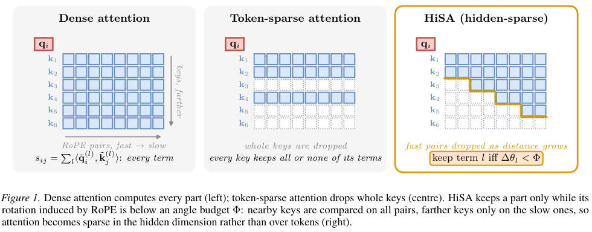

# HiSA: Sparsifying the Hidden Dimension of RoPE Attention in LLMs

[English](README-en.md)

> **L1参考组件，仅机制诊断**. 完整实验：**成本过高，不复现（审查 DONE）**。

## 论文信息

| Field | Value |
| --- | --- |
| 论文链接 | [arXiv:2611.26363v1](https://arxiv.org/abs/2611.26363v1); [fixed PDF](https://arxiv.org/pdf/2611.26363v1) |
| 公司 / 机构 / 学校 | Ambroise Borbely: EPFL / Swiss Data Science Center (EPFL and ETH Zurich) (fixed-v1 byline) |
| 首次公开日期 | 2026-11-19T16:31:46Z (arXiv v1); announced2026-11-20 |
| 原作者开源代码 | [https://github.com/ambroise-b/hisa](https://github.com/ambroise-b/hisa); Apache-2.0; revision `6224a46e7e439385ce432ce3f600afb88fb1e5a2` |
| 本地 adapter / key | `hisa`; `adapter: null`; not Evolve-integrated |
| 本地复现代码目录 | `src/auto_research/foundation_models/hisa_components.py` |

## 原始论文总结

### 背景与主要改动

HiSA不先筛token，而是对每个query-key点积只保留尚未超过角度预算的RoPE频率对。近处key保留更多分量，远处仅保留慢频分量；Q/K投影不变，规则只由位置、RoPE base和预算决定。

[Fixed-v1 primary source](https://arxiv.org/pdf/2611.26363v1)

~~~mermaid
flowchart LR
 Q[Pre RoPE Q and K] --> R[Position rotations]
 P[Absolute token positions] --> M[Unwrapped distance times frequency below Phi]
 R --> S[Sum only admitted pair scores]
 M --> S
 S --> N[Fixed sqrt d normalization]
 N --> C[Causal and within reach mask]
 C --> O[Softmax and original values]
~~~

<!-- paper-figure:start -->
### 原论文关键图

[](https://arxiv.org/pdf/2611.26363v1#page=2)

原始PDF裁切，没有语义编辑；是作者方法/结果，不是本地证据。[页码、裁切与SHA256](assets/provenance.json)，版权归原作者。
<!-- paper-figure:end -->

### 核心公式

$$
s_{ij}=d^{-1/2}\sum_{l=0}^{d/2-1}\mathbf 1[0\le(i-j)\theta_l<\Phi]\langle R_{i\theta_l}q_i^{(l)},R_{j\theta_l}k_j^{(l)}\rangle,\quad\theta_l=b^{-2l/d}.
$$

使用未绕回的相对旋转量，严格小于Phi，不是对2pi取模后比较。分母始终为sqrt(d)，不按剩余维数重标定。没有任何频率对仍有效的key必须退出softmax，而不是留下零logit；因果未来key也必须屏蔽。Phi无穷时恢复dense RoPE。本地位置限定为非负int64范围，uint64在转换前检查上界，其余整数转int64后验证；两个非负int64位置的差在安全范围内，不允许uint8相减回绕造成未来泄漏。

### 论文离线与线上效果

原文表7在d=64、base=1e4、Phi=90度时，4K因果QK乘加保留29.3%；表8对应理想逐pair KV比例61.9%，实际按chunk存储为66.5%。这些是不同口径，不能把QK运算节省直接称为训练或端到端加速。未报告生产线上A/B。

## 本地复现

### 数据协议与代码映射

实现精确Eq3的fp32/fp64小张量参考、因果/越reach屏蔽、带绝对位置的decode对齐与梯度负控。显式物化每pair分数，不是稀疏kernel；不实现FA3 block近似、GQA存储压缩、decoder训练、真实KV allocator或吞吐优化。GPU验收另由主运行器冻结后实跑，不以CPU单测代替。

```bash
PYTHONPATH=src python -c 'from auto_research.foundation_models.hisa_components import diagnostic; print(diagnostic(42))'
PYTHONPATH=src python -m pytest tests/test_nov20_hisa_components.py -q
```

生成小张量不是公开能力benchmark；CPU单测不完成CUDA验收。

### 同主题比较与边界

RoFormer保留所有RoPE二维对，使用相对旋转来编码距离；HiSA额外根据距离和频率删掉部分点积项。这是打分规则变化，不等于在既有checkpoint上无训练切换后仍保留能力。与只删整token的策略也不同，后者不能表达同一key只保留慢频分量。

### 高成本完整实验

原文从头训练135M/360M模型，分别2.7B/7.24B token，单H200每run，并包含学习率选择、长上下文续训、三seed子研究和dense对照。完整训练矩阵超出本轮单A100/A30短预算；仅小张量组件预期三seed合计小于30秒，零模型/数据下载、零API。

这是依据原文配置的成本判断，不是完整实验实测耗时。**成本过高，不复现（审查 DONE）**；不自动重试、不加入实现队列，不声明能力提升或Evolve晋级。
