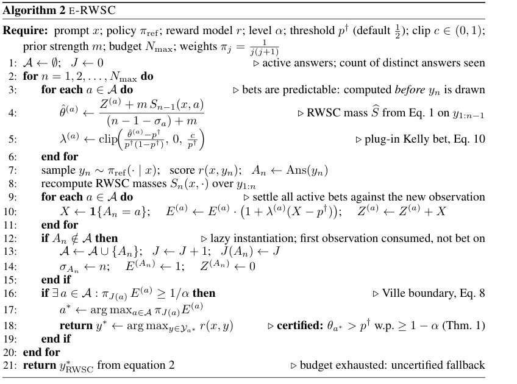

# Sequential Anytime Valid Tests for Efficient Inference-Time Alignment

<!-- source-sha256: 6f7990a337b89868094a0642455db0f632db53c314f586f5bb8d5bd885496a30 -->

[简体中文](README.md)

> **L1 mechanism component, diagnostic only; not LLM capability or a full paper reproduction.** CPU only, with no advertised CUDA path or Evolve-promotion evidence. High-cost full experiments are not reproduced (review DONE).

## Paper information

| Field | Value |
| --- | --- |
| Paper | [arXiv:2611.26413v1](https://arxiv.org/abs/2611.26413v1); [fixed-v1 text](https://arxiv.org/html/2611.26413v1) |
| First author / institution | **Vishesh Kumar Singh**, **Indian Institute of Technology Kanpur** |
| Original publication | **2026-11-19T17:00:42Z**; selected from the overlap pool on2026-11-21, not a Nov20/21 first release |
| Original author code | As of2026-11-21, no verified paper-specific author code repository was found in the fixed-v1 author entry or full text; cited projects do not establish release of this method. |
| Local adapter / key | `e-rwsc`; `adapter: null`, independent CPU component |
| Local code | `src/auto_research/foundation_models/e_rwsc.py` |

## Original paper

### Background and method

Fixed-N Best-of-N spends the full budget even on easy queries. A leader-tracking SPRT repeatedly changes its hypotheses and cannot inherit Wald's error guarantee. e-RWSC maintains an e-process per answer and makes predictable Kelly bets using past reward-weighted self-consistency masses and post-appearance agreement counts. The first appearance only initializes unit capital; it is not evidence from a success forced by the definition. Every old answer's stake is computed before the next response or reward, and leader changes do not reset capital.

Answers receive summable first-appearance-rank weights1/[j(j+1)]. A certificate is issued only when weighted capital reaches1/alpha, returning the highest-reward response in that answer cluster. Exhausting Nmax without a certificate falls back to explicitly uncertified RWSC. The guarantee assumes iid draws from a fixed policy and certifies probability above a threshold, not factual correctness. Rewards affect betting speed rather than the certified event; bad rewards may still harm selection or fallback quality.

### Key original figure

[](https://arxiv.org/pdf/2611.26413v1#page=13)

Original Algorithm 2, complete screenshot from fixed-v1 PDF page13; copyright belongs to the authors. Visually checked, without scientific-content changes. [Original source](https://arxiv.org/pdf/2611.26413v1#page=13); [crop and SHA256 provenance](assets/provenance.json). This depicts the authors' method, not local results.

### Core formula

$$
E_n^{(a)}=\prod_{i=\sigma_a+1}^{n}\left[1+\lambda_i^{(a)}\left(\mathbf 1\{A_i=a\}-p^\dagger\right)\right],\quad E_{\sigma_a}^{(a)}=1,\qquad \pi_j=\frac{1}{j(j+1)},\quad \pi_{J(a)}E_n^{(a)}\ge\frac{1}{\alpha}.
$$

Equation10 estimates theta from the past prefix and clips the Kelly stake to[0,c/p], with c<1 preventing one disagreement from wiping out capital. This implementation uses log capital and stable softmax. Zero reward variance uses uniform response weights, an explicit numerical convention. Only majority thresholds0.5<=p<1 are supported; exact ties use first appearance. None of these conventions makes the certificate evidence of factual correctness.

### Reported results

For MATH500 with Qwen2.5-3B-Instruct, ArmoRM-8B and Nmax512, AppendixD Table6 reports e-RWSC overall accuracy78.0%, certified-subset accuracy94.5% and196.1 mean candidates; fixed-budget BoN uses512 candidates and scores69.8%. The certified subset and full set have different denominators;94.5% is not overall accuracy. These are paper results, not local measurements. No production online A/B is reported.

### Relationship to existing methods

LLM Stochasticity distinguishes marginal distribution fit from temporal dependence. e-RWSC requires iid responses from a fixed policy; a balanced answer histogram or a prompt asking for randomness does not establish that assumption. Statistical diagnostics can expose some dependence but do not prove every certification assumption. e-RWSC also does not establish factual truth: even genuinely independent draws from a policy concentrated on a wrong answer can certify that majority quickly.

## Local implementation

### Data protocol and code mapping

Pure-standard-library, CPU-only RWSC aggregation, prefix-predictable betting, per-answer log capital and first-appearance weights, skipped first appearances, certified stopping and explicit uncertified budget fallback. Diagnostics use declared synthetic answer/reward streams to check causality, no reset on leader changes, certification of a wrong but concentrated answer, extreme-score softmax and uniform ties. No LLM, reward model, answer extractor, public benchmark run or Evolve promotion is provided; synthetic streams are not model outputs.

```bash
PYTHONPATH=src python -c 'from auto_research.foundation_models.e_rwsc import diagnostic; print(diagnostic(42))'
PYTHONPATH=src python -m pytest -q tests/test_nov21_e_rwsc.py
```

### Results, controls and limits

The unified three-seed CPU artifact is[`metrics/component-cpu-seeds42-44.json`](metrics/component-cpu-seeds42-44.json). It checks mechanism definitions and controls, with no data/checkpoint download, model training or benchmark-gain claim. Unit tests are not capability evaluation. The public CPU path rejects`device="cuda"`; no GPU validation is fabricated. Any future advertised CUDA path requires separate real A100/A30 validation.

### High-cost full experiment

AppendixD measures about3,657.7 GPU seconds per query for512 fixed candidates and about1,400.8 for e-RWSC on the authors' RTX6000Ada, plus a multi-model, multi-reward-model, multi-benchmark matrix. These are measurements on their hardware, not A100/A30 time estimates. Full generation and scoring are not reproduced. Only the cheap CPU stopping kernel runs; no3B/8B or larger models are downloaded.

**High cost: not reproduced (review DONE).** No lengthy probe, expanded training or automatic retry queue. Available resources are one A100 or A30, or a local Mac. This batch runs only CPU components capped at30 seconds per seed, without assuming multiple GPUs or simultaneous access to both hosts.
