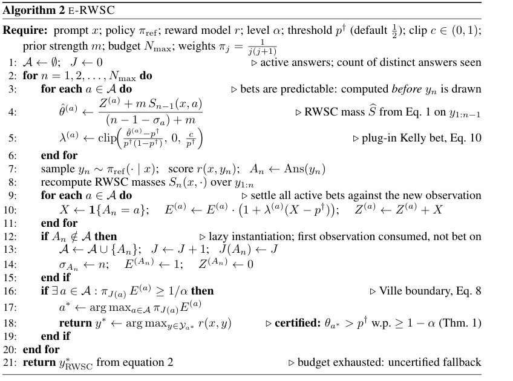
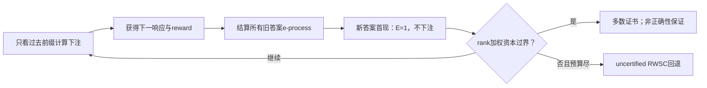

# Sequential Anytime Valid Tests for Efficient Inference-Time Alignment

[English](README-en.md)

> **L1核心机制组件，diagnostic only；不是LLM能力或完整论文复现。** 纯CPU，无CUDA宣传路径；不作为Evolve晋级证据。完整实验成本过高，不复现（审查 DONE）。

## 论文信息

| 字段 | 内容 |
| --- | --- |
| 论文链接 | [arXiv:2611.26413v1](https://arxiv.org/abs/2611.26413v1)；[固定v1原文](https://arxiv.org/html/2611.26413v1) |
| 公司 / 作者机构 | 一作 **Vishesh Kumar Singh**；**Indian Institute of Technology Kanpur** |
| 首次公开日期 | **2026-11-19T17:00:42Z**；本轮2026-11-21为重叠池新选题，不是11月20/21新首发 |
| 原作者开源代码 | 截至2026-11-21，固定v1作者入口与全文未找到已核实的本篇方法源码仓库；引用项目不等于本篇开源。 |
| 本地 adapter / key | `e-rwsc`；`adapter: null`，独立CPU组件 |
| 本地复现代码 | `src/auto_research/foundation_models/e_rwsc.py` |

## 原始论文总结

### 背景与主要改动

固定N的Best-of-N对容易题也花满预算；只追踪当前领先答案的SPRT会反复换假设，不能直接沿用Wald错误保证。e-RWSC按答案分别保留e-process，以过去响应的reward-weighted self-consistency质量和首现后的匹配次数构造可预测Kelly下注。新答案第一次出现只登记为单位资本，不把这个由定义强制成功的样本计作证据。所有旧答案的下注先于下一条响应/奖励计算，领先者改变也不重置资本。

答案按首现rank分配可求和权重1/[j(j+1)]；加权资本跨过1/alpha时才发证，选该答案簇内奖励最高的响应。Nmax用尽而无证书时退回RWSC，必须保留uncertified。证明假定固定政策的iid抽样，证书仅说明该答案在政策分布的概率超过阈值，不说明真实正确。奖励影响下注速度而不改变被认证对象；坏reward仍可能使选择/回退表现差。

<!-- paper-figure:start -->
### 原论文关键图

[](https://arxiv.org/pdf/2611.26413v1#page=13)

图片来自[原论文](https://arxiv.org/pdf/2611.26413v1#page=13)第13页Algorithm 2完整截图，版权归原作者所有；已视觉核对，无科学内容改动。[原图裁剪与SHA256](assets/provenance.json)。图示属于作者方法，不是本地运行结果。
<!-- paper-figure:end -->



### 核心公式

$$
E_n^{(a)}=\prod_{i=\sigma_a+1}^{n}\left[1+\lambda_i^{(a)}\left(\mathbf 1\{A_i=a\}-p^\dagger\right)\right],\quad E_{\sigma_a}^{(a)}=1,\qquad \pi_j=\frac{1}{j(j+1)},\quad \pi_{J(a)}E_n^{(a)}\ge\frac{1}{\alpha}.
$$

Eq.10先用过去前缀计算theta估计，再把Kelly stake裁到[0,c/p]，c<1保证一次不匹配不把资本清零。实现采用log资本和稳定softmax；零奖励方差按均匀响应权重处理，这是明确的数值约定。仅支持0.5≤p<1的多数认证，精确tie按首现顺序；这些约定不改变为正确性背书的禁令。

### 论文离线与线上效果

AppendixD Table6的MATH500、Qwen2.5-3B-Instruct与ArmoRM-8B、Nmax512配置报告e-RWSC整体accuracy78.0%、已认证子集94.5%、平均196.1候选；固定预算BoN为69.8%、512候选。已认证子集与整体分母不同，不能把94.5%当全部题的准确率；这些论文结果不是本地测量。未报告生产线上A/B。

### 与已有方法的关系

LLM Stochasticity区分边缘分布拟合与时序依赖；e-RWSC的保证需要固定政策的iid响应，不能由平衡答案直方图或“请随机回答”提示推导。前者的统计诊断可暴露某些依赖，却不能证明后者的全部假设。e-RWSC也不估计答案是否符合现实：即使输入真独立，政策总偏向错误答案时仍可快速发多数证书。

## 本地复现

### 数据协议与代码映射

纯stdlib、CPU-only的RWSC聚合、前缀可预测下注、逐答案log资本与首现权重、首次出现跳过、认证终止和显式未认证预算回退。诊断使用明确的合成答案/奖励流，检查因果顺序、领先变化不重置、错误答案也可能被认证、softmax极值和均匀tie。没有LLM、reward model、答案解析或公开benchmark运行；不把合成流叫模型输出，不接Evolve晋级。

```bash
PYTHONPATH=src python -c 'from auto_research.foundation_models.e_rwsc import diagnostic; print(diagnostic(42))'
PYTHONPATH=src python -m pytest -q tests/test_nov21_e_rwsc.py
```

### 结果、负控与边界

统一三种子CPU产物为[`metrics/component-cpu-seeds42-44.json`](metrics/component-cpu-seeds42-44.json)。这里只检查定义核与负控；没有下载数据或权重，没有训练模型或宣称benchmark收益。单元测试不能替代真实模型能力评测。公开的CPU路径显式拒绝`device="cuda"`，因此不伪造GPU验收；若未来新增CUDA宣传路径，必须另做真实A100/A30验证。

### 高成本完整实验

AppendixD在作者RTX6000Ada测量中，每题固定512候选约3657.7GPU秒、e-RWSC平均约1400.8GPU秒，另有多模型、多reward model、多基准矩阵。这是作者硬件的测量，不是本机A100/A30时间预测；完整生成/打分实验直接不复现。本轮只执行廉价CPU停止核，不下载3B/8B或更大模型。

**成本过高，不复现（审查 DONE）**。不尝试长时探针、不扩大训练、不加入自动重试队列。可用预算是一张A100或A30，或本地Mac；本轮仅运行每seed最多30秒的CPU组件，不假设多卡或两台同时可用。
