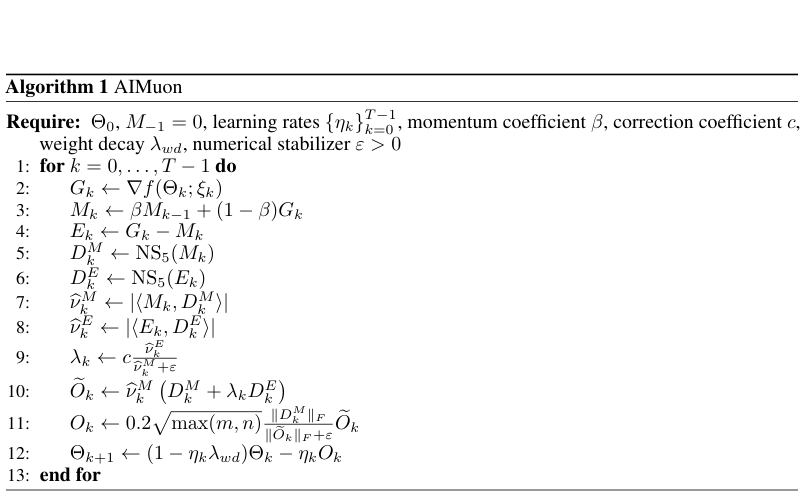

# Accelerating Muon with Spectral Residual Correction

<!-- source-sha256: dec9b4992d9408a7f103ac077db88f861e82b84c3df80684f4e96154645ca5bf -->

[简体中文](README.md)

> **L1 mechanism/scoring component, diagnostic only, not a full capability reproduction.** High-cost full experiments are not reproduced (review DONE), with no Evolve promotion.

## Paper information

| Field | Value |
| --- | --- |
| Paper | [Fixed v1](https://arxiv.org/html/2611.27077v1) |
| First author / affiliation | Zhixin Ren; Tsinghua University. Verified fixed-v1 byline. |
| Original publication | 2026-11-20T03:43:01Z; newly captured November20 first release, reviewed November23 |
| Original source code | No verified paper-specific author code was found in fixed v1 or the reviewed author entry; the cited Muon blog is not an AIMuon release. |
| Local adapter / key | `aimuon`; null adapter, independent component |
| Local code | `src/auto_research/foundation_models/aimuon.py` |

## Original paper

### Background and method

AIMuon retains ordinary EMA momentum but changes the parameter subproblem. It updates M, forms E=G−M, transforms M and E independently, and weights their directions by estimated nuclear norms. Mixing the residual before one transform is generally inequivalent because the matrix-sign map is nonlinear. Practical Algorithm1 uses two five-step BF16 Newton–Schulz approximations and absolute inner products instead of another SVD. It matches the combined Frobenius magnitude to Muon with the same M and applies decoupled weight decay. The stationarity theorem concerns the unnormalized exact matrix-sign iteration, not automatically this practical BF16 algorithm.

### Key original figure

[](https://arxiv.org/pdf/2611.27077v1#page=6)

Complete Algorithm 1 and caption from fixed-v1 page6, visually checked without scientific modification. Copyright belongs to the authors. [Source](https://arxiv.org/pdf/2611.27077v1#page=6) · [crop and fingerprint](assets/provenance.json). This is a paper figure, not local evidence.

### Core formula

$$
M=\beta M_{old}+(1-\beta)G,\quad E=G-M,\quad \widehat\nu_A=|\langle A,NS_5(A)\rangle|,\quad \widetilde O=\widehat\nu_M\left[NS_5(M)+c\frac{\widehat\nu_E}{\widehat\nu_M+\epsilon}NS_5(E)\right].
$$

Equation21 sets O=0.2√max(m,n)·||NS5(M)||F·Õ/(||Õ||F+ε), followed by Θ′=(1−ηλwd)Θ−ηO. C.2 specifies epsilon1e−12 in Eq20/21, not AdamW's1e−8. AppendixC casts to BF16, transposes tall inputs, normalizes by max(Frobenius norm,1e−7), and applies coefficients (3.4445,−4.7750,2.0315) five times. The component adds neither bias correction nor Nesterov and does not implement vector parameters, embedding treatment or a distributed optimizer.

### Reported results

Table1 reports GPT-2-small three-seed final validation loss of3.1980±0.0005 for Muon and3.1945±0.0005 for AIMuon. Table2 reports8.98%/10.05%/6.49% fewer steps to Muon's final loss across three models. These are not equal wall-clock speedups: matched-token GPT-2-medium runs take4.50h versus4.26h, and Qwen3-0.6B14.96h versus14.36h, excluding validation. No production online A/B is reported; these are not local measurements.

### Relationship to existing methods

AF-Muon addresses sparse-input/dense-output conflicts in tied embeddings through vocabulary support/cap directions and vector RMS updates without AdamW. AIMuon instead changes matrix spectral residual directions; it does not solve vocabulary support or replace AF-Muon's parameter partition. Matching magnitude removes a pure-scale explanation but does not guarantee a better direction.

## Local implementation

### Data protocol and code mapping

Only the functional matrix-parameter Algorithm1, NS5, and a20-step synthetic quadratic-matrix autograd diagnostic are implemented. Controls cover same-momentum magnitude matching, c=0 recovery of Muon, separate-versus-premixed transforms, zeros, transposition and BF16 overflow rejection. There is no LM pretraining, FineWeb reader, hyperparameter search or Evolve operator. CPU and real-A100 three-seed evidence is numerical/mechanism diagnosis, not a model capability comparison.

```bash
PYTHONPATH=src python -c 'from auto_research.foundation_models.aimuon import diagnostic; print(diagnostic(42))'
PYTHONPATH=src python -m pytest -q tests/test_nov23_aimuon.py
```

### Results, controls and limits

The three-seed CPU artifact is [mechanism diagnostics](metrics/component-cpu-seeds42-44.json). The CUDA path requires a real A100/A30 receipt; this batch validates tiny matrices without model downloads. No user conversations or private data are read. Synthetic values are not model capability, and three seeds do not qualify them for formal ranking.

### High-cost full experiment

Section4.1 trains GPT-2-small/medium and Qwen3-0.6B from scratch on8 H100s and about2.48B/6.9B/12B tokens, with independent optimizer tuning, seeds and ablations. Section4.3 timings are the authors' eight-device measurements, not single-A100 estimates. The full matrix is high-cost and not reproduced. Only8-by-12 synthetic matrices run locally under a30-second-per-seed component budget, with no model/data downloads or APIs.

**High cost: not reproduced (review DONE).** Keep the method and its limits without automatic retries or a blocked review watermark.
