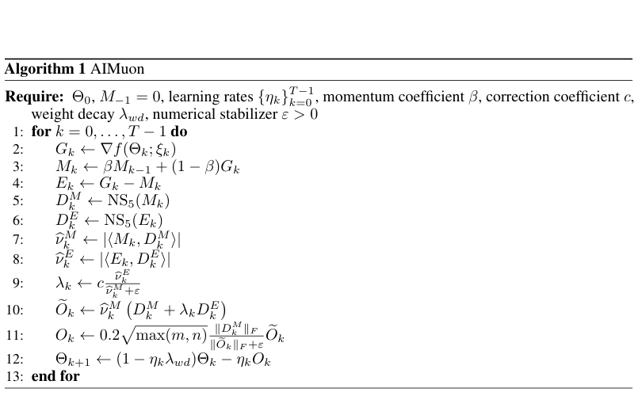

# Accelerating Muon with Spectral Residual Correction

[English](README-en.md)

> **L1机制/计分组件，diagnostic only，不是完整论文能力复现。** 高成本完整实验不复现（审查 DONE），不接Evolve晋级。

## 论文信息

| 字段 | 内容 |
| --- | --- |
| 论文链接 | [arXiv:2611.27077v1](https://arxiv.org/html/2611.27077v1) |
| 公司 / 作者机构 | 一作 **Zhixin Ren**，**Tsinghua University**；按固定v1首页署名 |
| 首次公开日期 | **2026-11-20T03:43:01Z**；11月20日首发，本轮11月23日新捕获选题 |
| 原作者开源代码 | 固定v1和本轮作者入口未找到可核验的本篇原作者源码；文中Muon博客不是AIMuon代码发布。 |
| 本地 adapter / key | `aimuon`；adapter为null，独立组件 |
| 本地复现代码 | `src/auto_research/foundation_models/aimuon.py` |

## 原始论文总结

### 背景与主要改动

AIMuon不改普通EMA动量，而改参数子问题：先更新M，再算E=G−M，分别对M与E做谱变换，以各自核范数估计决定相对权重。把残差混进动量后只做一次变换通常不等价，因为矩阵符号映射非线性。实用Algorithm1用两次五步BF16 Newton–Schulz近似，并用内积绝对值估计核范数，不做额外SVD；最后把合成步的Frobenius范数匹配到同M的Muon，权重衰减解耦。理论收敛结论针对未归一化、精确矩阵符号版本，不自动覆盖这个BF16实用算法。

<!-- paper-figure:start -->
### 原论文关键图

[](https://arxiv.org/pdf/2611.27077v1#page=6)

固定v1第6页Algorithm 1完整截图和图注，版权归原作者；已视觉核对，未改科学内容。[来源](https://arxiv.org/pdf/2611.27077v1#page=6) · [裁剪/指纹](assets/provenance.json)。这是论文方法图，不是本地结果。
<!-- paper-figure:end -->


### 核心公式

$$
M=\beta M_{old}+(1-\beta)G,\quad E=G-M,\quad \widehat\nu_A=|\langle A,NS_5(A)\rangle|,\quad \widetilde O=\widehat\nu_M\left[NS_5(M)+c\frac{\widehat\nu_E}{\widehat\nu_M+\epsilon}NS_5(E)\right].
$$

Eq21进一步设O=0.2√max(m,n)·||NS5(M)||F·Õ/(||Õ||F+ε)，再做Θ′=(1−ηλwd)Θ−ηO。C.2的Eq20/21稳定项为1e−12，不是AdamW的1e−8。AppendixC规定输入转BF16、行数大于列数时转置，按max(Frobenius范数,1e−7)归一化，五次使用系数(3.4445,−4.7750,2.0315)。本地不加入bias correction或Nesterov，不宣称一维参数、embedding、分布式优化器已实现。

### 论文离线与线上效果

Table1的GPT-2-small三seed最终validation loss为Muon3.1980±0.0005、AIMuon3.1945±0.0005；Table2达到Muon最终loss的步数减少8.98%/10.05%/6.49%（三个模型）。这不是wall-clock等比例加速：作者报告GPT-2-medium同token预算训练4.50h对4.26h，Qwen3-0.6B14.96h对14.36h，均不含验证。未报告生产线上A/B，以上不是本地结果。

### 与已有方法的关系

AF-Muon处理tied embedding上稀疏输入与稠密输出的冲突，以support/cap词表方向和一维RMS去掉AdamW；AIMuon改变的是矩阵参数的谱残差方向，不解决共享词表support问题，也不能自动替代AF-Muon全参数分工。相同步长只排除纯尺度效应，不保证新方向一定更优。

## 本地复现

### 数据协议与代码映射

仅矩阵参数的函数式Algorithm1、NS5和20步合成二次矩阵损失autograd诊断。检查相同动量的步长匹配、c=0退回Muon、独立变换不等于预混合、零矩阵、转置和BF16溢出拒绝；没有语言模型预训练、FineWeb读取、超参数搜索或Evolve算子。CPU与真实A100三seed的指标是数值/机制诊断，不是模型能力比较。

```bash
PYTHONPATH=src python -c 'from auto_research.foundation_models.aimuon import diagnostic; print(diagnostic(42))'
PYTHONPATH=src python -m pytest -q tests/test_nov23_aimuon.py
```

### 结果、负控与边界

三seed CPU产物见[机制诊断](metrics/component-cpu-seeds42-44.json)。CUDA路径必须有真实A100/A30回执；本轮只验证小矩阵，不下载模型。 不读取用户会话或私有数据；合成数值不是模型能力，不能因三个seed就进入正式排名。

### 高成本完整实验

Section4.1使用8×H100，从零训练GPT-2-small/medium和Qwen3-0.6B，约2.48B/6.9B/12B tokens，另有各优化器独立调参和多seed/消融。Section4.3训练用时是作者8卡测量，不能当作单A100估计。完整矩阵直接成本过高不复现；本地只用8×12合成矩阵，每seed预算30秒，无模型/数据下载和API。

**成本过高，不复现（审查 DONE）**；保留有价值方法和边界，不自动重试，不阻塞审查水位。
