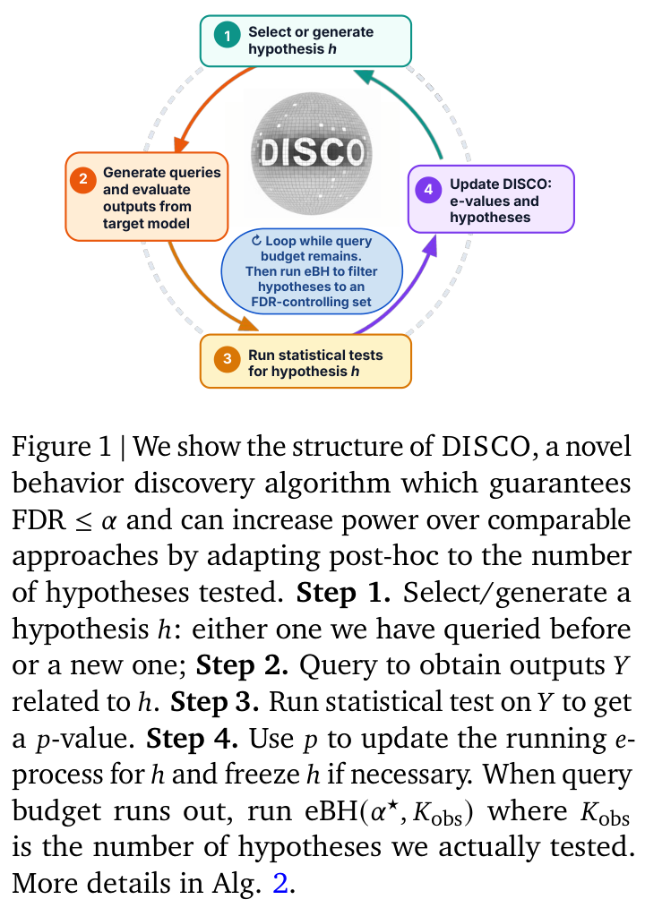
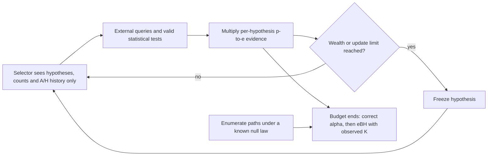

# Reliable Behavior Discovery via False Discovery Rate Control

<!-- source-sha256: 761817fd02758f3cdefae54a2375c5dbf1777ce7bf636363ea586127b9a4ca92 -->

[简体中文](README.md)

> L1 statistical component, diagnostic only; not an LLM behavior-discovery capability or complete paper reproduction. CPU-only, with no Evolve promotion. Full experiments are too expensive and not reproduced (review DONE).

## Paper information

| Field | Value |
| --- | --- |
| Paper | [arXiv:2611.27104v1](https://arxiv.org/abs/2611.27104v1); [fixed-v1 full text](https://arxiv.org/html/2611.27104v1) |
| Company / author institution | David Madras, Zi Wang, Marco Andreetto, Ken Burke, Caroline Pantofaru and Utsav Prabhu; all six authors list **Google DeepMind** |
| Original publication | **2026-11-20T04:25:13Z**, verified in the official v1 submission history; reviewed on 2026-11-23, not first published on the retrieval date |
| Author code | The paper names [google-deepmind/disco](https://github.com/google-deepmind/disco), but the entry returned HTTP404 when checked on 2026-11-23. **Accessible code and its commit were not verified**; this does not establish that the authors never released code |
| Local adapter / key | `disco`; `adapter: null`, standalone CPU statistical component |
| Local reproduction code | `src/auto_research/foundation_models/disco.py` |

## Original paper summary

### Background and main changes

Behavior discovery seeks repeatable input-output patterns rather than salient failure examples. Adaptively choosing hypotheses, querying a model and switching hypotheses after observations introduces selection bias. Controlling each individual test does not directly control FDR for the final discovery set. DISCO freezes e-processes and limits hypothesis selection to coarsened bin information, allowing final eBH to use the observed hypothesis count $K_{obs}$ rather than always weighting by a conservative predefined upper bound.

Each round generates an independent query batch for one hypothesis, obtains a valid p-value and updates its e-process. Reaching $e_{max}$ or $n_{max}$ updates freezes that hypothesis. In the binary version, the selector receives only A/H states, update counts and their histories: no raw model outputs, p-values or exact wealth. Guarantees also require a known, query-invariant null p-value distribution and memoryless sampling conditional on inputs. Replacing the denominator of an eBH helper with observed K alone is not DISCO.

<!-- paper-figure:start -->
### Key original figure

[](https://arxiv.org/pdf/2611.27104v1#page=2)

Original fixed-v1 Figure 1 and its complete caption, page 2; visually checked without scientific-content edits. Copyright belongs to the authors. [Crop and SHA256](assets/provenance.json). The figure shows the authors' complete discovery workflow; local code does not implement LLM hypothesis/query generation.
<!-- paper-figure:end -->



### Core formula

$$
E_i^h=E_{i-1}^h\,\kappa(p_i^h)^{\kappa-1},\quad E_0^h=1,\quad 0<\kappa<1,\qquad
k^*=\max\left\{k:\frac{kE^{[k]}}{\bar K}\ge\frac1\alpha\right\}.
$$

Binary-bin Eq.4 defines $E_A(n)=\mathbb E[E_n\mid\forall i\le n:E_i<e_{max}]$ and $P_H(n)=\Pr[\exists i\le n:E_i\ge e_{max}]$. Theorem 1 uses $\epsilon=\max_{n\le n_{max}}E_A(n)$ and $\delta=\bar K P_H(n_{max})$, choosing $\alpha^*=[(\alpha-\delta)/\epsilon]_0^1$ for final eBH and obtaining unconditional bound $\alpha^*\epsilon+\delta$. Here $\bar K$ is a deterministic upper bound fixed before running, not the observed K.

After termination, Theorem 2 uses $\epsilon_{post}=K_{obs}^{-1}\sum_{h:D_h=A}E_A(n_h)$ and $\delta_{post}=K_{obs}P_H(n_{max})$. Choosing $\alpha^*=[\alpha/\epsilon_{post}]_0^1$ controls FDR **conditional on no true-null exit**. The delta term quantifies failure of that condition; it must not be ignored or arbitrarily subtracted from alpha. Local output separates the conditional flag, epsilon, delta and bound.

### Paper results

Section 5 reports FDR control for DISCO and BUW-eBH at $\alpha\in\{0.01,0.05,0.1,0.2\}$, with higher behavior coverage for DISCO. Section 6 reports more true discoveries than other FDR-controlling approaches on text/image tasks. Discovery validity is estimated through independent 100-query replication, not a complete gold behavior list. The authors report average $\delta_{post}$ around 0.03 and discuss test validity, prompt operationalization and estimator variance. We do not transcribe figure values or present paper results as local measurements. No production online A/B is reported.

### Same-topic comparison and boundaries

[e-RWSC](../2611.26413-e-rwsc/README-en.md) certifies majority probability for an answer within one question under a fixed policy's iid sampling; it does not certify correctness. DISCO instead addresses false discoveries in a collection of behavioral hypotheses and pays a coarsening/freezing/correction cost for adaptive pool size. Their e-processes do not make certificates interchangeable: an answer's majority does not control cross-hypothesis FDR, and FDR control does not certify an output answer's correctness.

## Local reproduction

### Data protocol and code mapping

Implemented: `log_p_to_e`, Eq.2 step-up, `Disco` freezing and coarsened selection interface, path enumeration for small finite null laws in Eq.4, and Theorem 1/2 **unboosted binary-bin** certificates. Enumeration is exhaustive over the supplied finite law using floating-point sums, not uncorrected Monte Carlo. Non-super-uniform laws, excessive enumeration and configuration mismatches are rejected. Selector views omit p-values and exact e-values. This Python interface is not a security sandbox: callers must not capture target outputs through closures or other channels.

Diagnostics use explicitly supplied synthetic p-value streams and a known null law to check freezing, query budgets, interface separation, boundaries and unconditional/conditional certificates. Wealth is represented in log space; inclusive boundaries allow four ulps of arithmetic roundoff, an explicit numerical convention. No model, dataset, LLM generator or judge is run. The three-bin/boosted main experiment and infinitely fine-bin extensions are absent. This is not the complete DISCO discoverer, a model-capability improvement or Evolve integration.

```bash
PYTHONPATH=src python -c 'from auto_research.foundation_models.disco import diagnostic; print(diagnostic(42))'
PYTHONPATH=src python -m pytest -q tests/test_nov23_disco.py
```

### Results, negative controls and limits

The batch's three-seed CPU record is [`metrics/component-cpu-seeds42-44.json`](metrics/component-cpu-seeds42-44.json). A test also enumerates four independent all-null paths with a coarse-status-adaptive hypothesis pool, checking one finite example of the definitions and error control. This does not establish FDR or discovery power for real LLMs. The advertised path rejects `device="cuda"`; no GPU receipt is needed or fabricated.

### High-cost full experiments

Appendix L Table12 uses discovery/target pairings including Gemini-3.5/3.8-Flash, Gemini-3.1-flash-image, GPT-4o/4o-mini and Claude Sonnet4.5. Table13 allocates 900 discovery queries for Word Count, 600 for Hedging, and 400 each for Cats, Handedness and Symmetry per method. Every candidate additionally receives 100 independent verification queries. The synthetic study also uses 200 hyperparameter-optimization runs per method and 1,000 runs on a new seed. This cross-method/model image-generation and replication campaign exceeds the routine single-A100/A30 or Mac component budget; local GPUs cannot substitute for proprietary model APIs. No unverified dollar estimate is claimed and no trial campaign is attempted. Only a CPU component with at most six synthetic scalar queries and two updates per hypothesis is budgeted below ten seconds across three seeds, with no model/data downloads; this is a budget estimate.

**Too expensive; not reproduced (review DONE).** Full experiments have terminal status `not_reproduced_high_cost` and are excluded from automatic retries or implementation queues. Low-cost statistical evidence and that terminal decision remain separate.
