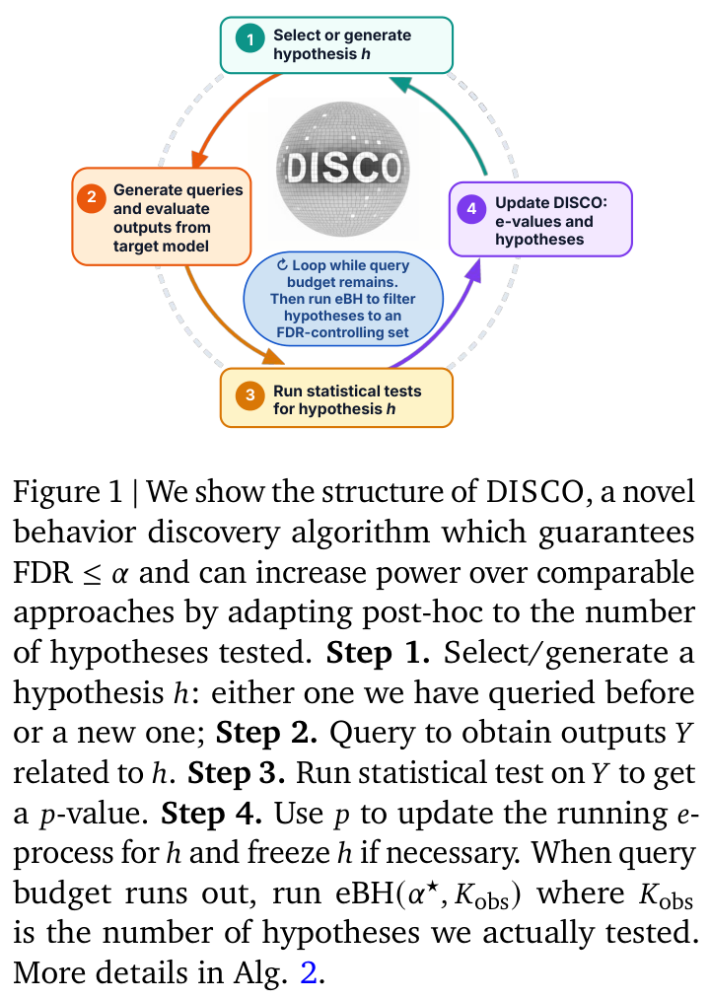
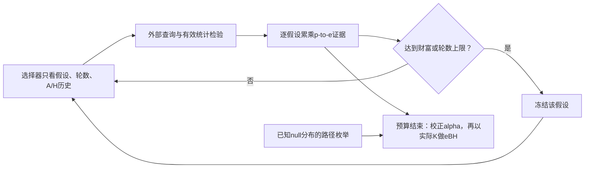

# Reliable Behavior Discovery via False Discovery Rate Control

[English](README-en.md)

> L1统计核心组件，diagnostic only；不是LLM行为发现能力或完整论文复现。纯CPU，不接Evolve晋级。完整实验：成本过高，不复现（审查 DONE）。

## 论文信息

| 字段 | 内容 |
| --- | --- |
| 论文链接 | [arXiv:2611.27104v1](https://arxiv.org/abs/2611.27104v1)；[固定v1全文](https://arxiv.org/html/2611.27104v1) |
| 公司 / 作者机构 | David Madras、Zi Wang、Marco Andreetto、Ken Burke、Caroline Pantofaru、Utsav Prabhu；六位作者均署名 **Google DeepMind** |
| 首次公开日期 | **2026-11-20T04:25:13Z**，以官方v1提交历史为准；本轮审查日期2026-11-23，不把抓取日当首发日 |
| 原作者开源代码 | 论文声明代码位于 [google-deepmind/disco](https://github.com/google-deepmind/disco)，但2026-11-23核对该入口返回HTTP404；**未核实可访问代码及其commit**，不能据此断言作者没有发布 |
| 本地 adapter / key | `disco`；`adapter: null`，独立CPU统计组件 |
| 本地复现代码 | `src/auto_research/foundation_models/disco.py` |

## 原始论文总结

### 背景与主要改动

行为发现寻找的是可重复的输入—输出规律，而不是几条显眼失败案例。不断挑选假设、查询模型、观察结果再换假设会产生选择偏差；即使每个单项检验都控制错误，也不能直接保证最终发现集合的FDR。DISCO通过冻结e-process和限制选择器只能看粗分箱状态，允许最终以实际测试假设数$K_{obs}$运行eBH，而不总以保守的预设上界加权。

每次为一个假设生成独立查询批，取得有效p值并更新其e-process。达到$e_{max}$或累计$n_{max}$轮就冻结，不能再查询。二分箱版本只把低于阈值的A、高于或等于阈值的H及轮数历史交给选择器；不能顺便泄露原始模型输出、p值或精确财富。保证还需要已知、查询不变的null p值分布，以及给定输入后的无记忆抽样。只写一个eBH函数并把分母换成实际K，不等于实现DISCO。

<!-- paper-figure:start -->
### 原论文关键图

[](https://arxiv.org/pdf/2611.27104v1#page=2)

来自固定v1第2页Figure 1的原图及完整图注，已视觉核对，无科学内容编辑；版权归原作者所有。[裁剪与SHA256](assets/provenance.json)。图示覆盖作者完整发现流程，本地不实现其中的LLM假设与查询生成。
<!-- paper-figure:end -->



### 核心公式

$$
E_i^h=E_{i-1}^h\,\kappa(p_i^h)^{\kappa-1},\quad E_0^h=1,\quad 0<\kappa<1,\qquad
k^*=\max\left\{k:\frac{kE^{[k]}}{\bar K}\ge\frac1\alpha\right\}.
$$

二分箱Eq.4定义$E_A(n)=\mathbb E[E_n\mid\forall i\le n:E_i<e_{max}]$和$P_H(n)=\Pr[\exists i\le n:E_i\ge e_{max}]$。Theorem 1令$\epsilon=\max_{n\le n_{max}}E_A(n)$、$\delta=\bar K P_H(n_{max})$，以$\alpha^*=[(\alpha-\delta)/\epsilon]_0^1$做最终eBH，可得到无条件上界$\alpha^*\epsilon+\delta$。这里$\bar K$是事先确定的查询轮数上界，不能偷换成事后K。

Theorem 2在运行结束后用$\epsilon_{post}=K_{obs}^{-1}\sum_{h:D_h=A}E_A(n_h)$、$\delta_{post}=K_{obs}P_H(n_{max})$。以$\alpha^*=[\alpha/\epsilon_{post}]_0^1$控制的是**没有null退出事件条件下**的FDR；$\delta_{post}$是该条件失败的概率项，不是可忽略的数，也不是从alpha中随意减去的一项。本地把条件标志、epsilon、delta和bound分别输出。

### 论文离线与线上效果

§5的合成情境bandit实验报告：在$\alpha\in\{0.01,0.05,0.1,0.2\}$下，DISCO与BUW-eBH均表现出FDR控制，DISCO的行为覆盖更高。§6在文本与图像任务上报告DISCO相对其他FDR控制方法获得更多真实发现；行为“真实”由独立的100次查询复验估计，不存在完整gold行为清单。作者披露平均$\delta_{post}$约0.03，并讨论检验有效性、提示操作化与估计方差的限制。这里不复刻图中数值，也不把原文报告当本地测量。未报告生产线上A/B。

### 同主题比较与边界

[e-RWSC](../2611.26413-e-rwsc/README.md)认证单题中某答案在固定政策iid抽样下的多数概率；它不是正确性证书。DISCO则控制多个行为假设组成的最终集合中误发现比例，并为自适应假设池支付分箱/冻结/校正代价。两者都使用e-process，却不能互借证书：一题答案占多数不意味着跨假设FDR受控，FDR受控也不保证某个输出答案正确。

## 本地复现

### 数据协议与代码映射

实现`log_p_to_e`、Eq.2 step-up、`Disco`的冻结与粗状态选择接口、Eq.4小型有限null分布的路径枚举，以及Theorem 1/2的**未boosted二分箱**证书。路径枚举是对所给有限分布的穷举，使用浮点求和；不是未经置信校正的Monte Carlo估计。它会拒绝非super-uniform null分布、超预算枚举和配置不匹配；选择器视图不含p值或精确e值。Python接口不是安全沙箱，调用方仍不能从闭包等旁路读取目标输出。

诊断只使用明确给定的合成p值流与已知null分布，检查冻结、预算、接口隔离、边界、无条件与条件证书。e值在log域计算；等号边界容许四个ulp的浮点运算误差，这是显式数值约定。没有模型、数据集、LLM生成器或judge，没有论文主实验的三分箱、boosting和无限细分箱扩展；因此不宣称完整DISCO行为发现器、模型能力提升或Evolve集成。

```bash
PYTHONPATH=src python -c 'from auto_research.foundation_models.disco import diagnostic; print(diagnostic(42))'
PYTHONPATH=src python -m pytest -q tests/test_nov23_disco.py
```

### 结果、负控与边界

本批统一CPU三种子记录为[`metrics/component-cpu-seeds42-44.json`](metrics/component-cpu-seeds42-44.json)。测试还穷举一个四路径、全null、粗状态自适应假设池，验证定义和错误控制的一个有限例子；它不是现实LLM的FDR验证，也不证明实际行为发现功效。公开路径拒绝`device="cuda"`，不需要也不伪造GPU回执。

### 高成本完整实验

Appendix L Table12包含Gemini-3.5/3.8-Flash、Gemini-3.1-flash-image、GPT-4o/4o-mini和Claude Sonnet4.5等发现器/目标组合；Table13给出的每方法发现预算为WordCount900、Hedging600、Cats400、Handedness400、Symmetry400次查询，每个候选还需100次独立复验。合成主实验另有每方法200次超参优化及新seed上1000次运行。该完整跨方法、跨模型、生成图像与复验矩阵的API/执行成本超出日常单A100/A30或Mac组件预算，且不能由本地GPU代替专有模型接口。这里不估算未经核实的美元金额，不尝试试跑；只运行最多六次合成标量查询、最多两轮/假设的CPU组件，预期三seed小于10秒且无模型/数据下载，时间为预算估计。

**成本过高，不复现（审查 DONE）**。完整实验终态为`not_reproduced_high_cost`，不加入自动重试或实现队列；低成本统计组件证据与该终态分别记录。
