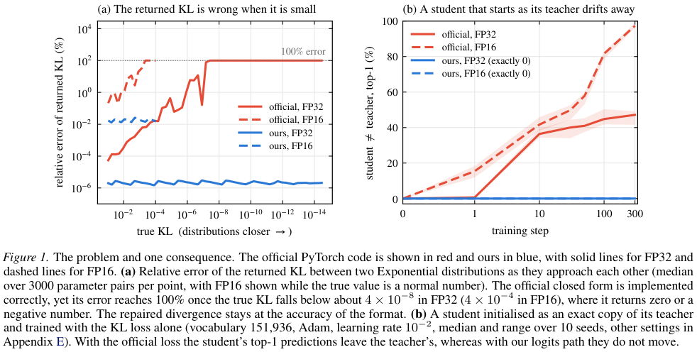
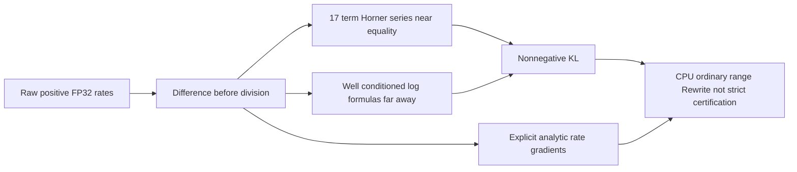

<!-- source-sha256: 359dca1245dc303d978f5fddf717efd98947fdd5e95bfd716d06e3dadbf522cf -->
# The KL Divergence Is Never Negative, Except in PyTorch

[简体中文](README.md)

> L1 component, diagnostic only; not complete paper/capability reproduction. Full experiments are too expensive, not reproduced (review DONE); no Evolve promotion.

## Paper information

| Field | Value |
| --- | --- |
| Paper link | [arXiv:2611.30835v1](https://arxiv.org/abs/2611.30835v1); [fixed PDF](https://arxiv.org/pdf/2611.30835v1) |
| Company / author institution | First author Zhen Yang: Yale University. Other affiliations include Oxford, Cambridge, Fudan, Wake Forest and City University of Hong Kong (Dongguan). |
| Original publication | 2026-11-23T15:18:30Z; fixedv1, newly first-released and reviewed2026-11-24. Announcement/retrieval dates do not replace original publication time. |
| Author code | [Author repository](https://github.com/xi-xiaoran/stablekl), pinned `fa4758ccecbe327ec55226202e629f6b4ae53282`, BSD-3-Clause; local code is only the Exponential Rewrite component. |
| Local adapter / key | `stablekl`; `adapter: null`; not Evolve-integrated |
| Local code | `src/auto_research/foundation_models/stablekl.py` |

## Original paper summary

### Background and main changes

For nearby distributions, true KL is second order, while textbook formulas subtract first-order or constant terms. They can return zero, negative values or inaccurate gradients. StableKL uses nonnegative decompositions, accurate differences, compensated arithmetic and analytic gradients, distinguishing operator error from information already lost in rounded log-probabilities. Local code covers only the Exponential Rewrite core.

<!-- paper-figure:start -->
### Key original figure

[](https://arxiv.org/pdf/2611.30835v1#page=2)

Original fixed-version PDF crop including the complete original caption; visually checked without scientific-content edits. Copyright belongs to the authors. The full method/result in the figure is not local capability evidence. [Provenance/SHA256](assets/provenance.json).
<!-- paper-figure:end -->



### Core formula

$$
x=\frac{\lambda_q-\lambda_p}{\lambda_p},\quad \varphi(x)=x-\log(1+x)\approx\frac{x^2}{2+x}-2s^3\sum_{k=1}^{17}\frac{s^{2(k-1)}}{2k+1},\quad s=\frac{x}{2+x};\qquad \partial_{\lambda_p}KL=-\frac{x}{\lambda_p},\quad\partial_{\lambda_q}KL=\frac{x}{\lambda_q}.
$$

The Exponential argument is formed from the raw rate difference before division, not ratio-minus-one. On−0.75≤x≤3, FP32 uses a17-term Horner series for phi. Outside it, well-conditioned log1p or log(rate_q/rate_p) branches are used. Custom autograd returns analytic gradients for both rates. A final nonnegative clamp is a boundary convention of the stable formula, not a repair obtained by clamping the cancelling textbook formula. Strict mode, interval arithmetic and error-free transformations for other families are absent.

### Paper results

Across about8.5M inputs,18 same-family closed forms and F.kl_div, the authors report value/gradient failures. Same-format Rewrite removes over97% of significant KL errors per configuration; strict mode has no significant errors on7.2M closed-form samples. These are frozen paper-benchmark results, not coverage established by a few dozen local Exponential examples. Correct rounding on567M operator components cannot certify this component. No production online A/B is reported.

### Same-topic comparison and boundaries

Stochastic rounding addresses FP32 updates disappearing on conversion to the BF16 grid, preserving changes in conditional expectation through randomized adjacent values. StableKL addresses deterministic algebraic cancellation on already stored parameters through formula rewrites and analytic gradients. The former does not repair KL algebra; the latter cannot recover an update lost before input storage. Precision promotion, clamping and stochastic rounding are not interchangeable patches.

## Local reproduction

### Data protocol and code mapping

Only positive, matching-shape FP32 CPU rates, a17-term phi series, far-range branches and first-order analytic autograd are implemented. Nonfinite/nonpositive inputs, unsupported dtype/shape/device, ratio overflow/underflow and nonfinite outputs are rejected; extreme-range mantissa/exponent handling is not claimed. An independent80-digit Decimal reference uses actual stored FP32 values to check near equality, branch boundaries, far values, gradients and exact identity. It is not interval certification. All18 families, FP16/BF16, strict correct rounding, F.kl_div, logits repair and distillation are absent.

```bash
PYTHONPATH=src python -c 'from auto_research.foundation_models.stablekl import diagnostic; print(diagnostic(42))'
PYTHONPATH=src python -m pytest -q tests/test_nov24_stablekl.py
```

### Results and limitations

CPU-only; CUDA is rejected. No GPU validation or model capability is claimed. [CPU component evidence](metrics/component-cpu-seeds42-44.json).

### High-cost full experiments

The author repository lists a10.8GB frozen benchmark, CPU hours per configuration and a cluster for all53. Downstream work includes ten-seed large-vocabulary distillation and Qwen2.5-1.5B/GPT-2 quantization/circuit studies with additional downloads. Appendix C.4 reports overhead of unfused reference operators; a tiny core is not full-package throughput. Full experiments are too expensive and not attempted. No10.8GB data or models are downloaded. Only32 nearby scalars and small formula tests are budgeted below10seconds across three seeds (estimate), CPU-only with CUDA rejected.

Terminal full-experiment status: not_reproduced_high_cost, review DONE, excluded from automatic retries/implementation queues. Component execution is not a full-model comparison.
