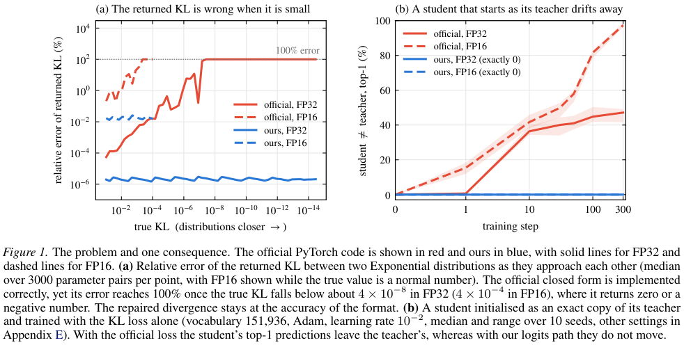
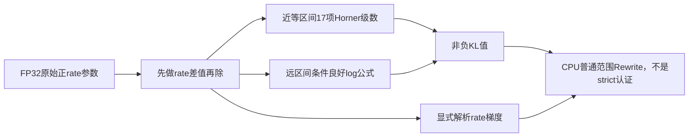

# The KL Divergence Is Never Negative, Except in PyTorch

[English](README-en.md)

> L1组件，diagnostic only，不是完整论文或模型能力复现。完整实验成本过高，不复现（审查 DONE）；不接Evolve晋级。

## 论文信息

| 字段 | 内容 |
| --- | --- |
| 论文链接 | [arXiv:2611.30835v1](https://arxiv.org/abs/2611.30835v1); [fixed PDF](https://arxiv.org/pdf/2611.30835v1) |
| 公司 / 作者机构 | 一作Zhen Yang：Yale University；其余作者机构包括Oxford、Cambridge、Fudan、Wake Forest和City University of Hong Kong (Dongguan)。 |
| 首次公开日期 | 2026-11-23T15:18:30Z；固定v1，本轮2026-11-24核对的新首发，不把公告/抓取日期替代原始时间。 |
| 原作者开源代码 | [原作者仓库](https://github.com/xi-xiaoran/stablekl)，固定`fa4758ccecbe327ec55226202e629f6b4ae53282`，BSD-3-Clause；本地只是Exponential Rewrite组件。 |
| 本地 adapter / key | `stablekl`; `adapter: null`; not Evolve-integrated |
| 本地复现代码 | `src/auto_research/foundation_models/stablekl.py` |

## 原始论文总结

### 背景与主要改动

近等分布的真实KL是二阶小量，但教科书公式往往由一阶或常数量相减得到，容易返回零、负数或错误梯度。StableKL把闭式KL重写成非负小量的组合，配合差值、补偿算术和解析梯度；它还区分F.kl_div算子误差与输入log-prob本身已丢失的信息。本地只选择其中Exponential族的Rewrite核。

<!-- paper-figure:start -->
### 原论文关键图

[](https://arxiv.org/pdf/2611.30835v1#page=2)

图片来自[原论文](https://arxiv.org/pdf/2611.30835v1)；固定版本PDF原图与完整原图注，已视觉核对，无科学内容编辑；版权归原作者所有。图中的完整方法/实验结果不是本地能力证据。 [Provenance/SHA256](assets/provenance.json).
<!-- paper-figure:end -->



### 核心公式

$$
x=\frac{\lambda_q-\lambda_p}{\lambda_p},\quad \varphi(x)=x-\log(1+x)\approx\frac{x^2}{2+x}-2s^3\sum_{k=1}^{17}\frac{s^{2(k-1)}}{2k+1},\quad s=\frac{x}{2+x};\qquad \partial_{\lambda_p}KL=-\frac{x}{\lambda_p},\quad\partial_{\lambda_q}KL=\frac{x}{\lambda_q}.
$$

Exponential的x先由原始rate之差计算，避免先取ratio再减1。在−0.75≤x≤3上，FP32用K=17的Horner级数计算φ；两侧使用条件良好的log1p或log(rate_q/rate_p)分支。自定义autograd直接返回两rate解析导数。末端非负截断只是稳定公式的边界约定，不是对原始消去公式clamp就算修复。原文strict模式、区间算术与其他分布的误差自由变换不在本地范围。

### 论文离线与线上效果

作者在约8.5M输入、18个同族闭式KL及F.kl_div上报告值和梯度错误；相同working format的Rewrite去掉每配置超过97%的显著KL错误，严格模式在7.2M闭式样本上无显著错误。上述是作者冻结基准结果，不是本地几十个Exponential样本的覆盖结论；正确舍入的567M算子分量也不能借给本组件。未报告生产线上A/B。

### 同主题比较与边界

随机舍入处理的是FP32小更新转BF16时落回同一格点，靠随机相邻格点在条件期望上保留变化。StableKL处理的是已存参数上的确定性代数消去，靠公式重写与解析梯度减少误差。前者不修复错误KL公式，后者也不能恢复输入量化前已经消失的更新；提高precision、clamp和随机舍入都不是可互换的补丁。

## 本地复现

### 数据协议与代码映射

仅FP32 CPU、形状匹配的正rate输入，17项φ级数、远区间分支及一阶解析autograd。对非有限/非正参数、dtype/形状/设备不符、ratio溢出/下溢和非有限结果直接拒绝，不冒充极端范围mantissa/exponent处理。独立80位Decimal参考以实际FP32存储值为输入，校验近等、区间边界、远区间、梯度和精确恒等；它不是区间认证。没有完整18族、FP16/BF16、strict正确舍入、F.kl_div、logits修复或蒸馏训练。

```bash
PYTHONPATH=src python -c 'from auto_research.foundation_models.stablekl import diagnostic; print(diagnostic(42))'
PYTHONPATH=src python -m pytest -q tests/test_nov24_stablekl.py
```

### 结果、负控与边界

CPU-only并拒绝CUDA；不宣称GPU验收或模型能力。 [CPU component evidence](metrics/component-cpu-seeds42-44.json).

### 高成本完整实验

作者仓库的冻结benchmark为10.8GB，README列明每配置CPU数小时、全部53配置需集群；下游含10seed大词表蒸馏、Qwen2.5-1.5B与GPT-2量化/电路实验，需额外模型数据。C.4还报告未融合参考算子的开销，不能把小核时间当完整包吞吐。完整实验直接成本过高不复现，不下载10.8GB或模型。仅32个近等标量与小型公式单测，三seed预算小于10秒（估计），CPU-only并拒绝CUDA。

完整实验为not_reproduced_high_cost终态、审查DONE，不进入自动重试/实现队列；组件执行不是完整模型对比。
