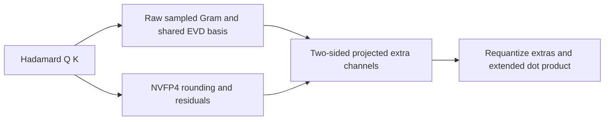
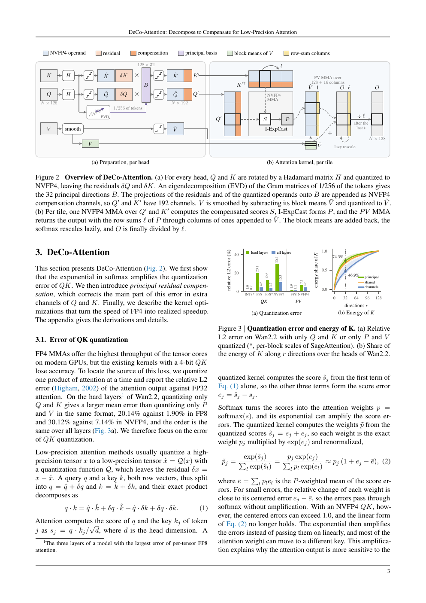

# DeCo-Attention: Decompose to Compensate for Low-Precision Attention

<!-- source-sha256: f2076f3863195fa17210bcb4f0af885d4d42e816d6a853f333c9a7642bd4c9a1 -->
[简体中文](README.md)

## Paper information

| Field | Content |
| --- | --- |
| Paper | [Fixed v1](https://arxiv.org/abs/2611.32035v1); [PDF](https://arxiv.org/pdf/2611.32035v1) |
| Institutions | NVIDIA; Yuhang He and Harrison Zhang contributed equally; first author Yuhang He: NVIDIA |
| Original publication | `2026-11-24T06:18:09Z`; overlap-backfill review on2026-11-27,not a new release today |
| Announcement | Not found in this run's or existing Nov25/26 bulletin captures; announced_on:null,not inferred from submission time |
| Author code | Page8 promises a future public kernel release. Fixed-v1 PDF/abstract and bounded title search found no verified dedicated author repository. Not found/not yet released; cited TensorRT/FlashInfer are not a DeCo release.  |
| Local adapter / key | `deco-attention`; adapter null; no Evolve integration |
| Local reproduction code | `src/auto_research/foundation_models/deco_attention.py` |
| Evidence | CPU-only component_only/l1_mechanism/diagnostic_only; no GPU path or capability claim |

## Original paper

### Background and method

FP4 Q/K score errors can be amplified by softmax. DeCo rotates Q/K with a randomly signed Hadamard matrix,estimates a shared principal basis from raw rotated sample Grams,and restores projected first-order residual terms on both sides. It omits second-order and discarded-direction terms; improvement is not guaranteed on every input.

### Core equations

$$
QK^\top=\widehat Q\widehat K^\top+\delta Q\widehat K^\top+\widehat Q\delta K^\top+\delta Q\delta K^\top.
$$

$$
G=\frac{K_{\mathcal S}^\top K_{\mathcal S}}{\operatorname{tr}(K_{\mathcal S}^\top K_{\mathcal S})}+\frac{Q_{\mathcal S}^\top Q_{\mathcal S}}{\operatorname{tr}(Q_{\mathcal S}^\top Q_{\mathcal S})},\quad B=\operatorname{TopEig}_r(G),
$$

$$
Q'=[\widehat Q\mid\mathcal Q(\delta QB)\mid\mathcal Q(\widehat QB)],\quad
K'=[\widehat K\mid\mathcal Q(\widehat KB)\mid\mathcal Q(\delta KB)].
$$

Eq6 uses raw rotated sampled Q/K,not already-rounded operands; normalize each Gram by its own trace. Sample max(N/256,2r),with stratification for mixed text/audio/video. Eq25 uses a power-of-two group scale,unsigned E4M3 block scales per16channels,and E2M1 values,including compensation channels. Divide scores by original sqrt(d),not sqrt(d+2r).

### Reported results

Table3 Wan2.2 hard-layer relative L2 error is2.80% for DeCo with FP8 PV versus30.56% for uncompensated NVFP4 QK; all-layer error is3.73% versus10.57%,still above VC-Attention FP8's2.64%. GB300's2.13x kernel/1.55x end-to-end speedups are dedicated-kernel measurements,not local emulation. No production A/B is reported.

### Comparison and limits

DualQuant fits row/column scales from static weights and rescales activations. DeCo estimates a basis from current Q/K and compensates both rounding residuals. Neither floating simulation is a packed low-bit kernel; A100 floating execution cannot establish native FP4 acceleration.



<!-- paper-figure:start -->
### Original paper figure



Unmodified full-page raster from [fixed-v1 PDF page3](https://arxiv.org/pdf/2611.32035v1#page=3),visually reviewed on2026-11-27. Copyright belongs to the original authors. The figure is not local evidence. [Provenance](assets/provenance.json).
<!-- paper-figure:end -->

The peer [foundation-models:dualquant](../../reproductions/2610.13767-dualquant/README.md) was actually reviewed; its source fingerprint and verified topic membership are recorded in the deep-dive proposal.

## Local reproduction

### Data and code contract

The component emulates Eq25 E2M1/E4M3 block16 rounding with nearest-even ties,Hadamard rotation,sampled raw Grams,EVD,two-sided residuals and requantized extra groups. It evaluates FP64 products/standard softmax on V. This is principal compensation only:no I-ExpCast,lazy rescale,common hardware group-scale alignment,V smoothing/PV quantization,packed storage,CuTe or TensorCore kernels. Mixed modalities require explicit correctly stratified sample indices; diagnostics use homogeneous tokens. The reference accepts only zero or matrix/group max-absolute magnitudes in [2^-400,2^400]. Out-of-range scales, unrepresentable products or Gram traces raise ValueError; it does not cover every finite FP64 magnitude.

```bash
PYTHONPATH=src python -c 'from auto_research.foundation_models.deco_attention import diagnostic; print(diagnostic(42))'
PYTHONPATH=src:scripts python -m pytest tests/test_nov27_foundation_components.py -q
```

### Evidence and negative controls

Checks verify the expanded dot equals both requantized correction products,the exact residual identity,and only second-order remainder at full rank before extra rounding. They also cover orthogonality,trace-scale invariance and original-head softmax scaling. Synthetic score errors are retained without requiring every seed to improve. Native FP4 kernel calls are0; CUDA is rejected. Frozen evidence is collected by the common runner; three tensor seeds establish neither video quality nor speed. Regressions also reject the smallest subnormal/largest finite magnitude and check finite results at both declared magnitude endpoints.

### High-cost full experiments

The paper evaluates four large video models including720p Wan2.2-T2V-A14B,100MovieGen prompts per method,multiple formats,and native FP4 on GB300/VR200/RTX PRO6000. One81-frame720p Wan baseline takes about302.7seconds on GB300. The complete matrix/dedicated hardware path is outside oneA100/A30-or-Mac resources; A100/A30 lack that native FP4 MMA. No checkpoints,captured QKV or videos are downloaded; CPU simulation time is not paper performance.

**Too costly; not reproduced (review DONE).** This applies to the full matrix,distinct from the bounded CPU component. Resolution:not_reproduced_high_cost. No automatic retry,implementation queue,Evolve promotion,large-resource download or costly trial for estimation.
