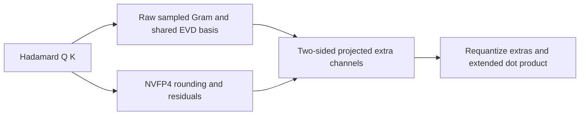
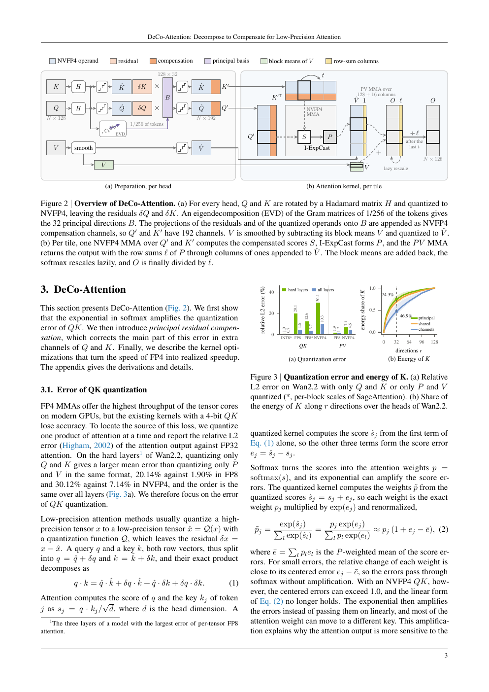

# DeCo-Attention: Decompose to Compensate for Low-Precision Attention

[English](README-en.md)

## 论文信息

| 字段 | 内容 |
| --- | --- |
| 论文链接 | [固定v1](https://arxiv.org/abs/2611.32035v1)；[PDF](https://arxiv.org/pdf/2611.32035v1) |
| 公司 / 作者机构 | NVIDIA；Yuhang He与Harrison Zhang为共同一作；一作Yuhang He：NVIDIA |
| 首次公开日期 | `2026-11-24T06:18:09Z`；本轮2026-11-27为重叠池补漏审查，不是今日新发 |
| arXiv公告日期 | 本轮及现存Nov25/26公告捕获未找到该身份，`announced_on: null`；不从首发时刻推断公告日 |
| 原作者开源代码 | 未找到/尚未发布。固定v1第8页明确kernel code将公开；本轮固定PDF/摘要与有界标题检索未找到已发布的专属作者仓库，未找到/尚未发布。引用TensorRT/FlashInfer不是本文已开源。 |
| 本地 adapter / 稳定键 | `deco-attention`；`adapter: null`，不接入Evolve |
| 本地复现代码目录 | `src/auto_research/foundation_models/deco_attention.py` |
| 证据级别 | CPU-only `component_only / l1_mechanism / diagnostic_only`，无GPU路径或能力收益声明 |

## 原始论文总结

### 背景与主要改动

FP4 Q/K舍入产生的score误差可能被softmax指数放大。DeCo先以带随机行符号的Hadamard旋转Q/K，从旋转后原始sample的Gram矩阵估计共享principal basis；把量化残差在主方向的两侧一阶项加回。它舍弃二阶残差和未保留方向，不保证逐样本必然比未补偿更好。

### 核心公式

$$
QK^\top=\widehat Q\widehat K^\top+\delta Q\widehat K^\top+\widehat Q\delta K^\top+\delta Q\delta K^\top.
$$

$$
G=\frac{K_{\mathcal S}^\top K_{\mathcal S}}{\operatorname{tr}(K_{\mathcal S}^\top K_{\mathcal S})}+\frac{Q_{\mathcal S}^\top Q_{\mathcal S}}{\operatorname{tr}(Q_{\mathcal S}^\top Q_{\mathcal S})},\quad B=\operatorname{TopEig}_r(G),
$$

$$
Q'=[\widehat Q\mid\mathcal Q(\delta QB)\mid\mathcal Q(\widehat QB)],\quad
K'=[\widehat K\mid\mathcal Q(\widehat KB)\mid\mathcal Q(\delta KB)].
$$

Eq6的sample是旋转后尚未量化的Q/K，各Gram独立trace归一化；sample为max(N/256,2r)，混合text/audio/video需分层抽样。Appendix Eq25每组用power-of-two全局scale、每16channel unsigned E4M3 block scale和E2M1值，额外通道不能保持高精度。attention除以原始sqrt(d)，不是扩展维数sqrt(d+2r)。

### 论文离线与线上效果

作者Table3 Wan2.2 hard layers：FP8 PV配置的attention相对L2误差DeCo2.80%，未补偿NVFP4 QK为30.56%；all layers为DeCo3.73%对10.57%，仍高于VC-Attention FP8的2.64%。GB300的2.13×kernel及1.55×end-to-end加速来自真实专用核，不是本地仿真。生产线上A/B未报告。

### 同主题比较与边界

DualQuant仅从静态权重拟合row/column尺度并重缩放激活；DeCo每次attention从Q/K本身估计basis，补偿两边量化残差，不训练静态权重尺度。两者的浮点仿真都不等于packed低位CUDA kernel，更不能以A100浮点执行宣称原生FP4加速。



<!-- paper-figure:start -->
### 原论文关键图



图片来自[原论文](https://arxiv.org/pdf/2611.32035v1#page=3)固定v1第3页，2026-11-27已目视核对整页栅格与完整图注，无科学内容改动；版权归原作者所有。图中结果不是本地测量。[来源与SHA256](assets/provenance.json)。
<!-- paper-figure:end -->

已实际审读对照[foundation-models:dualquant](../../reproductions/2610.13767-dualquant/README.md)，只比较机制和边界；README SHA记录在本轮deep提案，topic按现有membership核验。

## 本地复现

### 数据协议与代码映射

`nvfp4_round`按Eq25执行E2M1数值与E4M3 block16尺度的nearest-even仿真；`prepare`执行Hadamard、sample/raw Gram、EVD、两侧残差和再次量化extra groups；`compensated_attention`用FP64点积/标准softmax读取V。仅principal residual compensation组件，不含I-ExpCast、lazy-rescale、common-group hardware scale对齐、V smoothing/PV量化、packed存储或CuTe/TensorCore kernel。混合模态调用者须显式传正确sample indices；诊断仅单一token种类。 数值参考有明确有限范围：每个输入及中间量化组的最大绝对值须为0或落在[2^-400,2^400]；范围外、不可表示的乘积或Gram trace显式ValueError，不承诺覆盖全部FP64有限尺度。

```bash
PYTHONPATH=src python -c 'from auto_research.foundation_models.deco_attention import diagnostic; print(diagnostic(42))'
PYTHONPATH=src:scripts python -m pytest tests/test_nov27_foundation_components.py -q
```

### 结果、负控与边界

核对扩展点积等于两个已再次量化的一阶补偿项、完整残差恒等式、full-rank且extra-channel未再量化时只剩二阶残差、basis正交、trace尺度不变和原始head softmax尺度；保留合成未补偿/补偿score误差，不要求每seed提升。这里没有原生FP4调用，native_fp4_kernel_calls为0；拒绝CUDA。正式冻结指标由统一runner验收，不把三seed小张量当视频质量或速度证据。 另含最小subnormal/最大finite拒绝与所声明尺度两端点的有限性回归。

### 高成本完整实验

原文四个视频大模型含Wan2.2-T2V-A14B 720p，每方法100 MovieGen prompts、多个低精度对照，GB300/VR200/RTX PRO6000原生FP4平台；单Wan基线81帧720p在GB300约302.7秒。完整矩阵与专用硬件路径明显超本轮单A100/A30或Mac可执行范围；A100/A30没有该原生FP4 MMA。未下载checkpoint、captured QKV或视频数据，不用CPU仿真耗时替代论文性能。

**成本过高，不复现（审查 DONE）**适用于完整矩阵；局部CPU组件另行验收。完整实验终态`not_reproduced_high_cost`，无自动重试、自动实现队列或Evolve晋级，不下载大资源、不为估价探跑。
