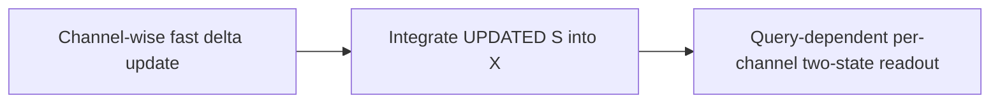
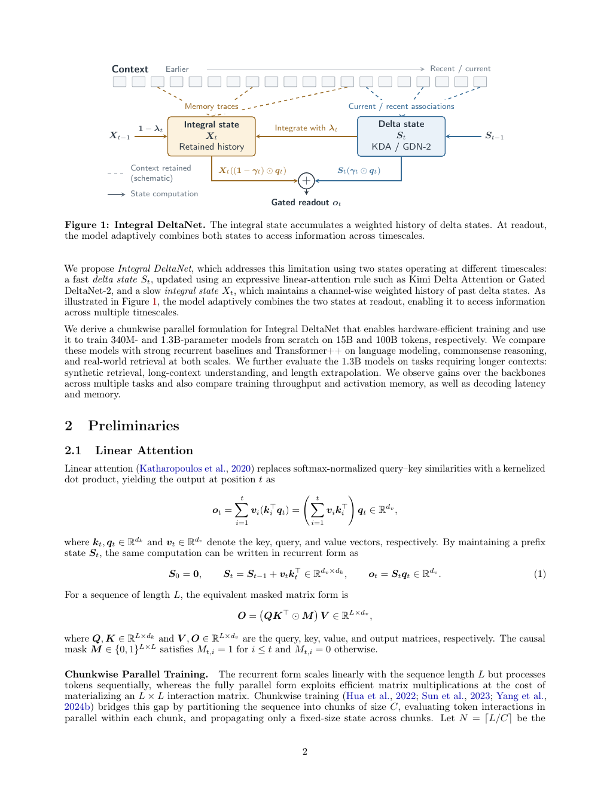

# Integral DeltaNet: Improved Linear Attention with Adaptive Memory Integration

<!-- source-sha256: 128902947e331d13d4a0aea969dfced70110840cc06559d127f196b03d4a355f -->
[简体中文](README.md)

## Paper information

| Field | Content |
| --- | --- |
| Paper | [Fixed v1](https://arxiv.org/abs/2611.32063v1); [PDF](https://arxiv.org/pdf/2611.32063v1) |
| Institutions | KAIST; KRAFTON AI; University of Wisconsin–Madison. Junsoo Oh completed the work during an internship at KRAFTON AI; first author Junsoo Oh: Kim Jaechul Graduate School of AI, KAIST |
| Original publication | `2026-11-24T06:50:52Z`; overlap-backfill review on2026-11-27,not a new release today |
| Announcement | Not found in this run's or existing Nov25/26 bulletin captures; announced_on:null,not inferred from submission time |
| Author code | The author repository is public and its HEAD was verified with git ls-remote. License not separately verified. The local component is independently implemented from equations without copying upstream source. URL:https://github.com/junsoo424/Integral-DeltaNet; HEAD:f6ec94e15d7b4a3eaea5d8b888168a2e1a7b7ac9 |
| Local adapter / key | `integral-deltanet`; adapter null; no Evolve integration |
| Local reproduction code | `src/auto_research/foundation_models/integral_deltanet.py` |
| Evidence | CPU-only component_only/l1_mechanism/diagnostic_only; no GPU path or capability claim |

## Original paper

### Background and method

Decay and targeted overwrite can remove useful old associations as well as interference. The method leaves KDA/GDN-2 fast updates intact, integrates the updated state over time, and uses input-dependent per-channel gates to read both timescales. A constant mixture, an independent second delta state and a wider single state are different designs.

### Core equations

$$
S_t=S_{t-1}\operatorname{Diag}(\alpha_t)\left[I-(b_t\odot k_t)k_t^\top\right]+(w_t\odot v_t)k_t^\top,
$$

$$
X_t=S_t\operatorname{Diag}(\lambda_t)+X_{t-1}\operatorname{Diag}(1-\lambda_t),\quad
o_t=S_t(\gamma_t\odot q_t)+X_t((1-\gamma_t)\odot q_t).
$$

$$
\gamma_t=\exp[-\operatorname{softplus}(W_\gamma^\uparrow W_\gamma^\downarrow h_t+b_\gamma)],\quad
\lambda_t=1-\exp[-\operatorname{softplus}(W_\lambda^\uparrow W_\lambda^\downarrow h_t+b_\lambda)].
$$

The first equation is GDN-2; broadcasting one beta across erase/write gives KDA. Lambda and gamma act on key channels, not value rows or one scalar. Integrate the updated S. The paper uses rank128 gates initialized near lambda=1-gamma=1/1024; the local rank is reduced but the trainable parameterization is retained.

### Reported results

Table1 reports a commonsense average of56.1 for1.3B/100B-token Integral KDA versus54.6 for KDA; Table2 retrieval is37.3 versus35.4, with task-level regressions. Table5 B300 batch8/4K decoding latency rises from3.34ms to4.63ms. Fixed-size memory does not imply lower latency. No production A/B is reported.

### Comparison and limits

KRA maintains regression coefficients and posterior covariance, restoring writable uncertainty under forgetting. Integral instead stores a delta state and its weighted history. Covariance is not a memory copy, and integral history does not implement KRA covariance-guided interference correction. Local L1 cannot compare language recall.



<!-- paper-figure:start -->
### Original paper figure



Unmodified full-page raster from [fixed-v1 PDF page2](https://arxiv.org/pdf/2611.32063v1#page=2),visually reviewed on2026-11-27. Copyright belongs to the original authors. The figure is not local evidence. [Provenance](assets/provenance.json).
<!-- paper-figure:end -->

The peer [foundation-models:kernel-ridge-attention](../../foundation-models/2611.23896-kernel-ridge-attention/README.md) was actually reviewed; its source fingerprint and verified topic membership are recorded in the deep-dive proposal.

## Local reproduction

### Data and code contract

The recurrent path executes channel-wise GDN-2/KDA-compatible updates,Eq6 integration and Eq7 readout. An independent chunk reference builds P/H and weighted integral-prefix operators, checking outputs,both states and actual autograd gradients, including partial chunks and state continuation. IntegralGates consumes caller-normalized hidden states. This is CPU FP64 only: no decoder,tokenizer,FLA/WY/UT fusion,LM pretraining or gold-based query selection. Explicit prefix matrices are a validation reference,not an efficient kernel.

```bash
PYTHONPATH=src python -c 'from auto_research.foundation_models.integral_deltanet import diagnostic; print(diagnostic(42))'
PYTHONPATH=src:scripts python -m pytest tests/test_nov27_foundation_components.py -q
```

### Evidence and negative controls

Checks cover random channel gates,non-square states,chunk/recurrent output and gradient equivalence,gate gradients,lambda=0/1,and continuation. The paper's hand-constructed answer-dependent readout is not treated as learned capability. Seeds42/43/44 support L1 only; the common runner separately collects frozen evidence,not early preflight as paper metrics.

### High-cost full experiments

Section4 trains340M/1.3B non-embedding models from scratch on15B/100B FineWeb-Edu tokens,with4K sequences and0.5M-token global batches,across backbones and extra15B-token ablations. B300 throughput/decoding measurements are not the same A100 configuration. The complete training matrix exceeds this run's single-A100/A30-or-Mac budget. This is a published-configuration assessment,not measured local full runtime or invented GPU hours.

**Too costly; not reproduced (review DONE).** This applies to the full matrix,distinct from the bounded CPU component. Resolution:not_reproduced_high_cost. No automatic retry,implementation queue,Evolve promotion,large-resource download or costly trial for estimation.
