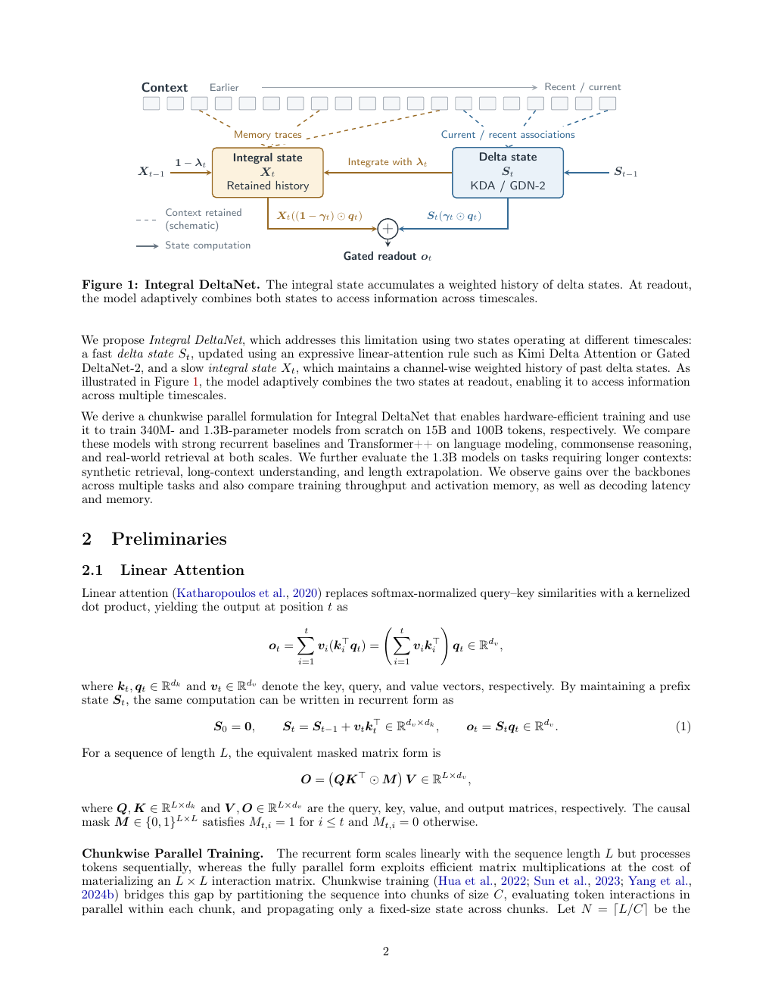

# Integral DeltaNet: Improved Linear Attention with Adaptive Memory Integration

[English](README-en.md)

## 论文信息

| 字段 | 内容 |
| --- | --- |
| 论文链接 | [固定v1](https://arxiv.org/abs/2611.32063v1)；[PDF](https://arxiv.org/pdf/2611.32063v1) |
| 公司 / 作者机构 | KAIST；KRAFTON AI；University of Wisconsin–Madison。Junsoo Oh在KRAFTON AI实习期间完成；一作Junsoo Oh：Kim Jaechul Graduate School of AI, KAIST |
| 首次公开日期 | `2026-11-24T06:50:52Z`；本轮2026-11-27为重叠池补漏审查，不是今日新发 |
| arXiv公告日期 | 本轮及现存Nov25/26公告捕获未找到该身份，`announced_on: null`；不从首发时刻推断公告日 |
| 原作者开源代码 | [作者代码](https://github.com/junsoo424/Integral-DeltaNet)；HEAD `f6ec94e15d7b4a3eaea5d8b888168a2e1a7b7ac9`。作者公开仓库，已用git ls-remote核验HEAD；许可未另行核验，本地按原文公式独立实现，不复制上游源码。 |
| 本地 adapter / 稳定键 | `integral-deltanet`；`adapter: null`，不接入Evolve |
| 本地复现代码目录 | `src/auto_research/foundation_models/integral_deltanet.py` |
| 证据级别 | CPU-only `component_only / l1_mechanism / diagnostic_only`，无GPU路径或能力收益声明 |

## 原始论文总结

### 背景与主要改动

单状态的衰减和定向覆盖会同时压低干扰与有用旧信息。本文保持KDA或GDN-2的fast更新不变，额外积累更新后状态的历史；查询时由输入相关的逐channel门读取两个时间尺度，而不是把所有历史都压进同一读出。常量混合门、额外独立delta state和仅增宽state是论文分别比较的不同设计。

### 核心公式

$$
S_t=S_{t-1}\operatorname{Diag}(\alpha_t)\left[I-(b_t\odot k_t)k_t^\top\right]+(w_t\odot v_t)k_t^\top,
$$

$$
X_t=S_t\operatorname{Diag}(\lambda_t)+X_{t-1}\operatorname{Diag}(1-\lambda_t),\quad
o_t=S_t(\gamma_t\odot q_t)+X_t((1-\gamma_t)\odot q_t).
$$

$$
\gamma_t=\exp[-\operatorname{softplus}(W_\gamma^\uparrow W_\gamma^\downarrow h_t+b_\gamma)],\quad
\lambda_t=1-\exp[-\operatorname{softplus}(W_\lambda^\uparrow W_\lambda^\downarrow h_t+b_\lambda)].
$$

第一式为GDN-2，KDA使用相同标量beta广播到erase/write；lambda与gamma均沿key channel，不是value行或一个全局标量。积分使用当前更新后的S。原文门rank128且初始化lambda≈1−gamma≈1/1024；本地缩小rank但保留同一可训练参数化。

### 论文离线与线上效果

作者Table1：1.3B/100B-token的Integral KDA commonsense平均56.1，对KDA54.6；Table2检索平均37.3对35.4，但不是每任务均改善。Table5 B300 batch8的4K decode latency从3.34ms升到4.63ms，不能只宣传固定内存而漏掉延迟代价。生产线上A/B未报告。

### 同主题比较与边界

KRA维护回归系数与后验协方差，遗忘时恢复可写不确定性；Integral维护delta与它的指数加权历史。两份state不意味着同一内容：协方差不是记忆副本，积分history也不执行KRA的相关key校正。现有L1不能比较语言召回收益。


<!-- paper-figure:start -->
### 原论文关键图



图片来自[原论文](https://arxiv.org/pdf/2611.32063v1#page=2)固定v1第2页，2026-11-27已目视核对整页栅格与完整图注，无科学内容改动；版权归原作者所有。图中结果不是本地测量。[来源与SHA256](assets/provenance.json)。
<!-- paper-figure:end -->

已实际审读对照[foundation-models:kernel-ridge-attention](../../foundation-models/2611.23896-kernel-ridge-attention/README.md)，只比较机制和边界；README SHA记录在本轮deep提案，topic按现有membership核验。

## 本地复现

### 数据协议与代码映射

`recurrent`执行channel-wise GDN-2/KDA兼容更新、Eq6积分和Eq7读取；`chunkwise`独立构造P/H及积分加权prefix算子，核对输出、两state和真实autograd梯度；支持尾部短chunk和携state续接。`IntegralGates`从调用方归一化hidden计算低秩门。仅CPU双精度小张量，无decoder、tokenizer、FLA/WY/UT融合实现、LM预训练或query-gold选择。显式prefix矩阵是验证参考，不是并行高性能kernel。

```bash
PYTHONPATH=src python -c 'from auto_research.foundation_models.integral_deltanet import diagnostic; print(diagnostic(42))'
PYTHONPATH=src:scripts python -m pytest tests/test_nov27_foundation_components.py -q
```

### 结果、负控与边界

自检覆盖随机channel gates、non-square state、chunk/递推输出与梯度等价、门梯度、lambda=0/1极端与分段续接。没有把论文教学例中按答案指定gamma的零风险构造当成学习能力。42/43/44合成诊断只支持L1；正式冻结证据由统一runner另行记录，不把早期检查写入paper metrics。

### 高成本完整实验

§4主矩阵为340M/1.3B非embedding参数，从头训练15B/100B FineWeb-Edu tokens，4K序列、0.5M-token global batch；多个backbone及额外15B-token门/state消融。B300训练/解码效率测量亦非A100原样配置。完整训练矩阵明显超本轮单A100/A30或Mac预算；这是已发表模型/token配置的成本判断，未测本地完整时长，不编造GPU小时。

**成本过高，不复现（审查 DONE）**适用于完整矩阵；局部CPU组件另行验收。完整实验终态`not_reproduced_high_cost`，无自动重试、自动实现队列或Evolve晋级，不下载大资源、不为估价探跑。
