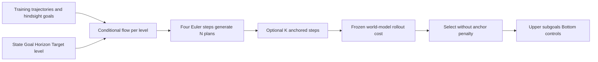
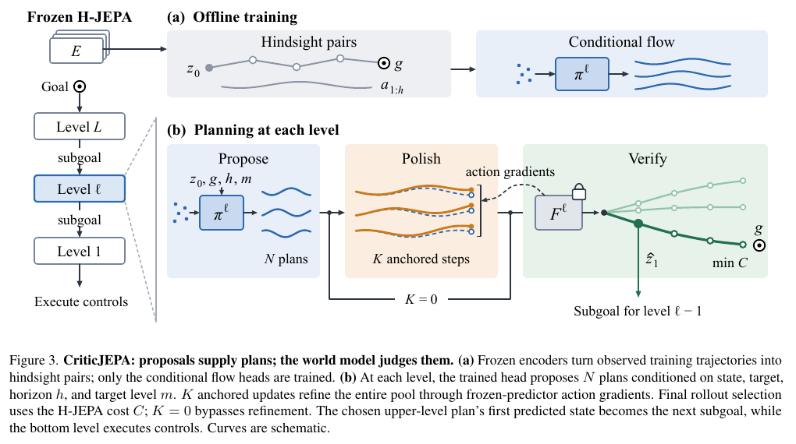

# CriticJEPA: compare plans instead of chasing world-model gradients

<!-- source-sha256: 32b97d41ccc34bc62adce7ebed90d23014c21411b81c4c56a8e6c4aa58cad34d -->

[简体中文](README.md)

## Paper information

| Field | Content |
| --- | --- |
| Paper | [CriticJEPA: World Models Are Better Critics Than Optimizers](https://arxiv.org/abs/2611.32357v1); [fixed-v1 PDF](https://arxiv.org/pdf/2611.32357v1) |
| Institutions | First author Xvyuan Liu: Tsinghua University; collaborators at Zhongguancun Academy and Manifold AI |
| First publication | `2026-11-24T10:30:16Z`; reviewed on 2026-11-25 |
| Authors' source code | The paper links an [author repository](https://github.com/daybraeklaxry/CriticJEPA-code) and [project page](https://daybraeklaxry.github.io/criticjepa/). On2026-11-25, git ls-remote returned Repository not found and raw/main README returned404. No readable source or commit was verified; public release is unconfirmed |
| Local key / adapter | `criticjepa`; `adapter: null` |
| Local code directory | None: review-only, without an operator, trainer or fixed-candidate substitute |
| Status | `deferred_high_cost` / `not_reproduced_high_cost`; not reproduced due to cost, review DONE |

## Original paper summary

### Background and changes

Improving predicted cost through gradients requires useful update directions; choosing among good proposals only requires informative relative scores. With frozen H-JEPA, prolonged search keeps reducing predicted cost after execution stops improving, while the same predictor ranks goal-conditioned proposals. CriticJEPA trains conditional flow proposals at every temporal level, selects them using frozen rollouts, and optionally applies short anchored corrections instead of relying entirely on unconstrained search.

<!-- paper-figure:start -->
### Original paper figure

图片来自[原论文](https://arxiv.org/pdf/2611.32357v1#page=5); fixed-v1 page5 Figure3, complete caption visually checked without scientific edits; 版权归原作者所有. Schematic curves are not local trajectories. [Provenance and SHA256](assets/provenance.json).
<!-- paper-figure:end -->

### Core equations

At level $\ell$, condition $c=(z_0^{(\ell)},z_0^{(m)},g^{(m)}-z_0^{(m)},h_\ell,m)$ with $m\ge\ell$. Real action segment $x_1$ and Gaussian $x_0$ define $x_\tau=(1-\tau)x_0+\tau x_1$. Training excludes padded action entries:

$$
\mathcal L_{flow}^{(\ell)}=\mathbb E\|v_\theta^{(\ell)}(x_\tau,\tau,c)-(x_1-x_0)\|^2_{valid}.
$$

Four Euler steps generate proposals. Frozen predictors and upper encoders evaluate plans in the target space using H-JEPA's temporal windows and action-consistency term:

$$
C^{(\ell)}(a)=\sum_{k\in\mathcal T_\ell}\|\tilde z_k^{(m)}-g^{(m)}\|^2+\beta_\ell R_{act}^{(\ell)}(a).
$$

$$
\mathcal J(a)=C(a)+\frac{0.1}{d_a}\|a-a_{prop}\|^2,\qquad i^*=\arg\min_i C(a^{(i)}_{final}).
$$

The anchor affects polish only; final selection excludes it. The first predicted state of the selected upper plan becomes a lower-level subgoal; the bottom executes a control block. Levels do not independently chase a final pixel goal. Encoders, action encoders and predictors stay frozen; only flow heads train.

### Reported results

Table3 reports Standard AntMaze results across three independently trained models: H-JEPA67.6%/131.0TFLOPs, CriticJEPA-0 78.7%/1.62TFLOPs, CriticJEPA-5 89.1%/5.11TFLOPs. Success is a model mean; algorithmic FLOPs per episode include encoding, proposals, prediction and polish backpropagation, not measured wall time. Table4 covers Cube, Push-T, FourRoom and AntMaze at two/three levels, with13–79times less planning computation. Refinement does not improve every setting. Production online A/B: not reported.

### Related mechanism and limits

[JEPA prediction-planning evaluation](../2610.19375-jepa-prediction-planning/README-en.md) separates prediction-error reductions from actual planning success. CriticJEPA additionally separates ranking from gradient optimization and tests the effect of candidate sources. Both reject control claims inferred from latent loss alone. The former is an evidence protocol; the latter requires trained flows, a frozen hierarchy and environment execution. The peer README was read and hashed in the batch deep-dive proposal.

## Local reproduction

### Data and code mapping

Review-only: no local code, environment execution, CPU/CUDA proxy or local success rate. This page and the [cost-review record](review/cost-assessment.json) retain source, mechanism and cost boundaries without a metrics directory. Paper tables are not local measurements, and no GPU receipt is fabricated for cataloging.

### High-cost full experiments

Not reproduced due to cost; review DONE. Section5.1 requires18frozen H-JEPA hierarchies, per-level six-block512-wide flow heads trained for25epochs at batch1024, four domains with150–450episodes per method, common candidate counts100/100/200, and K/pool ablations. Transferable GPU hardware and full wall time are not reported and are not invented. This multi-arm training/planning matrix exceeds one A100/A30 or a local Mac. No resources or trial reproduction were downloaded/run; a fixed-candidate fixture does not replace the core proposer. Terminal `not_reproduced_high_cost`, without retries, implementation queuing or evolve mapping.
