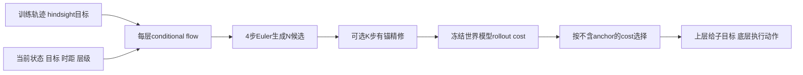
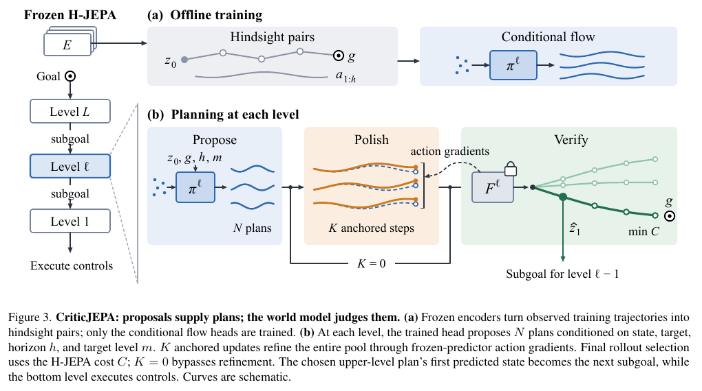

# CriticJEPA：把世界模型用于比较，而非长时间追逐其梯度

[English](README-en.md)

## 论文信息

| 字段 | 内容 |
| --- | --- |
| 论文链接 | [CriticJEPA: World Models Are Better Critics Than Optimizers](https://arxiv.org/abs/2611.32357v1)；[固定 v1 PDF](https://arxiv.org/pdf/2611.32357v1) |
| 公司 / 作者机构 | 一作 Xvyuan Liu：Tsinghua University；合作 Zhongguancun Academy、Manifold AI |
| 首次公开日期 | `2026-11-24T10:30:16Z`；审查日 2026-11-25 |
| 原作者开源代码 | 原文链接[作者仓库](https://github.com/daybraeklaxry/CriticJEPA-code)及[项目页](https://daybraeklaxry.github.io/criticjepa/)；2026-11-25 仓库 `git ls-remote` 返回 Repository not found，raw/main README 返回 404，未核到可读源码或 commit；不能确认已经公开 |
| 本地 adapter / 稳定键 | `criticjepa`，`adapter: null` |
| 本地复现代码目录 | 无；review-only，没有 operator、训练器或固定候选替代物 |
| 状态 | `deferred_high_cost` / `not_reproduced_high_cost`；成本过高，不复现（审查 DONE） |

## 原始论文总结

### 背景与主要改动

对一个预测器找到更低的预测 cost，需要其梯度方向可靠；从一组好候选中挑更好的，只要求局部排序有信息。论文在冻结 H-JEPA 上观察到：长梯度搜索可继续降低预测 cost，但实际行动不再改善；同一预测器却能比较 goal-conditioned 提案。CriticJEPA 在每个时间层级训练 flow proposer，再用冻结 rollout 选择；只给提案做短的有锚精修，而不让无约束搜索承担整个规划。

<!-- paper-figure:start -->
### 原论文关键图

图片来自[原论文](https://arxiv.org/pdf/2611.32357v1#page=5)，固定 v1 第 5 页 Figure 3；保留完整原图注，已视觉核对，无科学内容编辑；版权归原作者所有。示意中的曲线不是本地轨迹。[来源与 SHA256](assets/provenance.json)。
<!-- paper-figure:end -->

### 核心公式

层 $\ell$ 的 flow 条件为 $c=(z_0^{(\ell)},z_0^{(m)},g^{(m)}-z_0^{(m)},h_\ell,m)$，$m\ge\ell$。真实动作段 $x_1$ 与高斯噪声 $x_0$ 按 $x_\tau=(1-\tau)x_0+\tau x_1$ 插值，仅对有效未 padding 动作训练：

$$
\mathcal L_{flow}^{(\ell)}=\mathbb E\|v_\theta^{(\ell)}(x_\tau,\tau,c)-(x_1-x_0)\|^2_{valid}.
$$

四步 Euler 生成候选；冻结预测器 rollout 到目标层空间，按原 H-JEPA 时间窗与 action-consistency 代价打分：

$$
C^{(\ell)}(a)=\sum_{k\in\mathcal T_\ell}\|\tilde z_k^{(m)}-g^{(m)}\|^2+\beta_\ell R_{act}^{(\ell)}(a).
$$

$$
\mathcal J(a)=C(a)+\frac{0.1}{d_a}\|a-a_{prop}\|^2,\qquad i^*=\arg\min_i C(a^{(i)}_{final}).
$$

有锚项仅用于精修，最终选择不含该惩罚。上层选中计划的第一个预测状态给下层作子目标，底层执行控制块；不是各层独立地追最终像素目标。编码器、动作编码器和预测器全冻结，只有 flow heads 训练。

### 论文离线与线上效果

Table 3 在标准 AntMaze 的三套独立世界模型上报告：H-JEPA 67.6%／131.0 TFLOPs，CriticJEPA-0 78.7%／1.62 TFLOPs，CriticJEPA-5 89.1%／5.11 TFLOPs；success 为跨模型均值，compute 为每 episode 计入编码、提案、预测和精修反传的算法 FLOPs，不是实测墙时。Table 4 覆盖 Cube、Push-T、FourRoom 与 AntMaze、两／三层设置，报告 13–79 倍规划算量降低；并非每个任务都由精修获益。生产线上 A/B：未报告。

### 同主题比较与边界

[JEPA 预测—规划评测](../2610.19375-jepa-prediction-planning/README.md)说明一步预测误差下降不等于实际规划成功；CriticJEPA进一步区分排序候选与利用梯度优化候选，并实测不同候选来源的排序价值。它们都拒绝由 latent loss 推断控制能力，但前者是预测／规划证据协议，后者需要真正训练的 flow、冻结层级与环境执行。已审读 peer README，SHA 见本轮 deep-dive 提案。

## 本地复现

### 数据协议与代码映射

仅审查收录，无本地代码、无环境实跑、无 CPU/CUDA 机制代理、无本地成功率。此页与[成本审查记录](review/cost-assessment.json)只保存来源、方法和高成本边界，不设 metrics 目录；论文表格不是本地测量，也不需要为此收录伪造 GPU receipt。

### 高成本完整实验

成本过高，不复现（审查 DONE）。§5.1 需要 18 套冻结 H-JEPA 层级、每层 6-block／512宽 flow heads 训练 25 epochs、batch1024；四域每方法 150–450 episodes，常用候选 100/100/200，另有不同 $K$ 与候选池消融。论文没有给可迁移 GPU 型号／完整墙时；不编造小时数。此多臂训练与长程规划矩阵超单张 A100/A30 或 Mac 的有界预算，不下载、不试跑、不以固定候选 fixture 偷换核心 proposer。`not_reproduced_high_cost` 是审查终态，无自动重试、实现队列或 evolve 映射。
