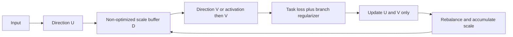
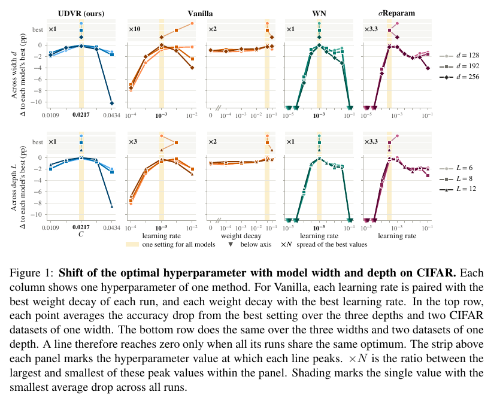

# UDVR: fixed directions with an optimizer-excluded scale buffer

<!-- source-sha256: 73bc8da43095deda0dbc2394d5a1725fa6a502b961ab4e450aed30e379bca991 -->

[简体中文](README.md)

## Paper information

| Field | Content |
| --- | --- |
| Paper | [Weight Scale Rebalancing: Transferable Training Recipes for Transformers](https://arxiv.org/abs/2611.32866v1); [fixed-v1 PDF](https://arxiv.org/pdf/2611.32866v1) |
| Institution | Yikun Hou, Naomi Graham and Alp Yurtsever: Department of Mathematics and Mathematical Statistics, Umeå University |
| First publication | `2026-11-24T16:03:02Z`; reviewed on 2026-11-25, not a new publication date |
| Authors' source code | No paper-specific public implementation found in the fixed-v1 paper or abstract; not found / not released, with no verified revision |
| Local key / adapter | `udvr`; `adapter: null` |
| Local code | `src/auto_research/foundation_models/udvr.py` |
| Status | CPU-only `component_only` / `l1_mechanism`; no CUDA path, full model training or evolve integration |

## Original paper summary

### Background and changes

A bilinear map admits differently scaled factors, but optimization is not invariant to these representations. UDVR inserts a diagonal buffer $D$ into natural QK, VO and FFN pairs. After each optimizer update, it pins U-column and V-row norms and transfers scale into D. The buffer is excluded from optimization; it is not an independently learned Weight Normalization magnitude.



<!-- paper-figure:start -->
### Original paper figure



图片来自[原论文](https://arxiv.org/pdf/2611.32866v1#page=7); fixed-v1 page7 Figure1, visually checked with the complete caption and no scientific edits; 版权归原作者所有. The curves are paper results, not local measurements. [Provenance and SHA256](assets/provenance.json).
<!-- paper-figure:end -->

### Core equations

For $U\in\mathbb R^{d\times r},V\in\mathbb R^{r\times d}$, let $a=\alpha\sqrt d$, $s_k=\|U_{:,k}\|_2/a$, $\rho_k=\|V_{k,:}\|_2/a$, $S=\operatorname{diag}(s)$ and $R=\operatorname{diag}(\rho)$ after an optimizer update.

$$
U^+=US^{-1},\quad V^+=R^{-1}V,\quad D^+=SDR\quad(\text{attention}).
$$

Attention preserves the product exactly. For the FFN $\phi(xUD)V$, Appendix C instead uses $D^+=SD$: V is still projected but its removed scale is discarded. Function invariance is therefore not claimed for arbitrary activations such as GELU.

$$
\mathcal R_{attn}=\gamma(\|UD\|_F^2+\|DV\|_F^2),\quad
\mathcal R_{ffn}=2\gamma(\|UD\|_F^2+\|V\|_F^2),
$$

$$
\eta_{attn}=C\alpha,\qquad\eta_{ffn}=\sqrt{d_{ffn}/d}\,C\alpha.
$$

The attention rate uses all stacked heads, without another head-count divisor. The paper fixes $\alpha=.01,C=.0217,\gamma=10^{-7}$. The FFN regularizer's factor2 is necessary because only U-side shrinkage reaches D.

### Reported results

Paper Table3 reports mean CIFAR-10/100 accuracy of88.55/67.95 for UDVR and87.00/66.62 for per-model-tuned Vanilla. These are not local results. The paper notes that WN also has a consistent optimum over these scales, so UDVR's distinction is not merely a more stable optimum. Further experiments cover DomainNet, ImageNet and120M–1.3B language pretraining. Production online A/B: not reported.

### Related mechanism and limits

[ProLand](../2611.00236-proland/README-en.md) coordinates product-space spectral updates and independently restores a LoRA factor toward the Stiefel manifold. UDVR pins lengths without orthogonality and accumulates scale. QR orthogonalization or independent Muon updates are not substitutes. The peer README was read and its hash is recorded in the batch deep-dive proposal.

## Local reproduction

### Data and code mapping

`rebalance` implements both branches; `UDVPair` provides actual autograd, Adam and a non-optimized buffer; `learning_rates` implements Eq4. Only finite CPU FP32/FP64 tensors are supported. Zero directions, invalid shapes/constants and non-CPU inputs fail. There is no Transformer retrofit, full QK/VO multi-head structure, SwiGLU modification or paper-data training. Callers must explicitly invoke `rebalance_()` after every optimizer step.

```bash
PYTHONPATH=src python -c 'from auto_research.foundation_models.udvr import diagnostic; print(diagnostic(42))'
python -m pytest tests/test_nov25_foundation_components.py -q
```

### Checks and results

Preflight seeds42/43/44 use6-by-4 and4-by-6 matrices. Initial attention-product maximum errors range from $4.44\times10^{-16}$ to $8.88\times10^{-16}$; after four actual Adam steps, direction-norm errors are at most $6.94\times10^{-18}$. The FFN non-invariance control is nonzero. The [preflight snapshot](../../research-audits/nov25-latest/preflight-udvr.json) is not frozen-source release evidence. The [unified frozen three-seed artifact](metrics/component-cpu-seeds42-44.json) is authoritative only according to its actual completion status; it supports L1, not cross-model hyperparameter transfer.

### High-cost full experiments

Not reproduced due to cost; review DONE. Appendix D specifies A10040GB, CIFAR200/300epochs with grids and three seeds, ImageNet300epochs on eight GPUs, and120M–1.3B language models over7Btokens each with three seeds. This matrix exceeds one A100/A30 or a local Mac. This is a published-configuration assessment, not measured local training time. No data/weights or full-training probe were downloaded/run. Terminal status: `not_reproduced_high_cost`, without automatic retries, implementation queuing or evolve promotion.
