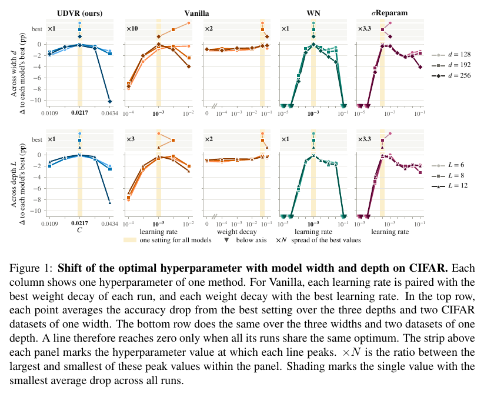

# UDVR：把方向固定、把尺度留在非优化 buffer

[English](README-en.md)

## 论文信息

| 字段 | 内容 |
| --- | --- |
| 论文链接 | [Weight Scale Rebalancing: Transferable Training Recipes for Transformers](https://arxiv.org/abs/2611.32866v1)；[固定 v1 PDF](https://arxiv.org/pdf/2611.32866v1) |
| 公司 / 作者机构 | Yikun Hou、Naomi Graham、Alp Yurtsever：Umeå University，数学与数理统计系 |
| 首次公开日期 | `2026-11-24T16:03:02Z`；本轮审查日 2026-11-25，不把发现日当首发日 |
| 原作者开源代码 | 固定 v1 全文与摘要未找到作者专用公开实现，未找到 / 尚未发布；无可核 revision |
| 本地 adapter / 稳定键 | `udvr`，`adapter: null` |
| 本地复现代码目录 | `src/auto_research/foundation_models/udvr.py` |
| 实现状态 | CPU-only `component_only` / `l1_mechanism`，不是完整模型训练；无 CUDA 路径或 evolve 集成 |

## 原始论文总结

### 背景与主要改动

同一个双线性映射可由许多不同尺度的矩阵因子表示，但优化器对这些表示并不等价。UDVR 在 attention 的 QK、VO 和 FFN 自然配对矩阵之间加对角 buffer $D$，每步更新后固定 $U$ 的列范数和 $V$ 的行范数，并把尺度移入 $D$。$D$ 不接受优化器更新；它不是 Weight Normalization 的独立可学习幅值。


<!-- paper-figure:start -->
### 原论文关键图



图片来自[原论文](https://arxiv.org/pdf/2611.32866v1#page=7)，固定 v1 第 7 页 Figure 1；保留原图与完整图注，已视觉核对，无科学内容编辑；版权归原作者所有。图中跨模型曲线是作者结果，不是本地小矩阵结果。[来源与 SHA256](assets/provenance.json)。
<!-- paper-figure:end -->

### 核心公式

设 $U\in\mathbb R^{d\times r},V\in\mathbb R^{r\times d}$，目标方向范数 $a=\alpha\sqrt d$。在一次优化器更新后，令 $s_k=\|U_{:,k}\|_2/a,\rho_k=\|V_{k,:}\|_2/a$，$S=\operatorname{diag}(s),R=\operatorname{diag}(\rho)$。

$$
U^+=US^{-1},\quad V^+=R^{-1}V,\quad D^+=SDR\quad(\text{attention}).
$$

attention 有 $U^+D^+V^+=UDV$。FFN 为 $\phi(xUD)V$；原文 Appendix C 使用 $D^+=SD$，仍投影 $V$ 但丢弃其尺度，因此不能声称 GELU 等任意激活下函数不变。

$$
\mathcal R_{attn}=\gamma(\|UD\|_F^2+\|DV\|_F^2),\quad
\mathcal R_{ffn}=2\gamma(\|UD\|_F^2+\|V\|_F^2).
$$

$$
\eta_{attn}=C\alpha,\qquad\eta_{ffn}=\sqrt{d_{ffn}/d}\,C\alpha.
$$

attention 学习率按所有 heads 堆叠后的宽度推导，不额外除以 head 数。论文固定 $\alpha=.01,C=.0217,\gamma=10^{-7}$；FFN 的正则系数 2 不能漏掉，因为仅 $U$ 侧尺度传入 $D$。

### 论文离线与线上效果

原文 Table 3 的 CIFAR-10/100 平均 accuracy 分别为 UDVR 88.55/67.95、逐模型调参 Vanilla 87.00/66.62；这些是论文实验口径，不是本地指标。原文说明 WN 的最优学习率也可跨所测尺度一致，UDVR 的优势不只是“最优点更稳定”。另有 DomainNet、ImageNet 与 120M 至 1.3B 语言预训练实验；生产线上 A/B：未报告。

### 同主题比较与边界

[ProLand](../2611.00236-proland/README.md)约束 LoRA 的一个因子接近 Stiefel 流形，并从乘积空间协调谱更新；UDVR不要求列正交，只固定每列／行长度、积累尺度。把 UDVR 换成 QR 正交化，或给两因子各跑 Muon，都改变定义。已审读该 peer README，指纹记录在本轮 deep-dive 提案。

## 本地复现

### 数据协议与代码映射

`rebalance` 精确执行两种分支，`UDVPair` 用真实 autograd、Adam 和非优化 buffer，`learning_rates` 执行 Eq4。仅 CPU FP32/FP64 有限小张量；零范数、非法 shape／常数及非 CPU 输入失败。没有矩阵安装到 Transformer、完整 QK/VO 多头结构、SwiGLU 改造或原文数据训练。调用者必须在每个优化器 step 后显式调用 `rebalance_()`。

```bash
PYTHONPATH=src python -c 'from auto_research.foundation_models.udvr import diagnostic; print(diagnostic(42))'
python -m pytest tests/test_nov25_foundation_components.py -q
```

### 结果与负控

42/43/44 的 $6\times4$ 与 $4\times6$ 预检查完成：初始 attention 乘积最大误差为 $4.44\times10^{-16}$ 至 $8.88\times10^{-16}$，4 次真实 Adam 更新后方向范数误差不超过 $6.94\times10^{-18}$。FFN 函数变化负控为非零，未把它藏成“等价变换”。[预检查快照](../../research-audits/nov25-latest/preflight-udvr.json)不作为正式冻结源指标；[统一冻结三 seed 证据](metrics/component-cpu-seeds42-44.json)以该产物的实际完成状态为准，仅支持 L1 机制，不等于跨模型调参结论。

### 高成本完整实验

成本过高，不复现（审查 DONE）。Appendix D 给出 A100 40GB；CIFAR 为 200/300 epochs、多个网格和三 seed，ImageNet 为 8 GPU、300 epochs，语言模型为 120M–1.3B、每模型 7B tokens 及三 seed。相对单张 A100/A30 或 Mac，此完整矩阵明显超预算；依据是已发表配置，不是本地计时估计。未下载数据／权重、未试跑完整训练；终态 `not_reproduced_high_cost`，不自动重试、不进入实现队列或 evolve。
