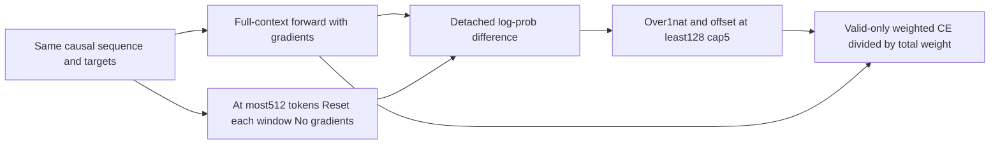
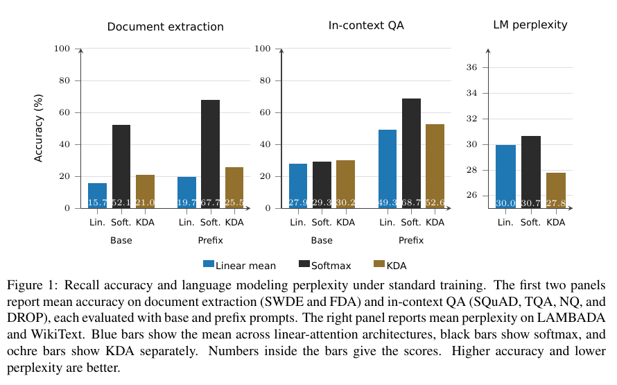

# TLCE: more supervision for predictions already using distant context

<!-- source-sha256: acab1c57bc187f65dfb30ab2a809f542ec9341ea0bd92a58fd058feb20e149e6 -->

[简体中文](README.md)

## Paper information

| Field | Content |
| --- | --- |
| Paper | [Eliciting the Recall Capacity of Linear Attention](https://arxiv.org/abs/2611.32969v1); [fixed-v1 PDF](https://arxiv.org/pdf/2611.32969v1) |
| Institutions | Johan Lindqvist: ELLIS Institute Tübingen / MPI-IS / Tübingen AI Center / KTH Royal Institute of Technology; Antonio Orvieto lists the first three |
| First publication | `2026-11-24T17:07:06Z`; reviewed on 2026-11-25 |
| Authors' source code | No paper-specific public implementation found in fixed v1; not found / not released, with no verified revision. FLA, FLAME and lm-evaluation-harness are general dependencies, not this paper's release |
| Local key / adapter | `thresholded-longce`; `adapter: null` |
| Local code | `src/auto_research/foundation_models/thresholded_longce.py` |
| Status | CPU-only `component_only` / `l1_mechanism`; no CUDA path, linear-attention backbone or evolve mapping |

## Original paper summary

### Background and changes

Fixed recurrent states can learn substantial associative storage on targeted tasks, yet standard language pretraining does not reliably elicit copying. The paper separates capacity, training incentives and recall prompts. Qualifying AR-hits account for about1.7% of held-out tokens, motivating sentence repetition and Thresholded LongCE (TLCE). These complementary interventions may cost general language modeling; available capacity does not imply recall on every task.



<!-- paper-figure:start -->
### Original paper figure



图片来自[原论文](https://arxiv.org/pdf/2611.32969v1#page=5); fixed-v1 page5 Figure1, visually checked with its complete caption and no scientific edits; 版权归原作者所有. This is the standard-training baseline, not a TLCE ablation or local result. [Provenance and SHA256](assets/provenance.json).
<!-- paper-figure:end -->

### Core equations

For the same target, $\Delta_i=\operatorname{sg}(\log p_{full}(y_i)-\log p_{short}(y_i))$. Short-context windows contain at most512tokens and reset state/attention at boundaries. With preceding boundary $s_i$:

$$
w_i=\begin{cases}\min(e^{\Delta_i},5),&\Delta_i>1\ \text{and}\ i-s_i\ge128,\\1,&\text{otherwise},\end{cases}
\qquad\mathcal L=-\frac{\sum_{i\in valid}w_i\log p_{full}(y_i)}{\sum_{i\in valid}w_i}.
$$

The1nat threshold is strict; offset128 is included. Weights are detached, the extra short forward has no gradients, and the denominator is total weight rather than token count. TLCE does not discover a distant cue the model has not yet learned to use.

Sentence repetition is a separate intervention: sentence-aligned spans averaging64tokens are copied to later sentence boundaries in the same context, with roughly10% repetition. It is not implemented locally; the TLCE component does not reproduce both interventions.

### Reported results

Combined repetition/TLCE narrows the long-distance AR-hit loss gap to standard-trained softmax with a language-modeling tradeoff. Appendix H reports full-training KDA document-extraction accuracy48.9%, versus39.1% for combined cooldown interventions and52.1% for standard softmax. Mean LAMBADA/WikiText perplexity penalties are approximately1.8 and1.9. This does not isolate content replacement; arms use one training seed, so small differences are not robust rankings. Production online A/B: not reported.

### Related mechanism and limits

[MERLIN](../2610.37645-merlin/README-en.md) changes historical readout through routing-key moments over multiple states. TLCE changes target weighting without changing recurrent equations or state size. Flexible routing and recall-focused supervision are separate axes, not interchangeable explanations or directly comparable benchmark gains. The peer README was read and hashed in the batch deep-dive proposal.

## Local reproduction

### Data and code mapping

`weights` / `loss` implement Eq4 over matching CPU FP32/FP64 target log-probabilities, int64 window offsets and a valid mask. Padding is excluded from the denominator; valid targets must be nonempty, finite and have nonpositive log-probabilities. `context_scores` actually executes full and no-grad windowed forwards on an external causal model. Callers provide already-shifted tokens/targets; every call must reset model state and avoid inconsistent stochasticity. This is not a dataset, teacher or gold-answer reader.

```bash
PYTHONPATH=src python -c 'from auto_research.foundation_models.thresholded_longce import diagnostic; print(diagnostic(42))'
python -m pytest tests/test_nov25_foundation_components.py -q
```

### Checks and results

Preflight CPU seeds42/43/44 pass strict-threshold, offset128, cap5, valid-denominator, detached-weight, no-grad-short and actual state-reset checks. A260-token,9-word,4-dimensional GRU only diagnoses the interface; it is not the paper's KDA, DeltaNet or softmax training comparison. Synthetic weights are `[1,1,5,5]` with loss2; the full gradient is checked directly against $-w/\sum w$. The [preflight snapshot](../../research-audits/nov25-latest/preflight-thresholded-longce.json) is not frozen-source release evidence. The [unified frozen three-seed artifact](metrics/component-cpu-seeds42-44.json) is authoritative according to its actual completion status and does not establish language recall capability.

### High-cost full experiments

Not reproduced due to cost; review DONE. Appendix B specifies approximately340Mparameters,20layers,width1024,15Btokens,4096context,batch128 and28672steps across four linear mixers and softmax, plus61.7M/2.52Btoken intervention sweeps. This matrix exceeds a bounded one-A100/A30 or local-Mac budget. Transferable GPU hours are not reported and are not invented. No data/models or trial pretraining were downloaded/run. Terminal `not_reproduced_high_cost`, with no automatic retries, implementation queue or evolve promotion.
