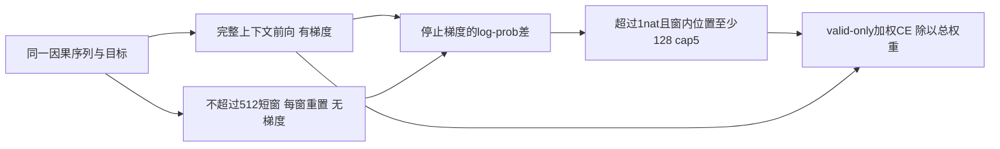
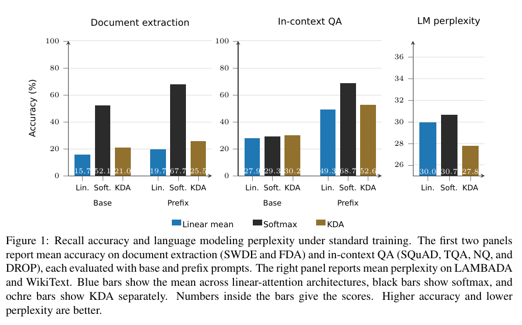

# TLCE：让已经用到远处上下文的预测获得更多监督

[English](README-en.md)

## 论文信息

| 字段 | 内容 |
| --- | --- |
| 论文链接 | [Eliciting the Recall Capacity of Linear Attention](https://arxiv.org/abs/2611.32969v1)；[固定 v1 PDF](https://arxiv.org/pdf/2611.32969v1) |
| 公司 / 作者机构 | Johan Lindqvist：ELLIS Institute Tübingen / MPI-IS / Tübingen AI Center / KTH Royal Institute of Technology；Antonio Orvieto 为前三机构 |
| 首次公开日期 | `2026-11-24T17:07:06Z`；审查日 2026-11-25 |
| 原作者开源代码 | 固定 v1 未找到作者专用公开实现，未找到 / 尚未发布；引用的 FLA、FLAME 与 lm-evaluation-harness 是通用依赖，不算本文源码；无可核 revision |
| 本地 adapter / 稳定键 | `thresholded-longce`，`adapter: null` |
| 本地复现代码目录 | `src/auto_research/foundation_models/thresholded_longce.py` |
| 实现状态 | CPU-only `component_only` / `l1_mechanism`；无 CUDA 路径、线性注意力 backbone 或 evolve 映射 |

## 原始论文总结

### 背景与主要改动

线性注意力的固定状态可以在专门训练的任务中存储大量关联，但标准语言预训练并不一定教会模型从上下文复制。论文分开研究容量、训练诱因和召回提示；目标语料里 qualifying AR-hit 仅约占 1.7%，因此增添句子重复，并用 Thresholded LongCE（TLCE）强化依赖远上下文的 token。两种干预互补，但可能牺牲通用语言建模；不能把“存在容量”写成“任意任务都能召回”。



<!-- paper-figure:start -->
### 原论文关键图



图片来自[原论文](https://arxiv.org/pdf/2611.32969v1#page=5)，固定 v1 第 5 页 Figure 1；完整图注已保留并视觉核对，无科学内容编辑；版权归原作者所有。该图是标准训练基线，不能误标成 TLCE 消融或本地结果。[来源与 SHA256](assets/provenance.json)。
<!-- paper-figure:end -->

### 核心公式

同一目标 $y_i$ 的完整／短窗条件概率之差为 $\Delta_i=\operatorname{sg}(\log p_{full}(y_i)-\log p_{short}(y_i))$。短窗最多 512 tokens，窗口边界重置状态和注意力。令 $s_i$ 为前一短窗边界：

$$
w_i=\begin{cases}\min(e^{\Delta_i},5),&\Delta_i>1\ \text{且}\ i-s_i\ge128,\\1,&\text{其他},\end{cases}
\qquad\mathcal L=-\frac{\sum_{i\in valid}w_i\log p_{full}(y_i)}{\sum_{i\in valid}w_i}.
$$

超过 1 nat 是严格大于；128 是包含边界。权重整体 stop-gradient，短窗仅多一次无梯度前向；归一化分母是总权重而非 token 数。若模型尚未使用远处线索、full 概率没有明显更高，TLCE 不会凭空发现该线索。

句子重复是另一项独立干预：把平均 64-token 的句子对齐片段复制到同上下文后面的句界，约 10% 的重复率增加召回监督。它未包含在本地组件中；不能把只做 TLCE 写成两干预都已复现。

### 论文离线与线上效果

原文报告重复与 TLCE 联合后缩小长距离 AR-hit loss 相对标准 softmax 的差距，但伴随语言建模成本。Appendix H 的全程 KDA 联合训练，document extraction accuracy 从 cooldown 联合干预的 39.1% 到 48.9%，标准 softmax 为 52.1%；平均 LAMBADA/WikiText 困惑度惩罚分别约 1.8 与 1.9。该比较不单独隔离内容替换因素，各臂仅一个训练 seed，小差异不能作稳健排名。生产线上 A/B：未报告。

### 同主题比较与边界

[MERLIN](../2610.37645-merlin/README.md)增加多状态段级读取的 routing key 矩统计，改变模型如何读取历史；TLCE不改状态大小或递归公式，而改变训练信号中不同目标的位置权重。路由更灵活与训练更偏重召回是两个轴，不能互相取代或直接拿不同 benchmark 的提升比较。已审读 peer README，SHA 记录在本轮 deep-dive 提案。

## 本地复现

### 数据协议与代码映射

`weights` / `loss` 执行 Eq4，接受同形 CPU FP32/FP64 的目标 log-prob、int64 窗内位置和 valid mask。padding 不进入分母，合法目标必须非空、有限且 log-prob 不大于零。`context_scores` 对外部因果模型实际运行完整前向与分窗无梯度前向；调用者提供已经移位对齐的 tokens/targets，模型每次调用必须重置状态，且不应引入前后不一致的随机性。接口不是数据集、teacher 或 gold 答案读取器。

```bash
PYTHONPATH=src python -c 'from auto_research.foundation_models.thresholded_longce import diagnostic; print(diagnostic(42))'
python -m pytest tests/test_nov25_foundation_components.py -q
```

### 结果与负控

42/43/44 的 CPU 预检查均完成：严格阈值／128边界／cap5、valid 分母、全权重断梯度、short 无梯度以及实际短窗状态重置通过。260-token、9词表、4维 GRU 只是短窗接口诊断，不是论文的 KDA、DeltaNet 或 softmax 对照训练。合成权重为 `[1,1,5,5]`，损失为 2；并直接核对 full 梯度为 $-w/\sum w$。[预检查快照](../../research-audits/nov25-latest/preflight-thresholded-longce.json)不作为正式冻结源指标；[统一冻结三 seed 证据](metrics/component-cpu-seeds42-44.json)以实际完成状态为准，不支持自然语言召回能力结论。

### 高成本完整实验

成本过高，不复现（审查 DONE）。Appendix B 的主实验约 340M、20 层、1024 宽、15B tokens、4096 context、batch128、28672 steps，比较四类线性 mixer 与 softmax；另有 61.7M／2.52B-token 多臂消融。依据这些发表配置，完整训练矩阵超单张 A100/A30 或 Mac 的有界预算；原文未给可移用 GPU 小时，不编造。未下载数据／模型、未试跑；终态 `not_reproduced_high_cost`，无自动重试、实现队列或 evolve 晋级。
