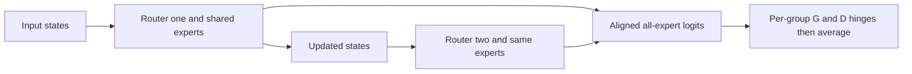
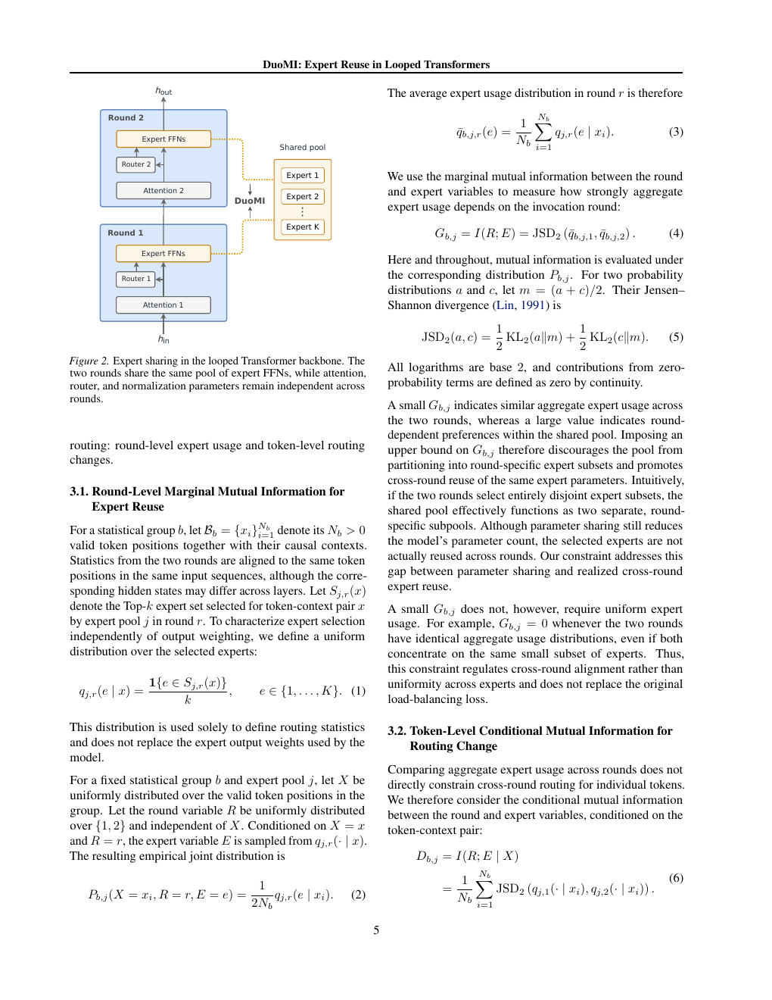

# DuoMI: Dual Mutual Information Regularization for Expert Reuse in Looped Transformers

<!-- source-sha256: 4275d915a8f5ae6311fbfc05ebf3c4639a85d8a1761deda8f9cabdde036f7033 -->
[简体中文](README.md)

## Paper information

| Field | Content |
| --- | --- |
| Paper | [Fixed v1](https://arxiv.org/abs/2611.33952v1); [PDF](https://arxiv.org/pdf/2611.33952v1) |
| Institutions | Huawei Foundation Model Lab; first author Xinlai Kang: Huawei Foundation Model Lab |
| Original publication | `2026-11-25T08:13:44Z`; reviewed on 2026-11-26, not a new publication date |
| arXiv announcement | `2026-11-26`, verified in the official cs.LG new / cs.AI cross-list bulletin; distinct from the v1 submission timestamp |
| Author code | Not found / not released after fixed-v1 and bounded author/title checks. |
| Local adapter / key | `duomi`; adapter null; no Evolve integration |
| Local reproduction code | `src/auto_research/foundation_models/duomi.py` |
| Status | CPU-only component_only / l1_mechanism; no CUDA path or capability claim |

## Original paper

### Background and method

The two invocations share expert FFNs but have independent attention, routers and normalization. Aggregate usage can agree while every token replaces its experts. Token-level change alone can still permit round-specific subpools. DuoMI separately controls aggregate and conditional round–expert dependence using differentiable all-expert softmax distributions, not hard Top-k membership.



<!-- paper-figure:start -->
### Original paper figure



Unmodified full-page raster from the [paper](https://arxiv.org/pdf/2611.33952v1#page=5), visually reviewed on2026-11-26. Copyright belongs to the original authors. This is the paper's method/results, not a local measurement. [Provenance and SHA256](assets/provenance.json).
<!-- paper-figure:end -->

### Core equations

For aligned valid positions, $p_{i,r}=\operatorname{softmax}(z_{i,r}/\tau)$ and base-two JSD:

$$
G_{b,j}=\operatorname{JSD}_2(\overline p_1,\overline p_2),\qquad
D_{b,j}=\frac1{N_b}\sum_i\operatorname{JSD}_2(p_{i,1},p_{i,2}),\quad 0\le G\le D\le1.
$$

$$
\Phi_{b,j}=\lambda_G[G_{b,j}-g_{max}]_+^2+\lambda_L[d_{min}-D_{b,j}]_+^2+\lambda_U[D_{b,j}-d_{max}]_+^2.
$$

$$
L=L_{base}+\frac{w_t}{BM}\sum_b\sum_j\Phi_{b,j}.
$$

Each group has eight sequences. Apply thresholds per group and pool before averaging. Defaults:tau=1,g_max=.02bits,D-band[.05,.30]bits,and weights.1. Soft D is not the Top-k replacement fraction; D=1-retention holds only for uniform hard Top-k distributions. The language, load-balancing and z-loss objectives retain their baseline coefficients.

### Reported results

Table1 reports a15-task average rising from50.08 to51.82(+1.74percentage points) on one looped OLMoE backbone; nine tasks improve and some regress. The unshared OLMoE reference is51.15. This is not evidence that every looped/MoE architecture benefits. No production A/B is reported.

### Comparison and limits

DuoMI regulates realized expert reuse using aggregate alignment and a token-level change band computed from all-expert soft routing at aligned positions in two rounds. [Reviewed peer:echomoe](../2611.22215-echomoe/README-en.md). EchoMoE reuses activation references and compresses communication deltas; DuoMI shares expert parameters and regularizes routing. A reference is not an expert pool. Communication reduction and routing reuse are different benefits, and tensor gradients establish no language-model gain. The peer source fingerprint is recorded in the deep-dive proposal.

## Local reproduction

### Data and code contract

PairedSharedExperts uses distinct routers/LayerNorms on successive states and invokes the same GELU FFN expert pool twice. Sparse Top-k dispatch and its weighting are unchanged by regularization. The penalty uses aligned pre-dispatch logits and eight-sequence groups with real backpropagation. This is only a coupled FFN component: no attention, causal LM, global balancing, expert parallelism or MindSpeed integration.

```bash
PYTHONPATH=src python -c 'from auto_research.foundation_models.duomi import diagnostic; print(diagnostic(42))'
python -m pytest tests/test_nov26_foundation_components.py -q
```

### Evidence and negative controls

The diagnostic explicitly uses a[.5,.8]D-band to activate lower-bound gradients, not to tune capability; library defaults retain[.05,.30]. Checks cover gradients into both routers/shared experts, updates,G<=D and unchanged dispatch. Negative controls cover aggregate cancellation with token swapping, threshold-before-group-averaging and excluded padding. Formal frozen evidence belongs to the common runner, not early preflight.

### High-cost full experiments

Appendix B specifies4.5B unique trainable parameters,1.3B active/token,16layers,64experts/Top8,and FineWeb-Edu sample-100BT:50000updates x512sequences x4096=104857600000token positions, plus comparator/threshold retraining. The complete matrix exceeds a bounded single-A100/A30-or-Mac budget. This is configuration-based, not an invented GPU-hour measurement.

**Too costly; not reproduced (review DONE).** This terminal decision applies to the complete paper matrix, distinct from bounded CPU components. Resolution:`not_reproduced_high_cost`. No large-resource download,trial training,automatic retry,implementation queue or Evolve promotion; full experiments do not block review closure.
