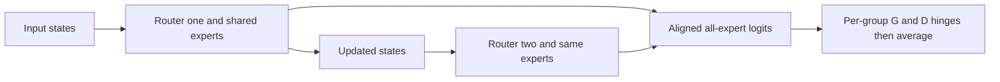
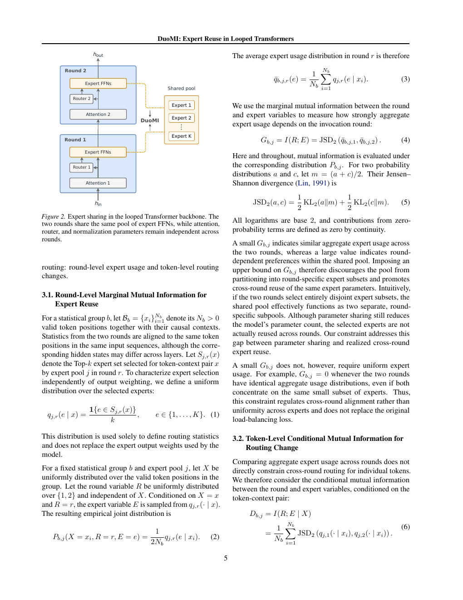

# DuoMI: Dual Mutual Information Regularization for Expert Reuse in Looped Transformers

[English](README-en.md)

## 论文信息

| 字段 | 内容 |
| --- | --- |
| 论文链接 | [固定 v1](https://arxiv.org/abs/2611.33952v1)；[原文 PDF](https://arxiv.org/pdf/2611.33952v1) |
| 公司 / 作者机构 | Huawei Foundation Model Lab；一作 Xinlai Kang：Huawei Foundation Model Lab |
| 首次公开日期 | `2026-11-25T08:13:44Z`（arXiv v1）；本轮发现/审查日 2026-11-26，不混作首发时间 |
| arXiv 公告日期 | `2026-11-26`；已核本轮官方 cs.LG new / cs.AI cross-list 公告，不改写 v1 首发时间 |
| 原作者开源代码 | 未找到 / 尚未发布。固定 v1 全文、PDF链接与摘要未找到作者专用公开源码；本轮有界标题/作者搜索也未找到，未找到/尚未发布，不将MindSpeed-LLM依赖当成DuoMI代码。 |
| 本地 adapter / 稳定键 | `duomi`；`adapter: null`；不接入 Evolve |
| 本地复现代码目录 | `src/auto_research/foundation_models/duomi.py` |
| 实现状态 | CPU-only component_only / l1_mechanism；没有CUDA承诺或能力提升声明 |

## 原始论文总结

### 背景与主要改动

两次调用共享expert FFN，但attention、router与normalization独立。仅看总体expert使用分布会漏掉每个token全部换expert的情况；仅看逐token变化又可能允许两轮偏好不同子池。DuoMI分别限制聚合round–expert依赖和token条件下的round–expert依赖，训练使用全部expert的softmax而非无梯度的硬Top-k集合。



<!-- paper-figure:start -->
### 原论文关键图



图片来自[原论文](https://arxiv.org/pdf/2611.33952v1#page=5)；未经科学内容编辑的整页栅格，含 Figure 2 完整图注，2026-11-26 已目视核对。版权归原作者所有；图中方法/结果不是本地测量。[来源与 SHA256](assets/provenance.json)。
<!-- paper-figure:end -->

### 核心公式

For aligned valid positions, $p_{i,r}=\operatorname{softmax}(z_{i,r}/\tau)$ and base-two JSD:

$$
G_{b,j}=\operatorname{JSD}_2(\overline p_1,\overline p_2),\qquad
D_{b,j}=\frac1{N_b}\sum_i\operatorname{JSD}_2(p_{i,1},p_{i,2}),\quad 0\le G\le D\le1.
$$

$$
\Phi_{b,j}=\lambda_G[G_{b,j}-g_{max}]_+^2+\lambda_L[d_{min}-D_{b,j}]_+^2+\lambda_U[D_{b,j}-d_{max}]_+^2.
$$

$$
L=L_{base}+\frac{w_t}{BM}\sum_b\sum_j\Phi_{b,j}.
$$

每组8条序列；先逐group、逐pool计算阈值罚项，再平均。默认tau=1、g_max=.02 bits、D区间[.05,.30] bits、三个权重均.1。D是平均JSD，soft D不是Top-k替换比例；只有均匀硬Top-k分布才有D=1−retention。基础语言、负载均衡与z-loss保持原配置。

### 论文离线与线上效果

作者Table1在同一looped OLMoE骨干15项下游任务的平均分由50.08升至51.82（+1.74个百分点）；9项改善、部分任务下降。未共享expert的OLMoE参考为51.15。结论只覆盖该骨干，不等于所有loop/MoE结构都获益。生产线上 A/B：未报告。

### 同主题比较与边界

DuoMI按相同token在两轮的全部expert软路由计算两种互信息：聚合使用对齐与逐token变化区间，训练时约束共享expert池的实际复用。 [已审读的对照：echomoe](../2611.22215-echomoe/README.md)。EchoMoE复用跨层激活参考并压缩通信变化量；DuoMI共享expert参数并约束路由。前者的reference不是后者的expert池，减少通信和改变专家复用不是可交换收益；小张量反传不代表语言模型提升。 对照README的SHA256记录于本轮deep-dive提案。

## 本地复现

### 数据协议与代码映射

`PairedSharedExperts`确实用两个独立router/LayerNorm读取连续状态，两轮调用同一GELU FFN expert池，稀疏Top-k派发和原加权不受正则改变。`duomi_penalty`读取派发前logits，valid token对齐，按8序列分组并真实反传。仅FFN耦合组件，无attention/因果语言模型、全局负载均衡、expert parallel或MindSpeed集成，不能称完整looped Transformer。

```bash
PYTHONPATH=src python -c 'from auto_research.foundation_models.duomi import diagnostic; print(diagnostic(42))'
python -m pytest tests/test_nov26_foundation_components.py -q
```

### 结果与负控

本地默认诊断为激活下界梯度而显式使用D区间[.5,.8]，不是调参求能力收益；库默认保留论文[.05,.30]。检查两router与共享expert非零梯度、实际更新、G≤D和派发不变；负控验证总体分布相同但逐token完全互换、group平均后阈值错误及padding排除。统一runner负责正式冻结结果，早期preflight不写成paper metrics。

### 高成本完整实验

Appendix B给出4.5B独立可训练参数、1.3B active/token、16层64 experts/Top8、FineWeb-Edu sample-100BT，50000步×512序列×4096=104857600000 token positions；多对照/阈值重训。该完整训练矩阵明显超单A100/A30或Mac有界预算；成本来自配置估计，论文未给本地可用的完整时长，不编造GPU小时。

**成本过高，不复现（审查 DONE）**，指完整论文实验矩阵；局部CPU组件与完整矩阵分开。终态 `not_reproduced_high_cost`，不下载大资源、不试训估价、不自动重试、不进入自动实现队列或Evolve；不让完整实验延期阻塞本轮审查闭环。
