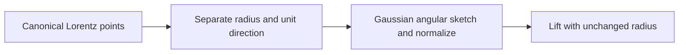
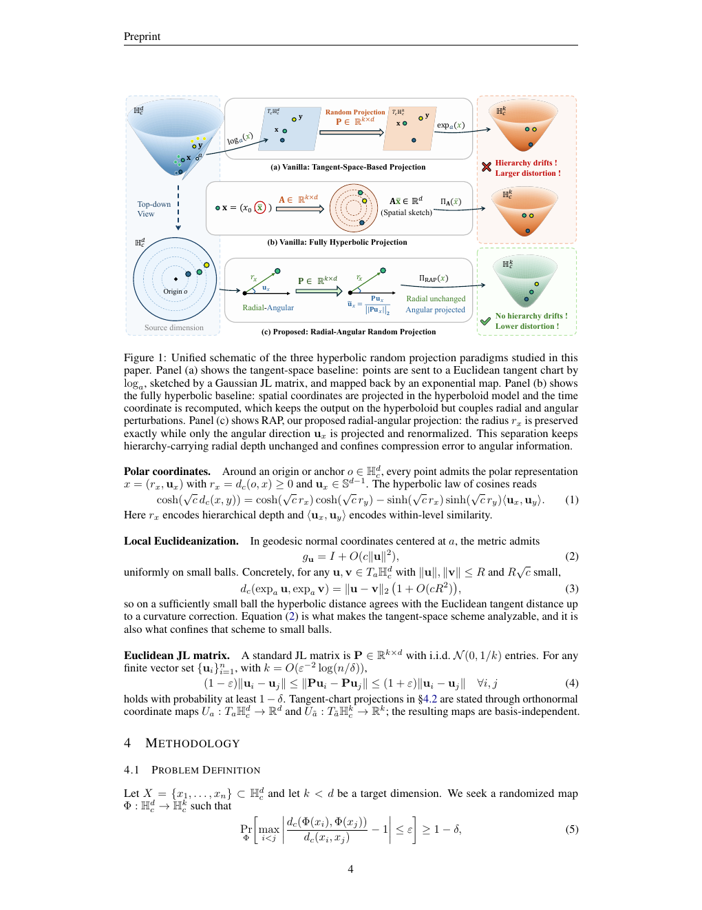

# RAP: Radial-Angular Random Projection for Hyperbolic Representations

<!-- source-sha256: 64ee21e21b476fe037a084b3c647e27e8d9526a00e2dc8373e8f8c6c248b1541 -->
[简体中文](README.md)

## Paper information

| Field | Content |
| --- | --- |
| Paper | [Fixed v1](https://arxiv.org/abs/2611.34298v1); [PDF](https://arxiv.org/pdf/2611.34298v1) |
| Institutions | The Chinese University of Hong Kong；Yale University；The Hong Kong University of Science and Technology (Guangzhou); first author Jiahong Liu: The Chinese University of Hong Kong |
| Original publication | `2026-11-25T12:50:23Z`; reviewed on 2026-11-26, not a new publication date |
| arXiv announcement | `2026-11-26`, verified in the official cs.LG new / cs.AI cross-list bulletin; distinct from the v1 submission timestamp |
| Author code | [Author repository](https://github.com/HUBERILT/RAP), HEAD `91afe946876ead00008465c6c75dcd0f94f5b5ff`; public Python repository verified, no declared license. Independently implemented from the formulas; upstream source was not copied. |
| Local adapter / key | `rap`; adapter null; no Evolve integration |
| Local reproduction code | `src/auto_research/foundation_models/rap.py` |
| Status | CPU-only component_only / l1_mechanism; no CUDA path or capability claim |

## Original paper

### Background and method

A spatial-coordinate sketch perturbs both radial depth and angular similarity. RAP separates them: keep radius, apply a Gaussian sketch to the unit direction, normalize, and lift to the target Lorentz hyperboloid. This is not ordinary Euclidean JL on the input coordinates. The finite-set guarantee still depends on bounded radii, pairwise separation and arcosh conditioning.



<!-- paper-figure:start -->
### Original paper figure



Unmodified full-page raster from the [paper](https://arxiv.org/pdf/2611.34298v1#page=4), visually reviewed on2026-11-26. Copyright belongs to the original authors. This is the paper's method/results, not a local measurement. [Provenance and SHA256](assets/provenance.json).
<!-- paper-figure:end -->

### Core equations

For $P_{ij}\sim\mathcal N(0,1/k)$, $r_x=d_c(o,x)$ and $u_x\in S^{d-1}$:

$$
\widetilde u_x=\frac{Pu_x}{\|Pu_x\|_2},\qquad
\Pi_{RAP}(x)=\frac1{\sqrt c}\left(\cosh(\sqrt c\,r_x),\sinh(\sqrt c\,r_x)\widetilde u_x\right).
$$

$$
\cosh(\sqrt c\,d_c(x,y))=\cosh(\sqrt c\,r_x)\cosh(\sqrt c\,r_y)-\sinh(\sqrt c\,r_x)\sinh(\sqrt c\,r_y)\langle u_x,u_y\rangle.
$$

These are Eq.11–12. Reject a non-origin direction in the projection kernel; map the origin to the target origin. Same-ray distances are exact, but arbitrary pairwise distances are not lossless.

### Reported results

In Table1, broad-radius n=512/k=32 gives mean relative distance distortion 0.040 for RAP versus about 0.077 for fully-hyperbolic and half-space projections. Appendix F.7 reports frozen-feature retrieval at k=64:18.31 versus15.24 for the strongest compressed comparator, below the uncompressed31.44. Improvement over compression baselines is not improvement over the original representation. No production A/B is reported.

### Comparison and limits

RAP reduces dimension within a hyperbolic geometry, preserving distance to a designated origin and projecting only the normalized angular direction without fitting data. [Reviewed peer:hvmap](../2611.01514-hvmap/README-en.md). HVMap learns paired mappings between heterogeneous encoder spaces and combines native/mapped scores. RAP does not align encoders or permit mixing arbitrary curvatures or origins. Their L1 components do not establish comparative semantic retrieval gains. The peer source fingerprint is recorded in the deep-dive proposal.

## Local reproduction

### Data and code contract

The component implements polar conversion, Eq.11–12, hyperbolic distances, and canonical-origin tangent/spatial comparators. It compresses128 synthetic32-dimensional points to8 dimensions. Source points and the projection matrix are paired locally, unlike the paper's independent per-method projection matrices. No WordNet, frozen vision-language features or million-point stress test is run.

```bash
PYTHONPATH=src python -c 'from auto_research.foundation_models.rap import diagnostic; print(diagnostic(42))'
python -m pytest tests/test_nov26_foundation_components.py -q
```

### Evidence and negative controls

Checks cover radii, the target hyperboloid, same-ray distance and origin preservation. Invalid directions, manifolds, finite values, curvature or non-origin projection kernels fail. Distortion is descriptive, not a capability claim. The integration owner separately collects frozen three-seed evidence; early preflight is not formal paper metrics.

### Full experiments and cost boundary

Core synthetic/WordNet projection is affordable and Appendix E explicitly describes CPU workloads without fitting. The million4096-dimensional-point stress test takes about11seconds and15.8GiB on one A40 in the paper; that is not evidence of prohibitive cost. The complete matrix also includes five frozen vision-language backbones,75 backbone–dataset cells and3375 compressed evaluations,but feature-file sizes,release paths and total runtime are not reported. The author repository exposes only the NumPy core and a256-point demo. There is insufficient evidence to label the whole paper high-cost. The accepted scope ends at bounded CPU L1; not undertaking the complete matrix is not a hardware-infeasibility claim.

The component scope is complete; the complete matrix was not run,not classified as prohibitively costly. Status:`not_run_scope_limited`; full_experiment_review_done:false. Review_done:true closes only this run's component/intake scope. No full-dataset outcome,automatic scope expansion,retry or Evolve claim.
