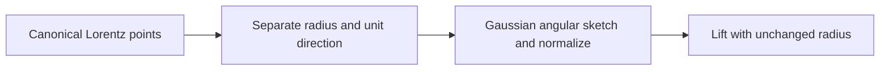
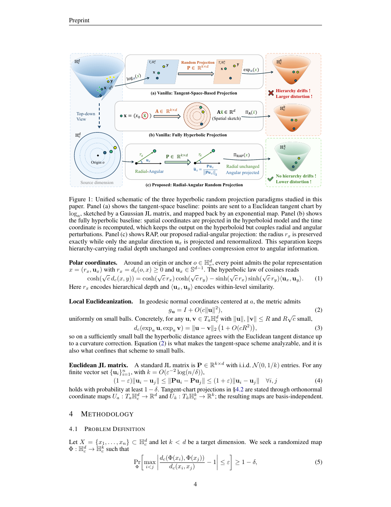

# RAP: Radial-Angular Random Projection for Hyperbolic Representations

[English](README-en.md)

## 论文信息

| 字段 | 内容 |
| --- | --- |
| 论文链接 | [固定 v1](https://arxiv.org/abs/2611.34298v1)；[原文 PDF](https://arxiv.org/pdf/2611.34298v1) |
| 公司 / 作者机构 | The Chinese University of Hong Kong；Yale University；The Hong Kong University of Science and Technology (Guangzhou)；一作 Jiahong Liu：The Chinese University of Hong Kong |
| 首次公开日期 | `2026-11-25T12:50:23Z`（arXiv v1）；本轮发现/审查日 2026-11-26，不混作首发时间 |
| arXiv 公告日期 | `2026-11-26`；已核本轮官方 cs.LG new / cs.AI cross-list 公告，不改写 v1 首发时间 |
| 原作者开源代码 | [作者仓库](https://github.com/HUBERILT/RAP)；HEAD `91afe946876ead00008465c6c75dcd0f94f5b5ff`。作者固定 v1 直接链接公开 Python 仓库，GitHub API 已确认 public；git ls-remote 核验 HEAD。未声明许可证，按论文公式独立实现，未复制源码。 |
| 本地 adapter / 稳定键 | `rap`；`adapter: null`；不接入 Evolve |
| 本地复现代码目录 | `src/auto_research/foundation_models/rap.py` |
| 实现状态 | CPU-only component_only / l1_mechanism；没有CUDA承诺或能力提升声明 |

## 原始论文总结

### 背景与主要改动

普通空间坐标投影会同时改变径向深度与角相似度。RAP拆开这两者：到所选原点的半径不变，角向量乘一次高斯矩阵后归一化，再提升回目标 Lorentz 双曲面。它不是对原始坐标做普通欧氏 JL；保证仍受半径上界、点间分离和 arcosh 条件数限制。



<!-- paper-figure:start -->
### 原论文关键图



图片来自[原论文](https://arxiv.org/pdf/2611.34298v1#page=4)；未经科学内容编辑的整页栅格，含 Figure 1 完整图注，2026-11-26 已目视核对。版权归原作者所有；图中方法/结果不是本地测量。[来源与 SHA256](assets/provenance.json)。
<!-- paper-figure:end -->

### 核心公式

For $P_{ij}\sim\mathcal N(0,1/k)$, $r_x=d_c(o,x)$ and $u_x\in S^{d-1}$:

$$
\widetilde u_x=\frac{Pu_x}{\|Pu_x\|_2},\qquad
\Pi_{RAP}(x)=\frac1{\sqrt c}\left(\cosh(\sqrt c\,r_x),\sinh(\sqrt c\,r_x)\widetilde u_x\right).
$$

$$
\cosh(\sqrt c\,d_c(x,y))=\cosh(\sqrt c\,r_x)\cosh(\sqrt c\,r_y)-\sinh(\sqrt c\,r_x)\sinh(\sqrt c\,r_y)\langle u_x,u_y\rangle.
$$

对应 Eq11–12。非原点方向若落入投影核则不可归一化，必须拒绝；原点映射为目标原点。同射线距离精确保留；任意角度的距离并非无损。

### 论文离线与线上效果

作者 Table1 的 broad-radius、n=512、k=32：平均相对距离失真 RAP 0.040，fully-hyperbolic 与 half-space 均约 0.077。Appendix F.7 的冻结视觉语言特征检索在 k=64 为18.31，对照15.24，未压缩31.44；所以相对压缩对照改善不等于超越未压缩表示。生产线上 A/B：未报告。

### 同主题比较与边界

RAP在同一双曲空间中压缩维度，保持每点到指定原点的半径，只随机投影并归一化角方向；不拟合数据。 [已审读的对照：hvmap](../2611.01514-hvmap/README.md)。HVMap学习异构编码器空间的配对映射并联合原生/映射分数；RAP不对齐不同编码器，也不能把不同曲率或原点的向量直接混用。二者解决的不是同一检索瓶颈，现有L1不支持语义检索收益比较。 对照README的SHA256记录于本轮deep-dive提案。

## 本地复现

### 数据协议与代码映射

`polar_to_lorentz`、`lorentz_to_polar`、`project_rap`、`pairwise_distance`真实执行极坐标分解、Eq11–12及双曲距离；另有原点 tangent 与 spatial 两对照。128个32维随机点压到8维，固定种子共享源点与投影矩阵，仅作机制诊断，和作者每方法独立随机投影协议不同。无WordNet、冻结视觉语言特征或百万点压力测试。

```bash
PYTHONPATH=src python -c 'from auto_research.foundation_models.rap import diagnostic; print(diagnostic(42))'
python -m pytest tests/test_nov26_foundation_components.py -q
```

### 结果与负控

检查半径、目标双曲面、同射线距离和原点不变；负控拒绝非单位方向、非双曲面、非有限数、非法曲率和非原点投影核。失真是描述性标量，不把某个seed的优劣断言为能力收益。正式冻结三seed指标由统一runner另行验收，本文不引用早期preflight冒充正式结果。

### 完整实验与成本边界

核心合成/WordNet投影可负担，Appendix E明确为CPU无拟合任务。百万4096维点压力测试作者单A40约11秒、峰值15.8GiB，不能据此认定高成本。完整矩阵另含五种冻结视觉语言backbone、75个backbone–dataset cells和3375次压缩评测，未报告特征文件体积、公开获取路径或总体时长；作者仓库只提供NumPy核心和256点demo。没有充分依据把全论文定为高成本。本轮授权范围止于小型CPU L1，不额外获取这些资源或执行完整矩阵；不把未承接写成硬件不可行。

本轮组件范围完成，完整矩阵未执行；不是高成本延期。`full_experiment_status: not_run_scope_limited`，`full_experiment_review_done: false`；`review_done: true`只说明本轮组件/选题范围闭环。未实测完整数据集效果，不自动扩展、重试或进入Evolve。
