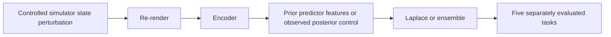
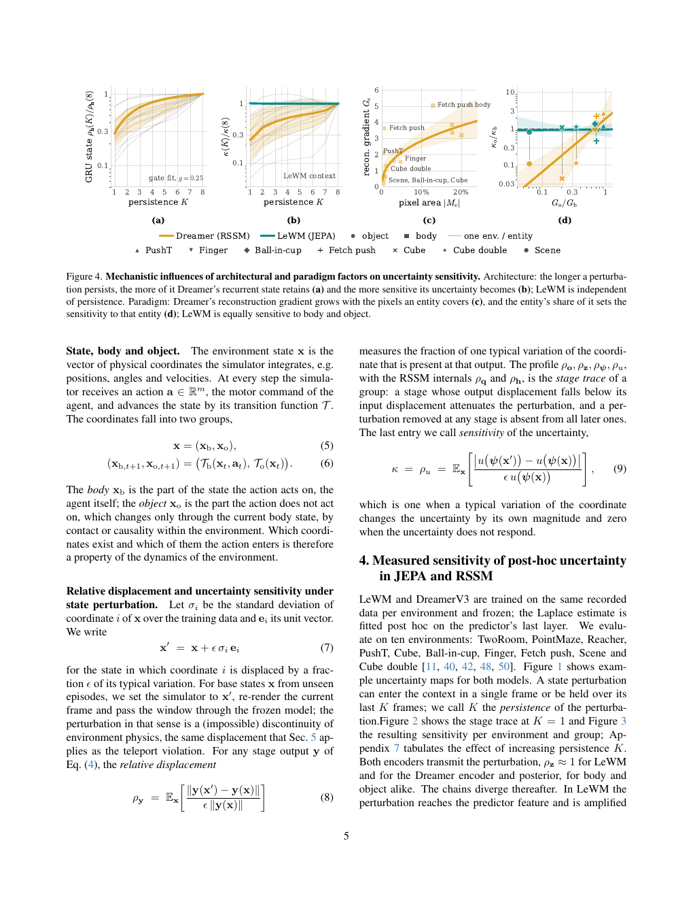

# Not all world models can doubt: how training objective and architecture shape epistemic uncertainty in JEPA and RSSM world models

<!-- source-sha256: 3a4cd54f9a6999d1a8faa0dbacc14e25f33e3d566ac69eb11423c40634110943 -->
[简体中文](README.md)

## Paper information

| Field | Content |
| --- | --- |
| Paper | [Fixed v1](https://arxiv.org/abs/2611.34830v1); [PDF](https://arxiv.org/pdf/2611.34830v1) |
| Institutions | Fraunhofer Heinrich-Hertz-Institut, Berlin, Germany; first author Simon Baur: Fraunhofer Heinrich-Hertz-Institut |
| Original publication | `2026-11-25T18:11:49Z`; reviewed on 2026-11-26, not a new publication date |
| arXiv announcement | `2026-11-26`, verified in the official cs.LG new / cs.AI cross-list bulletin; distinct from the v1 submission timestamp |
| Author code | Not found / not released after fixed-v1 and bounded author/title checks. |
| Local adapter / key | `jepa-eu`; adapter null; no Evolve integration |
| Local reproduction code | None: high-cost review only. |
| Status | review-only / deferred_high_cost; no CUDA path or capability claim |

## Original paper

### Background and method

After freezing LeWM/DreamerV3, fit last-layer Laplace on predictor features and compare five-head ensembles. Perturb simulator coordinates in training-standard-deviation units and re-render frames, tracing stage-wise displacement. Vary persistence K to examine recurrent averaging and inspect entity reconstruction gradients/pixel areas. This is an empirical diagnosis, not a completed causal ablation removing reconstruction or changing gates, nor a universal claim about JEPA/RSSM.

<!-- paper-figure:start -->
### Original paper figure

Unmodified full-page raster from the [paper](https://arxiv.org/pdf/2611.34830v1#page=5), visually reviewed on2026-11-26. Copyright belongs to the original authors. This is the paper's method/results, not a local measurement. [Provenance and SHA256](assets/provenance.json).
<!-- paper-figure:end -->

### Core equations

For frozen predictor feature $\psi$:

$$
\Lambda=\sigma^{-2}\sum_n\psi_n\psi_n^\top+\tau^{-2}I,\qquad s^2(\psi)=\psi^\top\Lambda^{-1}\psi.
$$

$$
x'=x+\epsilon\sigma_i e_i,\qquad
\rho_y=\mathbb E_x\frac{\|y(x')-y(x)\|}{\epsilon\|y(x)\|},\quad \kappa=\rho_{s^2}.
$$

A Laplace readout only sees its feature: a perturbation erased upstream cannot be recovered by changing that readout. The RSSM GRU admits a one-frame change through its gate and accumulates persistent changes; reconstruction allocates signal by pixels. The observation-dependent posterior feature is unavailable during imagination.

### Reported results

Table1 gives PushT unfamiliar-state AUROC:body .96/.73 and object .98/.80 for LeWM/Dreamer; Dreamer leads some cells such as Finger. JEPA does not consistently win physical shifts, and Scene/Cube-double expose failures. One instance per paradigm is studied; fixed-model bootstrap variation is not training-seed variance. No production A/B is reported.

### Comparison and limits

JEPA EU traces simulator-state perturbations through pixels, encoder, predictor features and post-hoc uncertainty, separating recurrent averaging from reconstruction-based entity weighting. [Reviewed peer:jepa-prediction-planning](../2610.19375-jepa-prediction-planning/README-en.md). Prediction-planning evaluation separates representation error, prediction error and execution. JEPA EU asks where uncertainty loses a perturbation. Low error, responsive uncertainty and planning success are different evidence. A posterior head observes the current frame and cannot replace a prior head in imagined rollout. The peer source fingerprint is recorded in the deep-dive proposal.

## Local reproduction

### Data and code contract

No local model,adapter,operator,command,metrics or GPU receipt is provided. A generic Laplace calculation or hand-written anomaly array is not passed off as the multi-environment comparison. The delivery is fixed-v1 review,figure provenance and teaching questions only.

No local command.

### Evidence and negative controls

No training,five-task evaluation or control-success measurement is executed locally. The review retains negative cells,the prior/posterior distinction,and causal interventions proposed only as future work; regression associations are not presented as implemented architecture interventions.

### High-cost full experiments

Two models are trained/frozen across10 visual-control environments. LeWM uses224-pixel ViT-Tiny,a six-layer predictor and2048-dimensional features,with100epochs where no official checkpoint exists. Dreamer-small uses64-pixel input,GRU512 and32x32 categorical state,also100epochs. CEM uses300candidates x30iterations,200episodes x3seeds per cell,multiple lambdas/two hard settings,and five-head ensembles. Only post-hoc head timing is attributed to one H200; total training hours and full data scale are not reported. The matrix exceeds this run's bounded single-A100/A30-or-Mac scope; no expensive probe or download is launched.

**Too costly; not reproduced (review DONE).** This terminal decision applies to the complete paper matrix, distinct from bounded CPU components. Resolution:`not_reproduced_high_cost`. No large-resource download,trial training,automatic retry,implementation queue or Evolve promotion; full experiments do not block review closure.
